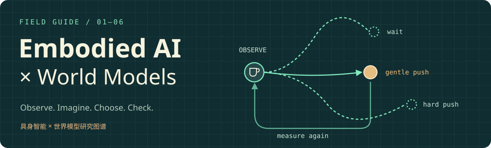

<strong>English</strong> · <a href="README.zh-CN.md">简体中文</a>

# Embodied AI × World Models Atlas

**If a robot can generate a convincing video of a cup reaching its target, why might it still miss the cup?** Predicting what a scene usually looks like, predicting what *my action* will change, and choosing what to do now are different problems. This field guide follows the history of their intersection.

**[Explore the interactive atlas ↗](https://hyfine.github.io/embodied-world-models-atlas/)** · [Bilingual paper index](CATALOG.md) · [Outlook & counterevidence](docs/outlook.en.md) · [Search method](EVIDENCE.md)

| Time | Route | What to take away |
|---|---|---|
| **3 minutes** | [Try the tabletop experiment](https://hyfine.github.io/embodied-world-models-atlas/) | Choose wait, gentle push or hard push; see why a predictor is not a policy |
| **15 minutes** | [Read the two histories and family tree](docs/guide.en.md) | Identify inputs, outputs and failure conditions for PlaNet, Diffusion Policy, V-JEPA 2-AC and DreamZero |
| **30 minutes** | [Explore the research library](https://hyfine.github.io/embodied-world-models-atlas/#library) → [request an experimental receipt](docs/outlook.en.md) | Trace papers to code and weights; separate visual fidelity, partial progress and physical success |

### One table, four approaches

Follow the bright paths from left to right. The top lane emits a push; the bottom lane first compares waiting, a gentle push and a hard push. **7 is a prediction; 4 is what the robot actually observes.** These are teaching values, not benchmark data. [Replay the decision ↗](https://hyfine.github.io/embodied-world-models-atlas/#decision-loop)

| At the cup | Reading family | Start with |
|---|---|---|
| **Try several pushes in imagination before choosing** | M · Model-based decisions. Separate decision-time search from training-time imagination | [PlaNet](CATALOG.md#planet) · [DreamerV3](CATALOG.md#dreamerv3) |
| **Predict future observations or sufficient features** | F · Ask whether predictions change *correctly* when actions change | [Visual Foresight](CATALOG.md#foresight) · [V-JEPA 2-AC](CATALOG.md#vjepa2) |
| **Learn actions directly from demonstrations** | P · Skills, action tokens and continuous chunks. A policy need not predict a future scene | [Diffusion Policy](CATALOG.md#diffusion-policy) · [OpenVLA](CATALOG.md#openvla) · [π0](CATALOG.md#pi0) |
| **Couple a visual future to executable actions** | J · Joint generation and a separately trained inverse-dynamics interface are different designs | [DreamZero](CATALOG.md#dreamzero) · [GE-Act 2.0](CATALOG.md#geact) |

E covers environments, data and evaluation; S covers other surveys. Navigation, quadruped locomotion and visuotactile grasping offer counterexamples to equating embodied AI with tabletop manipulation.

### Our current call

**Before asking “does this video look real?”, swap the proposed action and ask whether the predicted consequence changes correctly.** [DreamTrue](CATALOG.md#dreamtrue) studies action following; [SIMPLER](CATALOG.md#simpler) tests simulation against physical policy rankings. The first check does not replace the second. [Four falsifiable calls →](docs/outlook.en.md)

### Coverage and reuse

**2026-11-23 edition**: 38 curated records spanning 1991–2026, 25 distinct code links and 6 Hugging Face model cards. Dataset cards are separate. This is a cross-platform selection, **not an exhaustive index or an independent replication**.

- One [machine-readable TSV](data/works.tsv) drives the [bilingual catalog](CATALOG.md) and both static pages.
- [Inclusion rules and version distinctions](EVIDENCE.md) · [Contribute](CONTRIBUTING.md) · [Cite](CITATION.cff) · [License](LICENSE).
- No model download needed. Open `index.html` locally for the offline explorer. Rebuild with `node scripts/build.mjs` and validate with `node scripts/build.mjs --check`.
