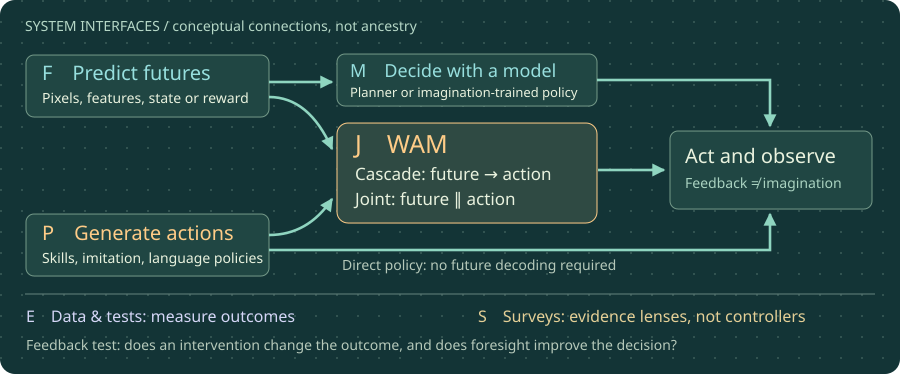

<h1 align="center">Embodied AI × World Models Atlas</h1>

<strong>From world models to world action models: how learning what happens next can shape what a robot does next.</strong>

<strong>English</strong> · <a href="README.zh-CN.md">简体中文</a>

Imagine a robot opening a drawer. A predictor can show the drawer opening without knowing where to grip. A policy can learn a useful pull without drawing the next frame. A **World Action Model (WAM)** couples a measurable future—an image, motion or learned state—to the production of actions. The coupling may cross two modules or live in a jointly trained model. It does **not** guarantee that the imagined pull works. [Definition and architecture: Wang et al., Fig. 3, §§2–4](https://arxiv.org/abs/2605.12090v1) · [What would establish decision utility: Yao et al., Table 4](https://arxiv.org/abs/2609.16697v1).

**Is WAM the frontier?** It is **one active frontier**, not a replacement for all policies or planners. In 2023 [UniPi](https://arxiv.org/abs/2302.00111) passed a video plan to an action decoder while [GR-1](https://arxiv.org/abs/2312.13139) learned future images and actions together. By 2026 [DreamZero](https://arxiv.org/abs/2602.15922) and [Fast-WAM](https://arxiv.org/abs/2603.16666v2) illustrated different ways of paying for foresight at execution. A newer paper is not necessarily a better controller.

**Choose a depth:** [Origins in five stops](docs/convergence.en.md#origins) · [Four research routes with primary papers](docs/convergence.en.md#research-routes) · [November 2026 findings and falsifiable forecasts](docs/convergence.en.md#frontier) · [Glossary](docs/convergence.en.md#terms).

**November evidence, not a leaderboard:** [SWAM](https://arxiv.org/abs/2611.12870v2) asks how action learning changes language–video alignment. [ζ0](https://arxiv.org/abs/2611.29277v1) predicts both scene features and the humanoid’s joint trajectory. These are different bets about **what to predict**; neither proves that every control task needs a WAM.

**[Start with the reading guide →](https://hyfine.github.io/embodied-world-models-atlas/research.html#contract)** Identify the inputs and outputs, [compare what actually runs](https://hyfine.github.io/embodied-world-models-atlas/research.html#coupling), then [design a test that could disprove the claim](https://hyfine.github.io/embodied-world-models-atlas/research.html#claim-test). Use the map and source index when you need a specific method or edition.

**[Explore the decision routes ↗](https://hyfine.github.io/embodied-world-models-atlas/#family-tree)**　·　[Compare nine survey perspectives](https://hyfine.github.io/embodied-world-models-atlas/perspectives.html)　·　[Trace a system](https://hyfine.github.io/embodied-world-models-atlas/#system-studio)

### Research desk · expanded edition

[Taxonomy audit: nine local survey editions](docs/taxonomy-review.md) · [What each direction’s exemplars actually represent](https://hyfine.github.io/embodied-world-models-atlas/runtime.html). The workbook codes mix mechanisms, domains and resources; they are navigation aids, not competing model classes.

| Choose a question | Where to go |
|---|---|
| What changes between predicting the next frame, planning and producing an action? | [Cross-family synthesis](https://hyfine.github.io/embodied-world-models-atlas/research.html) |
| What actually runs in each of the 15 workbook categories? | [Choose a system on the homepage](https://hyfine.github.io/embodied-world-models-atlas/#system-studio) or [browse all schematics](https://hyfine.github.io/embodied-world-models-atlas/runtime.html). Trace signals between modules, distinguish internal updates from measured feedback, then check the cited paper. |
| What was examined for a particular paper, model or repository? | [Search the 320 main + 70 supplementary rows by source and reading depth](https://hyfine.github.io/embodied-world-models-atlas/evidence.html) |
| Which PDF edition was used or collected? | [Versioned local-library catalog](https://hyfine.github.io/embodied-world-models-atlas/shelf.html) · [close reading of the supplied WAM survey](docs/wam-survey-deep-dive.md) |

The 45 records below form the **introductory map**, not the denominator of the larger bibliography. A row, a verified artifact, a PDF on disk and a cover-to-cover reading are four different things.

**Read the canopy as four questions**, not four disjoint model classes: what predicts, what plans, what acts, and what couples futures to actions? Infrastructure and surveys sit below, not beside controllers. Each work has one address on the map; its evidence card can show several roles. No branch asserts technical descent.

**See the field before reading the papers:** [replay the timeline](https://hyfine.github.io/embodied-world-models-atlas/#trajectory) · [compare family swimlanes](https://hyfine.github.io/embodied-world-models-atlas/#swimlanes) · [open the family tree](https://hyfine.github.io/embodied-world-models-atlas/#family-tree). Then follow one [architecture plate](https://hyfine.github.io/embodied-world-models-atlas/#architectures) to a [paper-to-code deep dive](docs/deep-dives.en.md).

| Time | Route | What to take away |
|---|---|---|
| **3 minutes** | [Try the tabletop experiment](https://hyfine.github.io/embodied-world-models-atlas/#cup-lab) | Choose wait, gentle push or hard push; see why a predictor is not a policy |
| **15 minutes** | [Read the two histories and family tree](docs/guide.en.md) | Identify inputs, outputs and failure conditions for PlaNet, Diffusion Policy, V-JEPA 2-AC and DreamZero |
| **30 minutes** | [Explore the research library](https://hyfine.github.io/embodied-world-models-atlas/#library) → [request an experimental receipt](docs/outlook.en.md) | Trace papers to code and weights; separate visual fidelity, partial progress and physical success |

### One table, four approaches

Follow the bright paths from left to right. The top lane emits a push; the bottom lane first compares waiting, a gentle push and a hard push. **7 is a prediction; 4 is what the robot actually observes.** These are teaching values, not benchmark data. [Replay the decision ↗](https://hyfine.github.io/embodied-world-models-atlas/#decision-loop)

| At the cup | Reading family | Start with |
|---|---|---|
| **Try several pushes in imagination before choosing** | M · Model-based decisions. Separate decision-time search from training-time imagination | [PlaNet](CATALOG.md#planet) · [DreamerV3](CATALOG.md#dreamerv3) |
| **Predict future observations or sufficient features** | F · Ask whether predictions change *correctly* when actions change | [Visual Foresight](CATALOG.md#foresight) · [V-JEPA 2-AC](CATALOG.md#vjepa2) |
| **Learn actions directly from demonstrations** | P · Skills, action tokens and continuous chunks. A policy need not predict a future scene | [Diffusion Policy](CATALOG.md#diffusion-policy) · [OpenVLA](CATALOG.md#openvla) · [π0](CATALOG.md#pi0) |
| **Couple a visual future to executable actions** | J · Joint generation and a separately trained inverse-dynamics interface are different designs | [DreamZero](CATALOG.md#dreamzero) · [GE-Act 2.0](CATALOG.md#geact) |

E covers environments, data and evaluation; S covers other surveys. Navigation, quadruped locomotion and visuotactile grasping offer counterexamples to equating embodied AI with tabletop manipulation.

### Our current call

**Before asking “does this video look real?”, swap the proposed action and ask whether the predicted consequence changes correctly.** [DreamTrue](CATALOG.md#dreamtrue) studies action following; [SIMPLER](CATALOG.md#simpler) tests simulation against physical policy rankings. The first check does not replace the second. [Four falsifiable calls →](docs/outlook.en.md)

### Coverage and reuse

**2026-11-25 introductory edition:** [45 curated records spanning 1991–2026](CATALOG.md). The [larger workbook and PDF-shelf snapshot](EVIDENCE.md) is separately versioned. This is a cross-platform selection, **not an exhaustive index or an independent replication**.

- One [machine-readable TSV](data/works.tsv) drives the [bilingual catalog](CATALOG.md) and both static pages.
- [Inclusion rules and version distinctions](EVIDENCE.md) · [Contribute](CONTRIBUTING.md) · [Cite](CITATION.cff) · [License](LICENSE).
- No model download needed. Open `index.html` locally for the offline explorer. Rebuild with `node scripts/build.mjs` and validate with `node scripts/build.mjs --check`.
