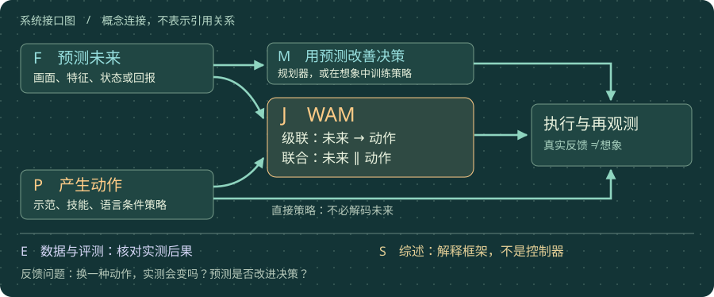
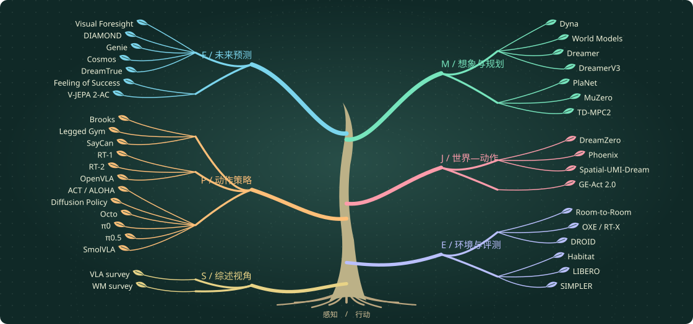

<h1 align="center">具身智能 × 世界模型研究图谱</h1>

<strong>从世界模型到世界动作模型：机器人怎样把“会发生什么”变成“下一步怎么做”。</strong>

<a href="README.md">English</a> · <strong>简体中文</strong>

想象机器人要打开抽屉。模型能画出抽屉打开，却未必知道该抓哪里；策略能学会拉把手，也不必先画出下一帧。**世界动作模型（World Action Model，WAM）**把可检验的未来状态（图像、运动或潜在表征）与动作生成耦合起来。统一的是问题和系统，不一定只有一个网络；它也不保证想象中的动作真能成功。[定义与架构：Wang 等，图 3、§§2–4](https://arxiv.org/abs/2605.12090v1) · [决策收益怎样验证：Yao 等，表 4](https://arxiv.org/abs/2609.16697v1)。

**WAM 是不是前沿？** 是**重要前沿之一**，而不是所有策略或规划器的替代品。早在 2023 年，[UniPi](https://arxiv.org/abs/2302.00111) 已把视频计划交给动作解码器，[GR-1](https://arxiv.org/abs/2312.13139) 已同时学习未来图像与动作。到 2026 年，[DreamZero](https://arxiv.org/abs/2602.15922) 和 [Fast-WAM](https://arxiv.org/abs/2603.16666v2) 进一步追问：执行时到底要为想象付出多少计算？时间更新，不等于控制一定更好。

**按深度进入：** [五个历史转折](docs/convergence.zh-CN.md#origins) · [四条研究路线与经典原作](docs/convergence.zh-CN.md#research-routes) · [2026 年 11 月观察与可推翻的预测](docs/convergence.zh-CN.md#frontier) · [术语注解](docs/convergence.zh-CN.md#terms)。

**11 月的证据，不是排行榜：** [SWAM](https://arxiv.org/abs/2611.12870v2) 问的是加入动作学习后，语言与视频还能否对齐；[ζ0](https://arxiv.org/abs/2611.29277v1) 同时预测场景特征与人形机器人的关节轨迹。两者对**应该预测什么**给出了不同答案，都没有证明每种控制任务都需要 WAM。

**[第一次来，从阅读导览开始 →](https://hyfine.github.io/embodied-world-models-atlas/research.zh.html#contract)** 先辨认输入与输出，再[比较部署时真正运行的模块](https://hyfine.github.io/embodied-world-models-atlas/research.zh.html#coupling)，最后[设计一个能推翻主张的实验](https://hyfine.github.io/embodied-world-models-atlas/research.zh.html#claim-test)。已有具体方法名或版本问题，再查路线图和书目。

**[探索方法路线图 ↗](https://hyfine.github.io/embodied-world-models-atlas/zh.html#family-tree)**　·　[对照九篇综述的视角](https://hyfine.github.io/embodied-world-models-atlas/perspectives.zh.html)　·　[追踪系统运行](https://hyfine.github.io/embodied-world-models-atlas/zh.html#system-studio)

### 扩展研究版：按问题选标签页

[九篇综述逐篇复核](docs/taxonomy-review.md) · [15 个方向的代表作与反例](https://hyfine.github.io/embodied-world-models-atlas/runtime.zh.html)。工作簿代码同时包含机制、应用域和研究资源，是阅读入口，不是互斥的模型分类。

| 你想弄清楚什么？ | 从这里进入 |
|---|---|
| 从预测下一帧，到规划、再到出动作，关键差别在哪里？ | [跨家族研究综合](https://hyfine.github.io/embodied-world-models-atlas/research.zh.html) |
| 工作簿的 15 个方向，部署时究竟运行哪些组件？ | [在主页选择系统](https://hyfine.github.io/embodied-world-models-atlas/zh.html#system-studio)，或[浏览全部系统图](https://hyfine.github.io/embodied-world-models-atlas/runtime.zh.html)。沿信号线区分内部更新与实测反馈，再查对应的论文图表。 |
| 某条论文或仓库，实际核读到哪一层？ | [按来源和阅读深度查询 320 条主表与 70 条补表记录](https://hyfine.github.io/embodied-world-models-atlas/evidence.zh.html) |
| 本地存的是哪个版本？ | [分方向论文书架](https://hyfine.github.io/embodied-world-models-atlas/shelf.zh.html) · [指定 WAM 综述精读](docs/wam-survey-deep-dive.md) |

下方的 45 个条目是**入门精选**，不是扩展书目的总数。一条表格记录、一个可核的仓库、一份下载的 PDF 和一次逐页精读不能混作同一指标。

**把树冠读作四个问题**：谁预测、谁规划、谁行动、谁把未来和动作耦合？下方两层分别提供研究基础设施和综述视角，不与控制器并列。每项工作有一个主入口，点选后可见多个角色；枝条不表示已证实的技术继承。

**先看全貌，再选一篇读：** [回放方法时间轨迹](https://hyfine.github.io/embodied-world-models-atlas/zh.html#trajectory) · [对照家族泳道](https://hyfine.github.io/embodied-world-models-atlas/zh.html#swimlanes) · [展开家族树](https://hyfine.github.io/embodied-world-models-atlas/zh.html#family-tree)。再沿一张[模块架构图](https://hyfine.github.io/embodied-world-models-atlas/zh.html#architectures)走到[论文与源码精读](docs/deep-dives.zh-CN.md)。

| 第一次来？ | 建议路线 | 读完能做什么 |
|---|---|---|
| **3 分钟** | [试试桌面推杯实验](https://hyfine.github.io/embodied-world-models-atlas/zh.html#cup-lab) | 自己选“不动 / 轻推 / 重推”，理解模型为何不是策略 |
| **15 分钟** | [读两条技术史与家族树](docs/guide.zh-CN.md) | 分清 PlaNet、Diffusion Policy、V-JEPA 2-AC、DreamZero 的输入、输出和失败条件 |
| **30 分钟** | [打开论文标本架](https://hyfine.github.io/embodied-world-models-atlas/zh.html#library) → [读实验收据](docs/outlook.zh-CN.md) | 找论文、代码、权重，对照作者到底测了画质、进度还是真机成功 |

### 同一个任务，四种做法

沿亮线从左读到右：上轨直接给动作；下轨先比较不动、轻推、重推的预测。**7 是预测，4 才是执行后的观测**。数字是教学设定，不是评测结果。[重播决策过程 ↗](https://hyfine.github.io/embodied-world-models-atlas/zh.html#decision-loop)

| 面对桌上的杯子 | 读哪一支 | 代表作 |
|---|---|---|
| **先在心里试几种推法，再做决定** | M · 模型规划和想象学习。区分部署时搜索和训练时想象 | [PlaNet](CATALOG.md#planet) · [DreamerV3](CATALOG.md#dreamerv3) |
| **预测下一帧，或预测够用的特征** | F · 感知未来。重点是预测是否跟着动作正确变化 | [Visual Foresight](CATALOG.md#foresight) · [V-JEPA 2-AC](CATALOG.md#vjepa2) |
| **从示范直接学怎样动** | P · 技能、动作符号与连续动作块。策略不一定生成未来 | [Diffusion Policy](CATALOG.md#diffusion-policy) · [OpenVLA](CATALOG.md#openvla) · [π0](CATALOG.md#pi0) |
| **让预测的未来参与动作生成** | J · 可以联合生成，也可以把预测交给独立动作模块；不要求全系统只有一张网络 | [DreamZero](CATALOG.md#dreamzero) · [GE-Act 2.0](CATALOG.md#geact) |

另设 **E**（环境、数据和评测）与 **S**（其他综述）。导航、四足运动、视触觉抓取是对照案例，不把具身智能等同于单臂桌面操作。

### 当前判断

**与其先问“视频像不像真的”，不如先问“把动作换掉，预测的后果是否跟着正确变化”。** [DreamTrue](CATALOG.md#dreamtrue) 研究动作遵从，[SIMPLER](CATALOG.md#simpler) 对照仿真与实机排序：前者不能替代后者。[四条可被推翻的判断 →](docs/outlook.zh-CN.md)

### 收录与复用

**入门图谱 2026-11-25 版：** [45 个精选条目，覆盖 1991–2026 年](CATALOG.md)。[扩展工作簿与 PDF 书架](EVIDENCE.md)另记版本。跨平台精选，**不是全网穷举或独立复现实验**。

- [可机读 TSV](data/works.tsv) → [双语索引](CATALOG.md) 与中英文静态站使用同一份数据。
- [收录规则与版本差异](EVIDENCE.md) · [贡献](CONTRIBUTING.md) · [引用](CITATION.cff) · [许可](LICENSE)。
- 无需下载模型。用浏览器打开 `zh.html` 即可离线浏览中文版；更新后运行 `node scripts/build.mjs`，检查用 `node scripts/build.mjs --check`。
