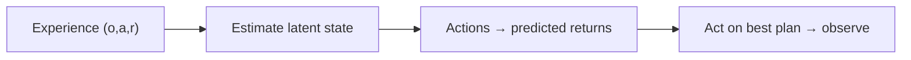
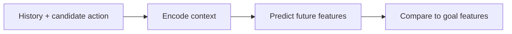
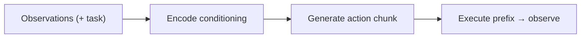
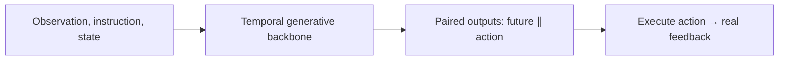
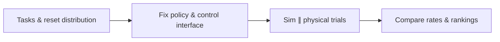
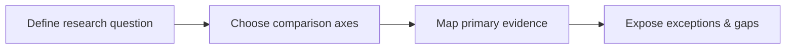

# From papers to implementations: six case studies

[简体中文](deep-dives.zh-CN.md) · [Architecture explorer](https://hyfine.github.io/embodied-world-models-atlas/#architectures)

Each diagram is a representative path, not a universal family algorithm. Five implementation or evaluation cases link to fixed source revisions; the sixth demonstrates a survey lens. These are paper and code readings, not reproduced scores.

## M · PlaNet

Imagination & planning · [ICML 2019 · PMLR](<https://proceedings.mlr.press/v97/hafner19a.html>)

This path shows online planning. Dreamer takes the other branch: train an actor on imagined trajectories, then use the actor at deployment.

**Interface.** Images and past actions enter; one action to execute leaves. The intermediate object is a belief state suitable for predicting returns, not a next-frame image delivered to the controller.

**Training or construction.** A deterministic recurrent state carries history; a stochastic state represents uncertainty. With an observation, a posterior corrects the prior. Observation/reward prediction and prior–posterior regularization shape the state; the paper also investigates latent overshooting for multistep dynamics.

**At execution time.** Sample action sequences from the current belief, accumulate predicted rewards in latent rollouts and use CEM to refit the distribution to high-return sequences. Execute the first action and update belief with a real frame. Compute grows with candidates, horizon and search iterations.

**Evidence and comparison.** The paper evaluates return and data efficiency in continuous-control environments from pixels, not grasping in unfamiliar homes. Compare Dreamer: both learn dynamics, but Dreamer shifts part of the decision cost into actor training in imagination.

**Code-reading exercise and failure test.** Trace top_k, the fitted mean and variance in cross_entropy_method. If preferred actions are outside training support, more search can exploit model error. Compare predicted and realized return as search budget grows.

Pinned source: [RSSM](https://github.com/google-research/planet/blob/c04226b6db136f5269625378cd6a0aa875a92842/planet/models/rssm.py) · [CEM](https://github.com/google-research/planet/blob/c04226b6db136f5269625378cd6a0aa875a92842/planet/control/planning.py)

## F · V-JEPA 2 / 2-AC

Predicting observations, events & features · [arXiv](<https://arxiv.org/abs/2506.09985>)

This is an action-conditioned feature predictor. Pixel models change the output; grasp-outcome prediction needs only an event probability. A latent action need not be a motor command.

**Interface.** Supply the robot’s current view, goal image and candidate controls. The desired intermediate output is a future representation under those controls, not a photorealistic frame. The video encoder alone has no calibrated motor interface.

**Training or construction.** Pretrain by predicting target representations of masked video regions from context. Freeze the video encoder, then train the 2-AC predictor on action-aligned DROID trajectories. Action-free pretraining does not remove the need for synchronized controls in stage two.

**At execution time.** Encode the goal image, roll candidate sequences through the action-conditioned predictor and rank predicted terminal features by distance to the goal features. Replan from fresh observations rather than sampling an action directly from the video encoder.

**Evidence and comparison.** The authors report about 62 hours of robot interaction for action-conditioned training and goal-image manipulation on Franka arms. Transfer across rooms is not transfer across arbitrary embodiments; video classification accuracy does not test the control loop.

**Code-reading exercise and failure test.** Follow cem from sample_action_traj to select_topk_action_traj in the MPC helper, separately from the AC predictor. Swap two actions with context fixed. If predicted features hardly change while real cup endpoints differ, search is not the only failure.

Pinned source: [2-AC predictor](https://github.com/facebookresearch/vjepa2/blob/204698b45b3712590f06245fbfba32d3be539812/src/models/ac_predictor.py) · [MPC](https://github.com/facebookresearch/vjepa2/blob/204698b45b3712590f06245fbfba32d3be539812/notebooks/utils/mpc_utils.py)

## P · Diffusion Policy

Skills & policies · [RSS 2023](<https://roboticsproceedings.org/rss19/p026.html>)

The diagram follows a chunk policy: the denoising target is action, not imagery. RT-2 instead decodes tokens, while SayCan selects an available skill.

**Interface.** Recent observations enter; a continuous command chunk leaves. When demonstrations go both left and right, per-step mean regression can point into the obstacle. The target here is a conditional distribution over action sequences.

**Training or construction.** Take observation windows with action sequences from demonstrations, corrupt the actions on a noise schedule and train a conditional denoiser. Images condition the prediction; they are not future video labels. The pinned walk-through follows the image-conditioned U-Net variant, not every backbone.

**At execution time.** Iterate scheduler.step from a noisy trajectory. predict_action unnormalizes the sampled sequence and returns a slice beginning at To−1 of length n_action_steps for execution before refreshing observations. Predicted and open-loop execution horizons are different.

**Evidence and comparison.** The original study evaluates action policies on 12 tasks across four manipulation benchmarks, not video prediction. Successful control is not evidence of an explicit internal cup simulator. Match execution rates and demonstration distributions before comparing methods.

**Code-reading exercise and failure test.** Read compute_loss → conditional_sample → predict_action in the same file. Keep the prediction horizon fixed, shorten the execution prefix, and record both recovery and inference cost. More frequent replanning can backfire if latency dominates.

Pinned source: [Image U-Net policy](https://github.com/real-stanford/diffusion_policy/blob/5ba07ac6661db573af695b419a7947ecb704690f/diffusion_policy/policy/diffusion_unet_hybrid_image_policy.py)

## J · DreamZero

World-action coupling · [arXiv](<https://arxiv.org/abs/2602.15922>)

Joint output need not mean generating a video first and retrieving actions later. GE-Act 2.0 is a contrasting design with an explicit visual-plan → inverse-dynamics interface.

**Interface.** Language, visual and robot context condition aligned future video and action chunks. Unlike a forward model that predicts consequences of a supplied action, the action itself is a generated variable.

**Training or construction.** Start from a pretrained image-to-video backbone, align videos and controls in robot trajectories, and learn paired outputs with flow matching and shared temporal modeling. Video provides dense supervision; predicting one plausible success is not a reward function.

**At execution time.** At inference, condition the next chunk on history and new observations; actions go to execution and predicted video serves modeling or inspection. This is not explicit MPC over competing videos. Count generation, communication and actuation latency separately.

**Evidence and comparison.** Separate AgiBot from DROID/Franka and task progress from whole-episode success before comparing baselines. A public DROID checkpoint does not reproduce the weights, data or outcomes of a different embodiment.

**Code-reading exercise and failure test.** Contrast training forward with lazy_joint_video_action in WANPolicyHead, then inspect the inference entry point. A falsifiable ablation removes future-video supervision while matching data, compute and action rate; measure recovery on held-out tasks, not just visual quality.

Pinned source: [Joint head](https://github.com/dreamzero0/dreamzero/blob/ab790c198fbce33503358efbbd4187ce9a89adf3/groot/vla/model/dreamzero/action_head/wan_flow_matching_action_tf.py) · [Inference entry](https://github.com/dreamzero0/dreamzero/blob/ab790c198fbce33503358efbbd4187ce9a89adf3/socket_test_optimized_AR.py)

## E · SIMPLER

Environments, data & evaluation · [arXiv](<https://arxiv.org/abs/2405.05941>)

This is an evaluation pipeline, not a neural network. A dataset supplies trajectories, a simulator supplies interaction, and real trials calibrate a proxy. These roles are not interchangeable.

**Interface.** A trained policy and task setup enter; simulated success rates and their agreement with physical outcomes leave. SIMPLER is a measuring instrument, not a new policy or a generative simulator learned from videos.

**Training or construction.** There is no central training loss. Match appearance, camera and controller behavior to the physical setup; visual matching and variant aggregation are evaluation alternatives. Decide which variations reflect deployment, then freeze the protocol.

**At execution time.** Repeat fixed-policy rollouts under specified tasks and resets. Step the environment with policy commands and record completion or failure; compare policies with paired physical evaluations. A high average simulator score does not ensure a correct ranking.

**Evidence and comparison.** Paired evaluations cover Google Robot and WidowX setups. Correlation supports the tested tasks, embodiments and policy set. A different gripper or a new contact material calls for recalibration.

**Code-reading exercise and failure test.** Trace run_maniskill2_eval_single_episode into the evaluator and inspect how termination contributes to reported success. If two policies score well in simulation, use matched physical resets to check rank reversals and false positives instead of collecting more generated clips.

Pinned source: [Episode evaluator](https://github.com/simpler-env/SimplerEnv/blob/eddb5690749a1e34267807c0f7b5eede323918d7/simpler_env/evaluation/maniskill2_evaluator.py)

## S · A Comprehensive Survey on World Models for Embodied AI

Survey lenses · [arXiv](<https://arxiv.org/abs/2510.16732>)

This is a survey-reading workflow, not an executable model. Reclassify one system by function, time and space rather than treating an architecture label as a capability score.

**Interface.** This is not a sixth controller. Its input is a body of world-model research and its output is a coordinate system: function, temporal modeling and spatial representation.

**Training or construction.** Separate what a model does from how it represents the world. A decision-coupled model can predict pixels or features; its output type alone does not establish how control works.

**At execution time.** Worked reading: place PlaNet at decision coupling, sequential rollout and compact latent representation, then compare its score with V-JEPA 2-AC. Both plan, but the latter scores goal features rather than a learned reward head. This mapping is the atlas’s interpretation.

**Evidence and comparison.** Coverage and taxonomic arguments are evidence about the literature. Reported scores remain those of the primary authors. Tables spanning protocols are not a single benchmark ranking.

**Code-reading exercise and failure test.** Reclassify the same system using the VLA survey’s action and planning lens. If changing axes changes a supposed ranking, check whether design coordinates have been mistaken for capability. No executable control component is claimed or pinned here.
