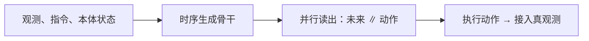

# 从论文到实现：六个精读案例

[English](deep-dives.en.md) · [交互架构图](https://hyfine.github.io/embodied-world-models-atlas/zh.html#architectures)

图示是代表路径，不是每个家族的统一算法。五项实现/评测案例附固定提交的源码，第六项是综述阅读示例。以下为代码与论文解读，未训练模型或复现成绩。

## M · PlaNet

想象与规划 · [ICML 2019 · PMLR](<https://proceedings.mlr.press/v97/hafner19a.html>)

图示为部署时规划。Dreamer 是另一支：训练时用预测轨迹更新 actor，部署时让 actor 直接给动作。

**输入与输出.** 输入图像历史与过去动作，输出下一条要执行的动作。关键中间量不是下一帧，而是能用来推演回报的信念状态。

**学习或构建.** 确定性循环状态携带历史，随机状态表达不确定性。有观测时后验校正先验；图像、奖励预测与先验—后验约束共同塑形。论文还研究用 latent overshooting 约束多步动力学。

**执行时发生什么.** 从当前信念采样多条动作序列。在潜模型里累计预测奖励，用 CEM 反复保留高回报序列、重估采样分布。执行第一步后从真实新帧更新信念。代价随候选数、规划长度、迭代数上升。

**证据与对照.** 论文在像素输入的连续控制环境中比较数据效率与回报。它不是未见家庭场景的抓取测试。对照 Dreamer：两者都学动力学，但后者把部分决策成本移入想象中的策略训练。

**精读练习与失败测试.** 检查 cross_entropy_method 中 top_k、均值和方差如何更新。一个反例：若优化器偏好的动作总落在模型训练分布之外，提高搜索预算反而可能放大模型误差。测试时同时记录预测回报与环境回报。

固定源码: [RSSM](https://github.com/google-research/planet/blob/c04226b6db136f5269625378cd6a0aa875a92842/planet/models/rssm.py) · [CEM](https://github.com/google-research/planet/blob/c04226b6db136f5269625378cd6a0aa875a92842/planet/control/planning.py)

## F · V-JEPA 2 / 2-AC

感知与未来预测 · [arXiv](<https://arxiv.org/abs/2506.09985>)

图示为动作条件特征预测。像素预测器换掉输出头；触觉结果预测只需事件概率；潜动作不必等于电机命令。

**输入与输出.** 给机器人当前图像、目标图像和动作候选；需要的是这些动作会导致的未来表征，而非栩栩如生的画面。视频编码器本身不能输出已校准的电机指令。

**学习或构建.** 先在大规模视频上由上下文预测遮蔽区域的目标表征。随后固定视频编码器，用带动作的 DROID 轨迹训练 2-AC 预测器。预训练不要求动作；第二阶段的动作同步不可省略。

**执行时发生什么.** 编码目标图像；用动作条件预测器推演候选序列；按终点表征与目标表征的距离筛选。部署时用新观测重复规划，而不是从视频编码器直接采一个动作。

**证据与对照.** 作者报告用约 62 小时机器人交互训练动作预测部分，并在 Franka 上研究目标图像引导的操作。跨房间测试不等于跨任意机型；视频分类得分也不验证控制环。

**精读练习与失败测试.** 分别打开 AC predictor 与 MPC 工具。沿 cem 找到 sample_action_traj 和 select_topk_action_traj。保持条件不变，交换两个候选动作；若预测特征几乎一致而真实杯子落点不同，问题在预测而非仅在搜索。

固定源码: [2-AC predictor](https://github.com/facebookresearch/vjepa2/blob/204698b45b3712590f06245fbfba32d3be539812/src/models/ac_predictor.py) · [MPC](https://github.com/facebookresearch/vjepa2/blob/204698b45b3712590f06245fbfba32d3be539812/notebooks/utils/mpc_utils.py)

## P · Diffusion Policy

技能与动作策略 · [RSS 2023](<https://roboticsproceedings.org/rss19/p026.html>)

图示为动作块策略；去噪对象是动作而非画面。RT-2 解码符号，SayCan 则选择已有技能。

**输入与输出.** 给最近若干观测，输出一段连续控制。左绕和右绕都是合理示范时，逐时刻回归平均值可能撞上障碍；这里拟合的是多种动作序列的条件分布。

**学习或构建.** 从示范中取观测窗口与对应动作序列，按噪声日程扰动动作，学习条件去噪目标。图像提供条件，不是要重建的视频标签。实现包含不同骨干，下面沿图像条件 U-Net 变体阅读。

**执行时发生什么.** 从噪声轨迹出发反复 scheduler.step，得到预测长度内的动作。predict_action 将输出反归一化，只取从 To−1 开始、长度 n_action_steps 的切片交给执行器，再获取观测。预测长度不等于开环执行长度。

**证据与对照.** 原论文跨四个操作基准的 12 个任务评测动作策略；不是视频预测基准。动作层面成功并不能证明内部显式模拟了杯子。比较不同方法要固定执行频率和示范分布。

**精读练习与失败测试.** 在同一文件按 compute_loss → conditional_sample → predict_action 顺序读。固定预测窗口而缩短执行前缀，记录闭环恢复与推理开销；更多重规划也可能因延迟而适得其反。

固定源码: [Image U-Net policy](https://github.com/real-stanford/diffusion_policy/blob/5ba07ac6661db573af695b419a7947ecb704690f/diffusion_policy/policy/diffusion_unet_hybrid_image_policy.py)

## J · DreamZero

世界—动作耦合 · [arXiv](<https://arxiv.org/abs/2602.15922>)

联合输出不是先生成视频再检索动作。GE-Act 2.0 是有意保留视觉计划 → 逆动力学接口的对照路线。

**输入与输出.** 输入语言、视觉及机器人上下文，输出时间对齐的未来视频与动作块。与前向模型“给定动作预测后果”不同，此处动作本身也是待生成量。

**学习或构建.** 以预训练图生视频骨干为起点，把机器人轨迹中的视频与动作对齐，用流匹配在共享时序建模中学习联合输出。视频给稠密监督，但“预测到一次成功”不是奖励函数。

**执行时发生什么.** 推理端结合历史和新观测生成下一块，动作进入执行接口，预测视频用于建模或检查。它不等于在多个候选视频中显式运行 MPC；必须另计生成、通信和动作执行的延迟。

**证据与对照.** 比较基线时先分 AgiBot 与 DROID/Franka，再分任务进度与整回合成功。公开 DROID 检查点不等于复现论文中另一机型的权重、数据和结果。

**精读练习与失败测试.** 在 WANPolicyHead 中对照训练 forward 与 lazy_joint_video_action，再看推理脚本如何服务动作块。可证伪实验：匹配数据、计算和动作更新率，只移除未来视频监督，比较未见任务上的恢复，而不只是画质。

固定源码: [Joint head](https://github.com/dreamzero0/dreamzero/blob/ab790c198fbce33503358efbbd4187ce9a89adf3/groot/vla/model/dreamzero/action_head/wan_flow_matching_action_tf.py) · [Inference entry](https://github.com/dreamzero0/dreamzero/blob/ab790c198fbce33503358efbbd4187ce9a89adf3/socket_test_optimized_AR.py)

## E · SIMPLER

环境、数据与评测 · [arXiv](<https://arxiv.org/abs/2405.05941>)

这里是评测管线，不是神经网络。数据集提供轨迹，模拟器提供交互，实机对照检验代理指标。三者不能互换。

**输入与输出.** 输入已训练的策略与任务设置，输出仿真成功率及其与实机结果的对应情况。SIMPLER 是测量仪器，不负责训练新策略，也不是从视频学到的生成式模拟器。

**学习或构建.** 这里没有主模型训练损失。构建与实机匹配的外观、相机及控制行为；视觉匹配与环境变体聚合是两种评测策略。先决定哪些扰动反映目标部署，再固定协议。

**执行时发生什么.** 按同一任务和重置条件反复运行固定策略。每回合将策略命令交给环境并记录完成或失败，再跨策略与实机比较；模拟平均分高不等于排序正确。

**证据与对照.** 论文在 Google Robot 与 WidowX 设置中研究配对评估。相关性只支持所测任务、机型与对照策略；新夹爪或新接触材料要重新校准。

**精读练习与失败测试.** 从单回合 run_maniskill2_eval_single_episode 追到聚合函数，核对终止与成功如何统计。设两个策略在仿真都高分：用同样数量的真机重置检查次序反转和假阳性，而不是再生成更多仿真视频。

固定源码: [Episode evaluator](https://github.com/simpler-env/SimplerEnv/blob/eddb5690749a1e34267807c0f7b5eede323918d7/simpler_env/evaluation/maniskill2_evaluator.py)

## S · A Comprehensive Survey on World Models for Embodied AI

综述入口 · [arXiv](<https://arxiv.org/abs/2510.16732>)

这是综述的阅读流程，不是可执行模型。沿功能、时间、空间轴复核同一系统，可避免把架构名误作性能等级。

**输入与输出.** 这不是第六个控制算法。输入是一组关于世界模型的工作，输出是比较它们的坐标系；比较对象是功能、时间建模和空间表征。

**学习或构建.** 将“模型做什么”与“如何表示世界”分开。一个用于决策的模型可以预测像素，也可以预测特征；不能从预测对象独自推出控制方式。

**执行时发生什么.** 阅读示例：将 PlaNet 放入决策耦合、逐步推演与紧凑潜表示，再与 V-JEPA 2-AC 比较目标评分。第二个系统也做规划，但目标来自特征而非学出的奖励头。此映射是本站解读。

**证据与对照.** 综述的覆盖范围与分类理由是证据；汇总的分数仍来自原作者。在改变试验协议时不要把表中数字当作同一基准的排行榜。

**精读练习与失败测试.** 对照 VLA 综述的动作与任务规划视角，把同一系统重分类。若改轴就改变“优劣”排序，先检查是否误把设计空间当成能力刻度。无可执行控制模块，本例不用源码钉点。
