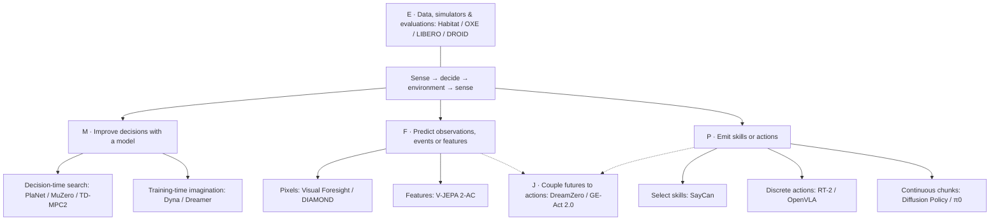

# Push the cup into the blue circle: two histories on one table

[简体中文](guide.zh-CN.md) · [Home](../README.en.md) · [Paper & code index](../CATALOG.md)

A cup sits to the left of a blue circle. “Push the cup into the circle.” A robot might recognize the cup, and even generate a convincing clip of it sliding into place, yet miss the cup entirely. What is missing?

## 1 · Three questions to put beside any paper

| Object | Question at the table | Typical input → output |
|---|---|---|
| **Policy** | What should I do now? | Observation, instruction, history → action or action chunk |
| **Forward world model** | What happens if I push from the left? What if I do nothing? | State, candidate action → possible next state, features or reward |
| **Inverse dynamics** | Which action could take this cup from here to the desired position? | Present and desired future → possible action |

**Embodied AI** studies a body acting and sensing in a loop; the body may be simulated. **World modeling** studies how an environment changes. Some models learn video regularities; others predict only quantities needed for decisions. We say **action-conditioned** only when the action is an input. A **planner** uses predictions and a goal to choose among actions. A predictor alone cannot tell you which future to want.

In symbols, a policy `π(a | o, g)` reads an observation and goal; dynamics `p(z′ | z, a)` advances a latent state; a cost `C(z′, g)` compares a prediction with the goal. State may need memory: a single image need not locate a cup behind a gripper. A latent state is not a miniature photo. It can discard details, including, unfortunately, whether contact has begun.

## 2 · How did prediction meet action?

| Period | The problem | What changed |
|---|---|---|
| 1991: must a robot model the world? | Must it imagine before every action? | [Brooks](../CATALOG.md#brooks) started from situated reactive behavior. [Dyna](../CATALOG.md#dyna) used simulated transitions alongside experienced ones to update decisions. These are design alternatives, not consecutive winners. |
| 2016–2019: start from a camera | Can we predict a push without writing down the physics? | [Visual Foresight](../CATALOG.md#foresight) predicted pixel motion under candidate pushes. [World Models](../CATALOG.md#world-models) separated vision, memory and control; [PlaNet](../CATALOG.md#planet) searched in latent space. |
| 2017–2021: bodies and objectives | Do navigation, chess and locomotion need the same “world”? | [R2R](../CATALOG.md#r2r) grounded instructions in indoor routes; [Habitat](../CATALOG.md#habitat) provided repeatable navigation environments. [MuZero](../CATALOG.md#muzero) learned quantities needed for search. [Legged locomotion](../CATALOG.md#legged) demonstrated simulation training without an explicit learned forward model. |
| 2019–2023: when to pay for imagination | Search on every step, or imagine more during training? | [Dreamer](../CATALOG.md#dreamer) trained the actor on imagined trajectories; [DreamerV3](../CATALOG.md#dreamerv3) emphasized stable training across domains. [TD-MPC2](../CATALOG.md#tdmpc2) retained short decision-time planning and estimated the rest with a value function. |
| 2022–2025: meaning meets motors | How does web knowledge about cups become commands? | [SayCan](../CATALOG.md#saycan) selected feasible skills; [RT-2](../CATALOG.md#rt2) emitted action tokens. [Diffusion Policy](../CATALOG.md#diffusion-policy) denoised continuous action chunks; [π0](../CATALOG.md#pi0) paired a continuous action expert with a vision-language backbone. Policies need not be world models. |
| 2024–2026: reuse videos for control | Internet video rarely has robot action labels. What can transfer? | [Genie](../CATALOG.md#genie) inferred latent actions. [V-JEPA 2-AC](../CATALOG.md#vjepa2) grounded feature prediction using robot interaction. [DreamZero](../CATALOG.md#dreamzero) generated futures and actions jointly; [GE-Act 2.0](../CATALOG.md#geact) retained a separately trainable inverse-dynamics interface. |

## 3 · Family tree: who consumes the prediction?

Edges are reading routes, not verified ancestry or rankings. DIAMOND also trains a policy; Visual Foresight also plans. The catalog picks one main entry point to avoid double-counting. S denotes surveys, not a fifth model architecture. Other useful axes are **representation** (pixel/feature/geometry), **supervision** (action-free video/trajectories/rewards) and **use** (training/deployment planning/offline evaluation).

## 4 · Four papers at the same table

| Work | What is learned? | Before the robot moves | Where the cup analogy breaks |
|---|---|---|---|
| [PlaNet](../CATALOG.md#planet) | A stochastic recurrent latent dynamics model from images, actions and rewards | Roll out candidate sequences, rank expected returns, execute the first action | If the model underestimates friction, the best plan is best only inside the model |
| [Diffusion Policy](../CATALOG.md#diffusion-policy) | A distribution of action sequences conditioned on observations, learned from demonstrations | Denoise noise into an action chunk; execute a prefix and observe again. No explicit future cup position required | A distribution can keep left and right detours distinct instead of averaging them. It may still miss a recovery absent from demonstrations |
| [V-JEPA 2-AC](../CATALOG.md#vjepa2) | Action-free video supplies features; robot trajectories ground an action-conditioned predictor | Try actions in the predictor; compare predicted features to a goal image | Feature proximity can be misleading if the representation misses contact |
| [DreamZero](../CATALOG.md#dreamzero) | A video backbone adapted to generate aligned visual futures and actions | Generate a paired prediction, execute actions and condition on a fresh observation | A coherent pair is not proof of search over alternatives; partial task progress is not complete success |

**A pencil-and-paper MPC example** (invented for teaching, not a reported result): the goal is position 8. Predicted endpoints for wait, gentle push and hard push are 3, 7 and 11. Absolute costs are 5, 1 and 3, so choose the gentle push. If the next observed position is 4 rather than 7, re-estimate from 4 instead of trusting the old trajectory. That is the feedback loop. A network could also directly output “gentle push”; its output alone does not establish that it compared three futures.

## 5 · Change the body, change the question

- **Navigation:** Replace the blue circle with a room. A high arrival rate need not mean short routes; SPL combines success with path efficiency relative to a shortest path. Check viewpoint jumps vs continuous motion. [R2R](../CATALOG.md#r2r) · [Habitat](../CATALOG.md#habitat)
- **Locomotion:** The objective may be tracking velocity without falling. If imagining takes longer than a footfall, simulate during training and deploy a direct policy instead. [Learning to Walk](../CATALOG.md#legged)
- **Contact:** A cup can slip even when both fingers appear to touch it. Compare vision with vision-plus-touch on the same gripper rather than comparing success on different robots. [The Feeling of Success](../CATALOG.md#touch)

## 6 · Your first reading session, no GPU

1. Open the [PushT dataset card](https://huggingface.co/datasets/lerobot/pusht). Pause just before contact and write down “what might the next frame show?” and “what action should come next?” They require different labels.
2. Open the [Diffusion Policy repo](https://github.com/real-stanford/diffusion_policy). Follow the Push-T example from the README to the image policies under `diffusion_policy/policy`. Separate observation length, prediction length and execution length. No weights needed.
3. Find the `predict_action` example on the [OpenVLA card](https://huggingface.co/openvla/openvla-7b). Which argument selects action unnormalization statistics? Compare the [V-JEPA 2 repo](https://github.com/facebookresearch/vjepa2): which component only encodes video and which receives actions?
4. If shuffling actions produces equally attractive videos, what have you learned? **Only that visual plausibility does not distinguish these conditions. To test grounding, check whether predictions change correctly under intervention.** Next: [outlook and evidence tests](outlook.en.md).
