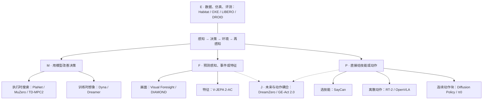

# 把杯子推到蓝圈：用一个任务读懂两条技术史

[English](guide.en.md) · [返回首页](../README.zh-CN.md) · [论文与代码索引](../CATALOG.md)

桌上有一个杯子，右边画着一个蓝圈。给机器人一句话：“把杯子推到圈里。”它能认出杯子，甚至能生成一段杯子滑入圈中的视频，却仍可能推空。差别在哪里？

## 1 · 三张便签，就能拆开大部分论文

| 便签 | 杯子实验中的含义 | 典型的输入 → 输出 |
|---|---|---|
| **策略** | 我现在该怎样动？ | 图像、指令、历史 → 下一步或一段动作 |
| **前向世界模型** | 如果从左边推，会发生什么？如果不推呢？ | 当前状态、候选动作 → 可能的后续状态/特征/奖励 |
| **逆动力学** | 给定杯子应到达的位置，什么动作能造成这种变化？ | 现在、期望未来 → 可能的动作 |

**具身智能**关心身体怎样通过感知和动作与环境形成闭环。这里的“身体”可以是仿真智能体；是否在真机上验证是另一个问题。**世界模型**关心环境如何变化；有的学习视频规律，有的只预测决策所需的量。本文把动作条件写出来时才称其为**动作条件世界模型**。**规划器**不是模型本身：它拿模型比较动作，再按目标选一个。预测未来并不会自动告诉机器人哪个未来值得追求。

记号版：策略 `π(a | o, g)` 读观测 `o` 和目标 `g`；动力学 `p(z′ | z, a)` 从潜状态 `z` 推演；代价 `C(z′, g)` 比较预测与目标。状态可以包含历史：杯子被夹爪挡住时，单张图像并不足够。潜状态不是缩小的照片，而是一份允许丢弃信息的摘要；若把“是否接触”一起丢弃，就无法判断杯子会不会移动。

## 2 · 两条历史线，什么时候相遇？

| 阶段 | 当时的问题 | 方法怎样改变了问题 |
|---|---|---|
| 1991：需要内部模型吗？ | 每个动作都必须先在头脑里演练？ | [Brooks](../CATALOG.md#brooks) 从与环境直接耦合的行为出发；[Dyna](../CATALOG.md#dyna) 则让模拟经验与真实经验一起更新决策。是两种选择，不是先后淘汰。 |
| 2016–2019：从摄像头出发 | 不手写整套物理方程，能否判断某一推会怎样？ | [Visual Foresight](../CATALOG.md#foresight) 预测候选推法下的像素运动。[World Models](../CATALOG.md#world-models) 把视觉、记忆和小控制器分开；[PlaNet](../CATALOG.md#planet) 在潜空间搜索，减去一部分像素负担。 |
| 2017–2021：身体与决策目标 | 导航、下棋、四足行走需要同样的“世界”吗？ | [R2R](../CATALOG.md#r2r) 把指令绑定到室内路线，[Habitat](../CATALOG.md#habitat) 让导航在可重复环境中运行；[MuZero](../CATALOG.md#muzero) 学的是够树搜索用的表示；[四足行走](../CATALOG.md#legged) 表明仿真训练也可以不学一个显式前向模型。 |
| 2019–2023：何时支付想象的成本？ | 部署时每一步都搜索，还是训练时多想一些？ | [Dreamer](../CATALOG.md#dreamer) 在想象轨迹上训练 actor；[DreamerV3](../CATALOG.md#dreamerv3) 强调跨域训练稳定性。[TD-MPC2](../CATALOG.md#tdmpc2) 仍在决策时做短期规划，用价值估计补足远期。 |
| 2022–2025：学“做什么”，也学“怎样做” | 用网络语义知识理解“杯子”，怎样变成电机命令？ | [SayCan](../CATALOG.md#saycan) 选可行技能，[RT-2](../CATALOG.md#rt2) 输出动作符号。[Diffusion Policy](../CATALOG.md#diffusion-policy) 对连续动作序列去噪，[π0](../CATALOG.md#pi0) 把连续动作专家接到视觉语言骨干上。并非所有策略都是世界模型。 |
| 2024–2026：视频先验进入控制 | 海量视频没有机器人动作标签，怎样借用？ | [Genie](../CATALOG.md#genie) 推断潜动作；[V-JEPA 2-AC](../CATALOG.md#vjepa2) 用真实交互给特征预测接上动作；[DreamZero](../CATALOG.md#dreamzero) 联合生成未来与动作；[GE-Act 2.0](../CATALOG.md#geact) 则保留了可单独训练的逆动力学接口。 |

## 3 · 家族树：按“预测交给谁”来读

分支表示**理解方法的入口**，不是引用链、技术继承或性能高低。DIAMOND 也在生成环境里训练策略，Visual Foresight 也规划；索引只选一个主入口以免重复计数。S 类是综述，不是第五种模型。还可沿三个独立维度切分：**表征**（像素/特征/几何）、**监督**（无动作视频/带动作轨迹/奖励）、**用途**（训练/部署时规划/离线评测）。

## 4 · 四篇代表作，沿同一张桌子对照

| 代表作 | 学到什么？ | 机器人动之前发生什么？ | 杯子例子暴露的局限 |
|---|---|---|---|
| [PlaNet](../CATALOG.md#planet) | 用图像序列、动作、奖励拟合带随机性和记忆的潜动力学 | 对候选动作序列向前推演，按预期回报筛选，再执行第一步 | 如果模型错误低估了摩擦，最优计划只是“在模型里”最优 |
| [Diffusion Policy](../CATALOG.md#diffusion-policy) | 从示范学观测条件下的动作序列分布 | 把噪声逐步变成一段动作，执行前缀再看；没有显式预测杯子的未来位置 | 既可左绕也可右绕时，分布比“平均动作”合适；未示范的纠错仍可能失败 |
| [V-JEPA 2-AC](../CATALOG.md#vjepa2) | 无动作视频先学表征；机器人轨迹再教预测器“动了会怎样” | 在动作条件预测器中试动作，按未来特征与目标图像特征的距离选择 | 若表示对接触/未接触不敏感，特征很近也可能没推到 |
| [DreamZero](../CATALOG.md#dreamzero) | 把预训练视频骨干改造成对齐的未来视频和动作生成器 | 从当前上下文生成配对预测，实际执行动作，并用新观测继续 | 视频与动作彼此相容，不代表模型比较过所有备选动作；任务进度也不是完整成功率 |

**一个可手算的 MPC 例子**（教学设定，不是论文数据）：目标位置为 8，模型预测“不动、轻推、重推”的终点分别为 3、7、11。按绝对距离比较，代价为 5、1、3，所以选轻推。执行后观察到 4 而不是 7，就从 4 重新估计；不要继续相信原来的轨迹。这就是闭环。若网络直接输出“轻推”，它可能是好策略，但仅凭这个输出不能知道它是否显式推演过三种未来。

## 5 · 其他身体会改变什么？

- **导航**：杯子的位置换成房间中的目的地。到达率高不一定路径短；SPL 把是否成功与相对最短路径长度结合。还要核对是离散视点跳转还是连续移动。[R2R](../CATALOG.md#r2r) · [Habitat](../CATALOG.md#habitat)
- **足式运动**：目标常是速度跟踪或不摔倒，反馈周期远短于语言规划。如果模型想象一次的时间比落脚窗口还长，可训练时模拟、部署时直接用策略。[Learning to Walk](../CATALOG.md#legged)
- **接触操作**：夹爪两侧都像是贴着杯子，实际却可能在滑。触觉能提供 RGB 缺失的信息；比较同一夹爪仅视觉与视触觉，而不是跨机器人拼分数。[The Feeling of Success](../CATALOG.md#touch)

## 6 · 第一次读论文，不装 GPU

1. 打开 [PushT 数据卡](https://huggingface.co/datasets/lerobot/pusht)，看一个推动 T 形块的片段。暂停在接触前，分别写下“下一帧可能怎样”和“下一步该怎样做”。它们需要不同的标签。
2. 打开 [Diffusion Policy 代码](https://github.com/real-stanford/diffusion_policy)。从 README 找 Push-T 示例；定位 `diffusion_policy/policy` 下的图像策略，区分观察长度、预测长度和执行长度。不需要下载权重。
3. 对照 [OpenVLA 模型卡](https://huggingface.co/openvla/openvla-7b) 的 `predict_action` 示例，找出选择动作反归一化统计的参数。再读 [V-JEPA 2 仓库](https://github.com/facebookresearch/vjepa2)：哪个组件只编码视频，哪个组件接收动作？
4. 自测：若打乱动作后视频仍一样好看，说明什么？**只能说视觉逼真度不能区分这两种条件；要验证模型懂动作，必须测预测是否随干预正确变化。** 下一站：[趋势与证据裁判](outlook.zh-CN.md)。
