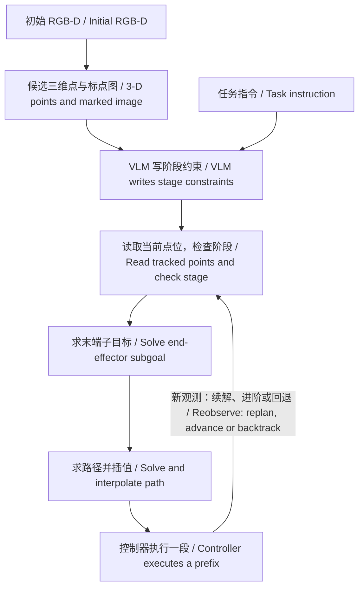
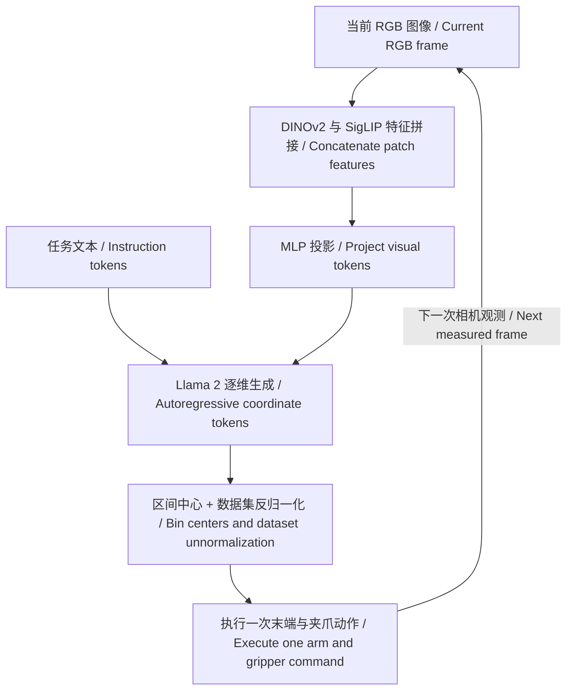

# 谁决定下一步动作？ / Who chooses the next robot action?

[EAI-1 · 语言、可行性与规划](#eai-1) · [EAI-2 · 视觉语言动作策略](#eai-2) · [来源与版本缺口 / Source gaps](#source-gaps) · [69 条逐项证据 / Row ledger](../data/reading-eai-a.json)

同样是“把茶倒进杯子”，一个模型可以说出目标、指出壶嘴、写出约束，或者直接给机器人一个动作。这四种输出不能用同一种成功率来评价。本文以 **ReKep** 和 **OpenVLA** 为例，沿着观测走到真正的动作，再沿反馈走回来，定位每种实验究竟测试了哪一段。

“Pour the tea” can elicit a goal, a point on the spout, a geometric constraint, or a motor command. Each is useful, but an accurate point is not yet a successful pour. The two readings below follow the handoff to the actuator and identify what can change after the robot moves.

**阅读范围 / Coverage.** 工作簿 `Paper_Repo_List` 的 **No. 132–153（22 条）**、**154–200（47 条）**，使用表中的 `No.`，不是 Excel 物理行号。59 条主链接通向 arXiv，其中两条共用一篇；其余 10 条通向发布文章。逐条查读正文的方法、实验或发布方披露的对应部分；31 条列有 GitHub 链接，30 条列有 Hub 链接，两组有重叠。代码阅读以说明文档和能识别该版本的推理、训练或评测路径为单位。**60 条记为 `sections`，9 条为 `repo`**：前者含 ER 2 发布文另链的安全评测报告，后者是项目级证据。没有把检索、下载、模型卡或源码静态阅读记作“全文读完”或“复现”。

The [ledger](../data/reading-eai-a.json) gives a finding, a source and a locator for **each** workbook entry, checked on 2026-11-24. `sections` means selected substantive sections, not every page or appendix. `repo` includes first-party release articles where these are the primary evidence. No model was run, no gated weights were obtained, and no scores below are independent measurements. The separate [runtime records](../data/runtime-eai-a.json) use the same two examples as the diagrams.

## EAI-1 · 语言怎样落到物理约束上？ / From language to executable constraints

**先找接口。** [SayCan (§§3–5)](https://arxiv.org/html/2204.01691) 在已有技能中选择下一项：语言模型判断“是否有助于目标”，技能价值函数判断“现在能否成功”。模拟厨房布局的真机实验中，两项指标分别是**计划合理率 84%**、**执行成功率 74%**（101 个请求）。[Inner Monologue (§§3.2–4.3)](https://arxiv.org/html/2207.05608) 问了不同的问题：失败后，规划器有没有收到足以改变下一步的信息？厨房实验用了学习到的成功判别器，但物体识别反馈来自人。[RoboPoint (§§4–5)](https://arxiv.org/html/2406.10721) 则输出图像中的点；训练时先放置物体再移除，可在“空桌面”生成有空间关系的落点标签。点落在正确区域，仍不代表手臂可达或抓握稳定。

**Read the interface before the score.** SayCan's state-conditioned skill ranking can reject an infeasible instruction without changing the skill itself. Inner Monologue can change a subsequent instruction after receiving a success flag or a scene description, but the source of that feedback matters. A pointing system can localize an *empty* destination that an object detector cannot box. None of these contracts specifies the full motion. ReKep makes the missing handoff unusually explicit.

### 代表作：ReKep，先写“什么要成立”，再求“怎么动”

[Huang et al., arXiv:2409.01652v2，30 页](https://arxiv.org/pdf/2409.01652v2) · [Fig. 2、式 1，PDF p. 4](https://arxiv.org/pdf/2409.01652v2#page=4) · [公开实现及真机移植说明](https://github.com/huangwl18/ReKep/tree/63c43fdba60354980258beaeb8a7d48e088e1e3e)

**表示与求解。** 输入是指令、彩色图、深度及标定；不是给定精确的物体网格。论文 §3.4 在分割掩码内聚类 DINOv2 视觉特征，将候选点还原到三维并在图上编号。VLM 看到的是**指令和带编号的图**，输出各阶段的小程序。对当前关键点矩阵 $K$，每个程序返回一个标量，约定 $f(K)\leq 0$ 为满足。终点约束要求关系在阶段结束时成立；路径约束表示中途也要保持的关系。例如移动水壶时，终点要求壶嘴在杯口上方，运输途中另有保持直立的要求；只给终点并不能避免提前洒出。

求解器不一次规划整个任务。先找本阶段末端执行器的目标位姿，再求通往它的路径；碰撞、运动长度、可达性等进入代价。论文用局部刚性近似预测手动了以后相关点会在哪里，并以跟踪结果不断修正。附录 A.8–A.9 的数值实现把约束违规转成高权重代价，所以名称中的“约束”**不是**安全性或可行性的数学保证。§3.3 报告先用全局搜索配合局部优化，随后用上一解热启动局部求解；约 10 Hz 是后者的量级，不是视觉语言模型生成代码的频率。

**Representation and execution.** The language model specifies relationships, not waypoints. A constraint can express “align these two points at the end of the move” independently of “keep these parts upright throughout it.” The pose solver and path solver turn these tests into motion using the current point estimates, collision geometry and arm state. Reusing the program while refreshing its *arguments* is what makes feedback practical. It also explains a failure mode: a numerically good solution to a constraint on the wrong point is still the wrong movement.

**从仓库走一遍 / Code walk.** [`main.py` L57–101](https://github.com/huangwl18/ReKep/blob/63c43fdba60354980258beaeb8a7d48e088e1e3e/main.py#L57-L101) 中，`perform_task` 在没有缓存时才提出点并生成程序；`_execute` 按阶段加载 `subgoal` 与 `path` 两组函数。[L107–182](https://github.com/huangwl18/ReKep/blob/63c43fdba60354980258beaeb8a7d48e088e1e3e/main.py#L107-L182) 每轮读取点、末端位姿、关节、距离场与碰撞点。当前路径约束超容差会触发回退，否则先调用 [`SubgoalSolver.solve`](https://github.com/huangwl18/ReKep/blob/63c43fdba60354980258beaeb8a7d48e088e1e3e/subgoal_solver.py#L177)，再调用 [`PathSolver.solve`](https://github.com/huangwl18/ReKep/blob/63c43fdba60354980258beaeb8a7d48e088e1e3e/path_solver.py#L175)。执行队列每轮最多取 `action_steps_per_iter` 个动作；下一轮可以换掉未执行的路径，而非把上一整条预测当事实。

The public demo assumes a Fetch arm in OmniGibson and can start from a cached VLM query. It reads tracked points and scene geometry from the simulator; the [deployment notes](https://github.com/huangwl18/ReKep/blob/63c43fdba60354980258beaeb8a7d48e088e1e3e/README.md#real-world-deployment) explicitly exclude the physical perception pipeline. Running the demo would test the optimizer and control logic, **not** reproduce the paper's real-world tracking, mask propagation or distance-field reconstruction.

**实验证据 / What the experiments establish.** [§4.1、Tables 1–2、Fig. 4，PDF p. 7](https://arxiv.org/pdf/2409.01652v2#page=7)。下表把论文的逐任务计数相加，分母是每种方法的尝试次数，不是每帧的点数；VoxPoser 是附录 A.4.2 适配过的对照。

| 条件 / Condition | VoxPoser 对照 | 自动生成约束 / Automatic | 人工标注约束 / Annotated |
|---|---:|---:|---:|
| 单臂与双臂共 7 项，各 10 次 / Seven tasks, ten trials each | 7/70 | 31/70 | 48/70 |
| 从中选 3 项并施加干扰 / Three selected tasks with disturbances | 2/30 | 8/30 | 14/30 |

自动版超过该对照，但多数常规试验仍未完成。人工版保留求解器，换了约束来源，不能把 48/70 当成自动系统的表现。干扰组是子集，不能把两行相减来估计“普遍抗扰损失”。§4.3 对失败录像的人工归因把跟踪列为最大误差来源，尤其是遮挡；改进语言推理无法凭空恢复丢失的几何观测。

The annotated condition separates *specifying* a feasible relation from *executing* it. Neither condition eliminates occlusion or the approximate rigid-motion assumption. In the garment experiment (§4.2), execution is even conditioned on having a feasible strategy; it is not the same denominator as end-to-end automatic success in Table 1.

### 从该代表作看其他证据 / What changes in the rest of EAI-1?

| 输出 / Output | 可检验的问题 / Test the right claim |
|---|---|
| 程序或代价 / Programs or costs | [Code as Policies, Table III](https://arxiv.org/html/2209.07753) tests composition over a supplied API; [ProgPrompt, §§III-C, V](https://arxiv.org/html/2209.11302) tests assertions against the current world state; [VoxPoser, §3.3](https://arxiv.org/html/2307.05973) recomputes a spatial cost for replanning. 能调用一个动作，不等于生成了该底层技能。 |
| 空间判断 / Spatial judgments | [MOKA, §IV-D](https://arxiv.org/html/2403.03174) needs extra height information to turn a free-space image mark into motion. [RoboRefer, Table 6](https://arxiv.org/html/2506.04308) substitutes a point localizer inside a manipulation pipeline. 二维命中、三维定位和执行成功是三个不同测试。 |
| 解释或评价 / Explanation or evaluation | [ECoT, §§4.3, 5.5](https://arxiv.org/html/2407.08693) generates reasoning **before** action; caching makes slow traces usable. [RoboBrain 2.5, §6.3](https://arxiv.org/html/2601.14352) compares before/after observations and scores signed progress; reversed video tests whether regress is recognized. 评价动作结果不是产生动作。 |
| 调度 / Orchestration | [Gemini Robotics 1.5, §§2.1, 4–5](https://arxiv.org/html/2510.03342) gives ER tool choice and success monitoring; the VLA implements the action tool. [ER 2 safety report, pp. 1–3](https://storage.googleapis.com/deepmind-media/gemini-robotics/Gemini-Robotics-2-Safety.pdf) distinguishes offline tool emulation from physical stopping. 会选停止工具不是通过功能安全认证。 |

## EAI-2 · 动作的单位、时钟与反馈 / Action units, timing and feedback

**先问“一次输出什么”。** [RT-2 (§3.2)](https://arxiv.org/html/2307.15818) 把控制坐标放进语言模型的词表；[π0 (§IV)](https://arxiv.org/html/2410.24164) 用连续流一次生成多个未来动作；[FAST (§V)](https://arxiv.org/html/2501.09747) 将整段动作变换到频域并压缩成较短的离散序列。三者都能以图像和语言为条件，却没有在预测同一种 token。一秒能产出许多动作，不等于一秒能使用同样多次**新的观测**。这在移动物体上尤其重要：[DynamicVLA (§§3.3–3.4, Table 7)](https://arxiv.org/html/2601.22153) 测量推理延时，丢弃动作块中已经过时的前缀，再执行剩余部分。

**What does one inference buy?** Count decisions, actuations and newly observed states separately. A chunk can drive many actuations without an intervening observation; autoregression can require many token predictions for just one physical decision. OpenVLA is a useful reference precisely because one model call, the units of its output, and the next camera observation can all be traced in public code.

### 代表作：OpenVLA，从词表末端到 WidowX 的运动

[Kim et al., arXiv:2406.09246v3，37 页](https://arxiv.org/pdf/2406.09246v3) · [Fig. 2，PDF p. 4](https://arxiv.org/pdf/2406.09246v3#page=4) · [官方代码](https://github.com/openvla/openvla/tree/c8f03f48af692657d3060c19588038c7220e9af9) · [基础模型卡](https://huggingface.co/openvla/openvla-7b)

**离线学习。** 基础模型接收一张工作区 RGB 图像和一条指令。DINOv2 与 SigLIP 分别编码同一图块，通道拼接后经 MLP 投影至语言空间；Llama 2 同时看到视觉表示和指令。§3.2–3.3 用经过筛选的 Open X-Embodiment 数据（约 97 万段示范）做动作词元预测。逐坐标按数据集范围归一化，用分位数减少极值影响，并借用词表尾端表达离散动作。这个训练目标不要求模型生成未来的相机图像；**下一帧来自真实环境**。

**一次推理。** 基础 Bridge 接口的动作向量有七个坐标：平移、旋转各三个，另有夹爪。逐维生成的七个 token 不是七个时刻。预测的归一化值也不能直接作为物理命令：对需还原的维度，归一化中心 $u$ 要映回 $q_{01}+(u+1)(q_{99}-q_{01})/2$。目标数据集和控制器决定这个数值的含义。若单位或统计量选错，语言和视觉都可能正确，手臂却仍移动过远或过短。

**Offline objective, online interface.** A fused image patch representation and an instruction condition the next-token model. At deployment those tokens are coordinates of **one** action. Quantization trades resolution for access to the pretrained language decoder. It does not make a translation delta, a rotation command and a gripper setting interchangeable across embodiments. The implementation's quantile lookup is part of the policy interface, not a cosmetic rescaling step.

**在代码中检查动作契约 / Inspect the action contract.**

1. [`prismatic/vla/action_tokenizer.py`](https://github.com/openvla/openvla/blob/c8f03f48af692657d3060c19588038c7220e9af9/prismatic/vla/action_tokenizer.py) 用 `digitize` 将截断后的值映成倒序词表 ID。一个容易忽略的实现细节：默认 256 个边界值只有 255 个相邻区间中心；解码会裁剪最末索引。这比笼统说“输出 256 个等距中心”更准确。
2. [`OpenVLAForActionPrediction.predict_action`, L492–536](https://github.com/openvla/openvla/blob/c8f03f48af692657d3060c19588038c7220e9af9/prismatic/extern/hf/modeling_prismatic.py#L492-L536) 依据 `unnorm_key` 决定要生成多少维，取序列末尾的动作 ID，映射至中心，按 `mask` 对指定维度用 `q01`、`q99` 还原。When a checkpoint contains statistics for more than one dataset, omitting the key is ambiguous; the helper checks for this rather than picking a robot silently.
3. [Bridge 真机评测循环，L81–96、126–161](https://github.com/openvla/openvla/blob/c8f03f48af692657d3060c19588038c7220e9af9/experiments/robot/bridge/run_bridgev2_eval.py#L81-L161) 固定 `bridge_orig`，循环刷新观测、处理图像、调用策略，然后 `env.step(action)`。脚本读取本体状态用于环境和记录，**不表示**原版基础模型以本体状态或多视角图像为输入。The nominal 5 Hz configuration is a driver setting, not a guarantee that a given GPU returns a fresh action every 200 ms.

**实验问的并非同一个问题 / Four experiments, four scopes.**

| 问题 / Question | 论文证据 / Reported evidence | 不能推出 / Boundary |
|---|---|---|
| 已有本体能否按指令行动？ / Direct transfer | [Fig. 3, §5.1](https://arxiv.org/pdf/2406.09246v3#page=7), App. Table 4: WidowX, 17 tasks × 10 trials per method. Mean score 70.6% for OpenVLA, 50.6% for RT-2-X; some tasks allow half credit. | OpenVLA's semantic-generalization subset trails RT-2-X; these are not all binary, perfect rollouts. |
| 换评测平台结论是否相同？ / Same ranking elsewhere? | [Fig. 4](https://arxiv.org/pdf/2406.09246v3#page=8), App. Table 6: Google robot, 12 tasks × 5 trials. OpenVLA 85.0% ± 4.6%, RT-2-X 78.3% ± 5.4% (standard errors). | 作者判为相近；不能移植 WidowX 的 20 个百分点差距。The two robots are tested, not arbitrary unseen hardware. |
| 新台架需要多少数据？ / Adaptation | §5.2, Fig. 5: seven downstream Franka tasks, 10–150 demonstrations each. On diverse multi-instruction tasks the generalist initialization helps; on narrow single-instruction tasks a from-scratch Diffusion Policy is competitive. | Fine-tuning is not zero-shot. A mean across tasks can conceal which alternative would work best for a single task. |
| 训练或推理成本能否降低？ / Budget | [Tables 1–2 and footnote 4](https://arxiv.org/pdf/2406.09246v3#page=10): rank-32 LoRA trains about 1.4% of parameters; on the 8-task Bridge quantization subset, int4 uses 7.0 GB versus 16.8 GB for bfloat16, with overlapping score errors. | 这两节使用较小的数据混合与仅 SigLIP 的变体。Do not attach that memory measurement to the exact fused-vision checkpoint used for the headline comparison. |

**局限 / Limits.** 单帧输入不能显式区分某些视觉相同但运动方向不同的状态；逐坐标解码也会拖慢控制。这解释了为什么 [OpenVLA-OFT §§IV–V](https://arxiv.org/html/2502.19645) 在保留原预训练的同时改用并行、分块的连续输出，以及为什么 [SmolVLA §3.3、Table 13](https://arxiv.org/html/2506.01844) 另外研究异步队列和观测刷新。These are changes to the deployed control interface, not features to retroactively attribute to base OpenVLA.

### 横向比较 / Three comparisons worth keeping separate

- **学的是场景变化还是电机命令？ / Future state or motor command?** [UniVLA, §III](https://arxiv.org/html/2505.06111) learns latent actions from frame pairs and still needs an embodiment-specific decoder. [InternVLA-A1, §3.3](https://arxiv.org/html/2601.02456) jointly trains a future-visual-latent objective and an action expert. 训练时使用未来画面，不等于部署时让机器人执行“图像”。
- **慢模块推理得好，快模块就能及时纠错吗？ / Does better reasoning imply faster correction?** [Helix](https://www.figure.ai/news/helix) uses the newest available slow latent in a fast upper-body policy. [Helix 02](https://www.figure.ai/news/helix-02) adds a distinct whole-body tracking layer. [GR00T N1, §2.1](https://arxiv.org/html/2503.14734) uses VLM features to condition flow-based action generation. “双系统”并不指定统一的频率、消息格式或反馈机制。
- **扩大了什么？ / What was scaled?** [Xiaomi-Robotics-1, §§2.2–3.3](https://arxiv.org/html/2607.15330) distinguishes large-scale UMI data, embodiment-specific post-training and new-task fine-tuning. [ScaleVLA, §3.1, Fig. 4, §4.5](https://arxiv.org/html/2611.21607) freezes a large MoE backbone and stops at encoder features; the action head is trained on demonstrations. Its 9/10 in-domain charger insertions and 8/15 OOD insertions are more informative about that physical task than the parameter count alone. 数据小时、源模型总参数、每动作延时、真实任务成功率不可互为替代指标。

## 来源、版本与可复现边界 / Access, identity and reproducibility

| 行号 / Rows | 核对结果 / What the link actually establishes |
|---|---|
| 143, 157, 168 | ReKep 的模拟演示不含真机感知链；OpenVLA 主仓库同时介绍后作 OFT，但二者的解码器不同。#168 所列 GitHub URL 返回 404；[作者项目页](https://openvla-oft.github.io/) 指向可读的 [moojink/openvla-oft](https://github.com/moojink/openvla-oft)。该行的权重只对应 LIBERO-Spatial。 |
| 142, 146–147, 152, 180 | The ECoT checkpoint README is only metadata; RoboRefer links the 2B SFT release. Both RoboBrain model pages are visible but require agreement for file access. Both GitHub names resolve to the same tree: use [`rb_v2.0/inference_rb2.py`](https://github.com/FlagOpen/RoboBrain2.5/blob/af98c932aac9ff715d70da177088d7bb95573ff7/rb_v2.0/inference_rb2.py) for **2.0**, not the top-level 2.5 loader. [VLA-Adapter](https://huggingface.co/VLA-Adapter) is an **organization** URL; it does not pin a model. |
| 149, 153, 182, 195, 199 | 1.5 的 ER 和 VLA 共用一份报告，不能作两条独立试验证据。ER 2 的[安全报告](https://storage.googleapis.com/deepmind-media/gemini-robotics/Gemini-Robotics-2-Safety.pdf)确有实验，但不是 Robotics 2 或 2.5 动作模型的完整训练说明。2.5 发布稿区分 ER 的流程监控、VLA 的手臂控制、Argon 的数据生成；不可并成同一模型的闭环能力。 |
| 160, 163, 172 | One [openpi](https://github.com/Physical-Intelligence/openpi) repository covers three methods. Inspect `pi0.py` versus `pi0_fast.py` and the `pi05` conditioning branch. The listed π0/π0.5 Hub artifacts are LeRobot integrations; the π0.5 card documents the flow head, not every mechanism in the research recipe. |
| 170–171, 178, 188, 192 | GO-1 是 AgiBot 平台论文的一部分。GR00T N1 用 [`n1-release`](https://github.com/NVIDIA/Isaac-GR00T/tree/n1-release)；#192 的 N1.7 文章描述 Early Access，而默认代码已是 GA。G0 读 [2025 年的源码](https://github.com/OpenGalaxea/GalaxeaVLA/blob/2cec5c9dc57064df8bd43f0151d0d60d3e76535e/vla/model/g0/galaxeazero.py)，不是现版 G0.5；InternVLA-A1 读 [`InternVLA-A1` 分支](https://github.com/InternRobotics/InternVLA-A-series/tree/InternVLA-A1)，不是 A1.5。 |
| 166, 185, 187, 190–192, 195, 198–199 | Primary evidence for the product on these rows is a vendor/project article, sometimes supplemented by code or a related report. A four-minute dishwasher run (#187), a repeated packaging streak (#190), and a blinded whole-task comparison across 30 homes (#198) have different denominators. 不能把演示视频、损失曲线、现场试点和对照试验合并成排行榜。 |

“未列代码”只说明这一行没有提供代码地址，**不是**断言项目闭源。相反，某些仅列权重的行能从模型卡追到代码，如 [GO-1](https://github.com/OpenDriveLab/AgiBot-World) 与 [WALL-OSS](https://github.com/X-Square-Robot/wall-x)。有源码、可下载权重、具备原实验传感器和数据，是三种不同的可访问性。For exact paper sections, per-row repository revisions/files and checkpoint identities, use the [reading ledger](../data/reading-eai-a.json) rather than inferring release identity from a current repository name.
