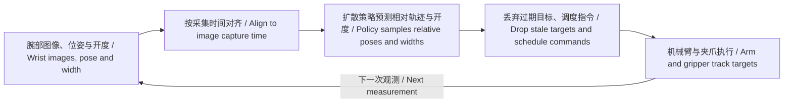
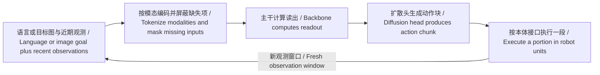
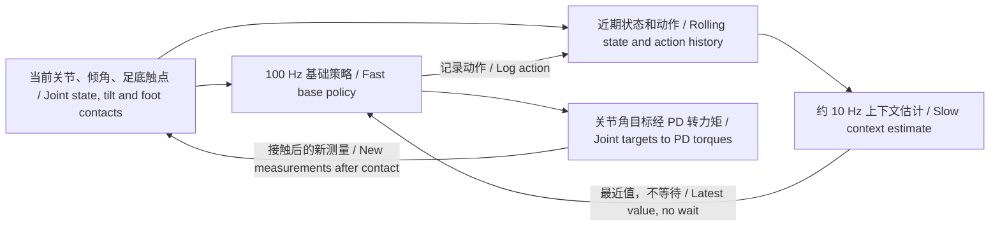
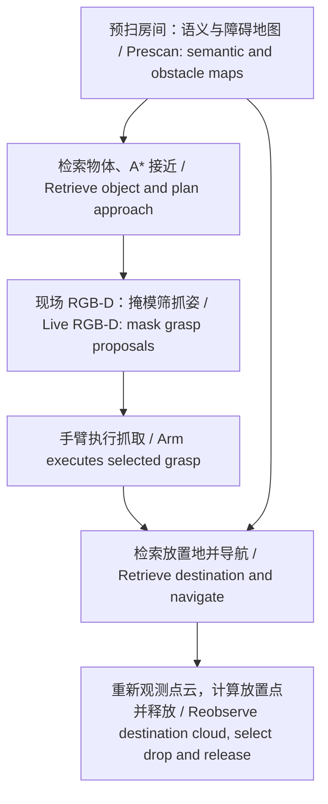

# 从示范到执行：四种具身闭环 / From demonstration to execution: four embodied control loops

**阅读范围 / Scope.** `Paper_Repo_List` 的 **No. 201–267**，不是 Excel 的物理行号。按原表划分，不把同行的续作拆成新行。**67 rows:** [EAI-3 · 23](#eai-3) · [EAI-4 · 14](#eai-4) · [EAI-5 · 15](#eai-5) · [EAI-6 · 15](#eai-6). [逐行证据 / Reading ledger](../data/reading-eai-b.json) · [运行图数据 / Runtime data](../data/runtime-eai-b.json).

**怎样读 / How to read.** 每个图只画一项代表工作的执行过程，不把全类拼成一个虚构模型。读数值前先问：谁提供动作标签？部署时哪些量仍可观测？成功以物体、子任务、整条轨迹还是试验回合为单位？ A predicted pose, a scored answer and a successful pick-and-drop are different outputs. The notes below link method and evaluation evidence alongside implementation material; a repository link does not mean its results were reproduced.

**证据口径 / Evidence levels.** `sections` 表示抽读方法、实验及注明的图表，不是从头至尾审阅；`repo` 表示平台文档而非论文实验。Paper numbers below are the authors' results. For #223 and #224 the manuscript was read via text renderings (figure **captions** and tables, not inspection of the image pixels). #258 and #264 explicitly mark narrower access to manuscript passages plus author materials. #251 has no separate platform paper here. No row is marked `full`.

## EAI-3 · 从人类示范到机器人指令 / Visuomotor imitation and data collection

这组工作解决两个不同的错误。**标签歧义**：同一画面下向左、向右都合理，单步均方误差却可能回归到两者中间。IBC 在候选动作上找低能量，BeT 选离散中心再修残差，Diffusion Policy 对整段动作采样。**接口歧义**：人手轨迹看起来合理，但对机器人而言坐标、时间、可达性可能都不对。ALOHA 直接记录关节示范；UMI 用与机器人相似的工具记录相对运动；Phantom 则由手部视觉估计生成标签。增加模型容量并不会自动修正时间戳。
These alternatives change *where a mistake can enter*. A voxel or a rendered view can improve spatial precision (#204, #207), yet a keyframe benchmark may rely on a separate motion planner (#209). Likewise, a long action chunk preserves a choice over time, but contact may change before the next chunk arrives. #218 responds inside the chunk using a fast tactile decoder; #214 reduces the cost of producing the chunk. Those are different ways to reduce reaction delay.

### 精读 / Close reading: UMI (#211) — 先对齐时间，再谈跨本体 / Align time before transferring a skill

1. **示范不在机器人上 / Offline capture.** [Figs. 2, 5–6](https://arxiv.org/abs/2402.10329) 区分手持装置和策略接口。腕部鱼眼相机也记录 IMU；SLAM 恢复示范轨迹，夹口宽度提供抓取信号。训练并不把人的绝对世界坐标当成机器人标签。 Every waypoint in one prediction is expressed relative to the **same current** end-effector pose. This is not a chain of stepwise pose deltas: integrating a sequence of small rotation errors is a different failure mode from miscalibrating an absolute base frame.
2. **执行 / At execution.** 以延迟最大的观测流（通常是图像）为基准，按采集时刻插值位姿与夹爪开度；扩散策略给的是带时间戳的位姿和开度目标，并非电机力矩。 For each actuator, discard predictions whose intended time has already passed after observation, inference and actuation delay. The remaining commands are scheduled; the next observation window closes the loop. The [repo](https://github.com/real-stanford/universal_manipulation_interface) separates the offline SLAM pipeline from real-world deployment.
3. **反事实检验 / What changes the outcome?** §V 的投掷测试中，延迟匹配时 105/120 个物体落入目标箱，去掉后 69/120。释放时机改变，抓到并不等于投对。 In §VI/Fig. 9 the denominator changes: cup arrangement succeeded in **28/40** trials with training cups and **15/20** with held-out cups in the generalization test. The same visual backbone trained only on the narrow-domain data failed there. §VIII identifies a remaining constraint: a hand can demonstrate a pose the target arm cannot reach.

### 逐行阅读 / Row evidence

**201 · Implicit BC (IBC)** — 不直接回归动作：给观测和候选动作打能量分，推理时找低谷。Fig. 5 分开列出状态、像素与实机任务，不能只凭 D4RL 得分推断实机能力。 An energy model can keep two plausible actions apart instead of averaging them. Test-time action search is part of the policy; Fig. 5 compares it with explicit regression across six domains.

证据 / Evidence: §§2, 4; Fig. 5; App. B. [Paper](https://arxiv.org/html/2109.00137) · [Particle / block-pushing / D4RL recipes](https://github.com/google-research/ibc)

**202 · BC-Z** — 语言或人类示范视频提供任务向量；FiLM 调制单目 ResNet，再回归位姿增量和夹爪角。新任务测试与训练任务上的人工接管消融不是同一组实验。 BC-Z separates task specification from motor decoding. Compare held-out commands in Table 2 with the manual versus HG-DAgger supervision ablation, which uses training tasks.

证据 / Evidence: §§5.1–5.3, 6.2–6.3; Fig. 3; Table 2. [Paper](https://arxiv.org/html/2202.02005) · [BC-Z code](https://github.com/google-research/tensor2robot/tree/master/research/bcz) — Tensor2Robot BC-Z subdirectory.

**203 · BeT / VQ-BeT** — BeT 用 k-means 中心加连续残差；VQ-BeT 改为先学习动作的多级残差码，再预测码并解码。两篇论文分别测模式覆盖、目标条件行为，不能把后者成绩归给前者。 BeT classifies an action bin and corrects its offset. VQ-BeT learns a residual quantizer before fitting the policy; its goal-conditioned comparison is a different experiment.

证据 / Evidence: BeT §§2–3, Fig. 3; VQ-BeT §§3–4, Fig. 2, Table 1. [Paper](https://arxiv.org/html/2206.11251) · [VQ-BeT paper](https://arxiv.org/html/2403.03181) · [BeT code](https://github.com/notmahi/bet) · [VQ-BeT code](https://github.com/jayLEE0301/vq_bet_official) — Separate BeT and VQ-BeT training repos.

**204 · PerAct** — 多视 RGB-D 拼成体素，Perceiver 把语言与体素块压入 latent，再读出下一关键帧平移体素、离散旋转和夹爪状态；关键帧之间由运动规划器执行。 The action is detected in 3-D, not emitted as motor torques. Table 1 scores binary completion over 25 episodes per RLBench task for 10- and 100-demo training regimes.

证据 / Evidence: §§3, 4.2; Fig. 2; Table 1. [Paper](https://arxiv.org/html/2209.05451) · [RLBench/PyRep setup and evaluation](https://github.com/peract/peract)

**205 · Diffusion Policy** — 以观测历史为条件，对整段动作而非未来图像去噪；只执行一段前缀后重新观察。Push-T 中绕左或绕右都可行，关键是单次 rollout 内不要换边。 Fig. 3 tests commitment to a mode, not just per-step prediction error. The §5.2 footnote reports only 22 environment initializations for Robomimic, not the nominal 50, due to an evaluation-code bug.

证据 / Evidence: §§2–4, 5.2, 5.4; Figs. 2–3. [Paper](https://arxiv.org/html/2303.04137) · [Simulation configs, logs and real-robot pipeline](https://github.com/real-stanford/diffusion_policy)

**206 · ACT + ALOHA** — 训练时 CVAE 编码示范动作风格，测试时用先验中心；Transformer 输出双臂关节目标块。重叠预测按时间加权，不是执行完整旧块。 Fig. 7 separates the value of chunking from temporal ensembling. Table I compares two simulated and two real tasks, not all six physical tasks on identical footing.

证据 / Evidence: §§IV-A–C, V-C, VI-A; Figs. 3, 7. [Paper](https://arxiv.org/html/2304.13705) · [ACT training and simulated tasks](https://github.com/tonyzhaozh/act)

**207 · RVT / RVT-2** — 把点云从多个虚拟视角重投影，由各平面的热图确定三维关键点。RVT-2 在粗定位后放大局部再次渲染；18 项 RLBench 平均成功率与毫米级实机插入测试须分开读。 RVT avoids a dense 3-D network; RVT-2 spends its second pass on local spatial resolution. The shared repository has distinct training paths for the two versions.

证据 / Evidence: RVT §3, Table 1; RVT-2 §III, Fig. 2, Table I. [Paper](https://arxiv.org/html/2306.14896) · [RVT-2 paper](https://arxiv.org/html/2406.08545) · [Version-specific RVT / RVT-2 configs](https://github.com/NVlabs/RVT)

**208 · Mobile ALOHA** — 遥操作同步记录双臂与移动底盘；将静态 ALOHA 片段混入移动任务的行为克隆，而非从静态片段学习底盘驾驶。七项实机任务按阶段记分。 The static/mobile data mixture changes the supervision for shared arm skills. Compare the same mobile ACT task with and without co-training; success on an early subtask need not finish the run.

证据 / Evidence: §§4, 6.1; Fig. 2; Table 1. [Paper](https://arxiv.org/html/2401.02117) · [Mobile teleop/recording stack](https://github.com/MarkFzp/mobile-aloha)

**209 · 3D Diffuser Actor** — 把带位置的 RGB-D 特征与带噪末端轨迹在三维空间交互，再预测去噪方向。RLBench 比的是下一个关键位姿，BiRRT 补路径，不是整条轨迹的无规划控制。 A 3-D scene conditions trajectory diffusion. On RLBench the planner is held in common; separate multi-view and single-view results rather than attributing all gains to diffusion.

证据 / Evidence: §3, Fig. 2; §§4.1–4.2; Tables 1–2. [Paper](https://arxiv.org/html/2402.10885) · [RLBench and CALVIN evaluation](https://github.com/nickgkan/3d_diffuser_actor)

**210 · ALOHA 2** — 换低摩擦导轨、改重力补偿与相机布置。Fig. 4 测的是操作者打开主夹爪所需的力（14.68→0.84 N），不是自主策略成功率。 ALOHA 2 changes the demonstrator's mechanical interface and supplies a simulation model. The workbook points to the ALOHA root; the project directs builders to the aloha2 subfolder.

证据 / Evidence: §§2–4; Figs. 2–4. [Paper](https://arxiv.org/html/2405.02292) · [Hardware project](https://aloha-2.github.io/) · [ALOHA 2 build files](https://github.com/tonyzhaozh/aloha/tree/main/aloha2) — ALOHA 2 hardware page and versioned build files.

**211 · UMI** — 手持宽角腕相机采动作；执行时把位姿、夹爪开度对齐到图像时间戳，并跳过过期指令。投掷按物体计，杯子摆放按回合计。 UMI predicts a trajectory in one current end-effector frame. Latency compensation raised correctly sorted throws from 69/120 to 105/120 objects; it cannot make an unreachable demonstration feasible.

证据 / Evidence: §III, Figs. 5–6; §§V–VI, Figs. 8–9; §VIII. [Paper](https://arxiv.org/html/2402.10329) · [SLAM, policy training, cup reproduction](https://github.com/real-stanford/universal_manipulation_interface)

**212 · DexCap** — 胸前深度与追踪相机记录双手；把指尖经 IK 对齐 LEAP 手并将点云转入机器人坐标。Table I 单看不用机器人数据的设置，高难度双手任务另有纠正示范。 Retargeting changes both the observed scene and the fingertip action label. The single-hand comparison does not imply that human-only recordings solve all the bimanual tasks.

证据 / Evidence: §§III–IV, V-B; Figs. 2–4; Table I. [Paper](https://arxiv.org/html/2403.07788) · [Collection, retargeting and policy pipeline](https://github.com/j96w/DexCap)

**213 · DP3 (3D Diffusion Policy)** — 稀疏点云经小型 MLP 与本体状态一起条件化动作扩散。Reach 的五示范空间可视化只是诊断；仿真总表按每种子的最高五次评估取均值。 DP3 tests the 3-D input inductive bias with few demonstrations. Its checkpoint selection and mixture of scripted, RL and human experts matter when comparing success rates.

证据 / Evidence: §III; §§IV-A, V; Figs. 2–3. [Paper](https://arxiv.org/html/2403.03954) · [DP3 implementation and benchmark scripts](https://github.com/YanjieZe/3D-Diffusion-Policy)

**214 · Consistency Policy** — 从已训练的扩散教师蒸馏一致性学生，用少数网络调用预测整段动作。Push-T 得分是目标覆盖率，Robomimic 才是任务成功率，不应把两者都写成成功率。 Table I pairs task metrics with number of function evaluations. Faster denoising does not eliminate sensing or actuator latency; distillation still needs a trained teacher.

证据 / Evidence: §III; §IV-B, Table I; §V. [Paper](https://arxiv.org/html/2405.07503) · [EDM teacher and CTMP student recipes](https://github.com/Aaditya-Prasad/consistency-policy)

**215 · UMI on Legs** — 将腕相机坐标下的扩散轨迹转入任务空间，由仿真训练的全身控制器同步驱动腿与臂。投掷测试开始时球已交给机器人，测的是抛掷而非寻球抓球。 UMI supplies a desired end-effector trajectory, not base velocities. The study measures controller tracking/survival in simulation separately from real-world task success.

证据 / Evidence: §§3.1–3.3, 4.1–4.4; Fig. 3; App. 10.1. [Paper](https://arxiv.org/html/2407.10353) · [UMI on Legs code](https://github.com/real-stanford/umi-on-legs) — Whole-body controller and deployment repo.

**216 · EgoMimic** — 用 Aria 眼镜追踪头手，对齐人手和机械臂的动作坐标与视觉外观，再联合训练。比较叠衣、收纳等任务的同域表现与新场景表现。 The benefit tested is co-training given robot demonstrations, not a robot-free policy. Table I is useful for seeing which measurements are actually shared across the two bodies.

证据 / Evidence: §III-B–C; §IV; Fig. 2; Table I. [Paper](https://arxiv.org/html/2410.24221) · [EgoMimic code](https://github.com/SimarKareer/EgoMimic) — Sample training and rollout instructions.

**217 · Phantom** — 手部网格经深度点云 ICP 校正，以拇指和食指定位夹爪；擦除人手并渲染机器人，得到成对的观测和动作。Franka、Kinova 实验仍依赖手姿估计质量。 Phantom synthesizes robot-looking training views, not robot rollouts. Occluded fingertips can corrupt both the action label and the image used to learn it.

证据 / Evidence: §§3.2–3.3, 4, 6; Figs. 2–3. [Paper](https://arxiv.org/html/2503.00779) · [Hand-pose, rendering and policy pipeline](https://github.com/MarionLepert/phantom)

**218 · Reactive Diffusion Policy (RDP)** — 慢扩散网络输出压缩动作块，快 GRU 解码器在块内读取即时触觉/力反馈。把触觉仅拼在慢网络输入端不是等价消融。 The fast decoder can change the next command before a new visual chunk is ready. Contact-task comparisons distinguish feedback rate from simply including another sensor.

证据 / Evidence: §IV, Fig. 6; §V-B, Tables II–IV. [Paper](https://arxiv.org/html/2503.02881) · [TactAR hardware and slow/fast policy](https://github.com/xiaoxiaoxh/reactive_diffusion_policy)

**219 · DexUMI** — 外骨骼机构使编码器关节到指尖的映射接近目标手；图像修补降低外观差异。两类手各自的机构不同，20 回合的分阶段累计成绩不是通用手部零样本转移。 Finger encoders measure compatible commands rather than inferring every joint from video. The matched-start ablations vary finger representation, tactile feedback and rendering.

证据 / Evidence: §3.1, Figs. 2–3; §5, Table 1. [Paper](https://arxiv.org/html/2505.21864) · [Exoskeleton build and policy evaluation](https://github.com/real-stanford/DexUMI)

**220 · Streaming Flow Policy** — 把示范动作路径本身视为流路径，学习沿路径的速度场。从上一动作（或实测状态）续积分，不是每轮从噪声重生成一整块。 The action/state variants differ in where integration restarts. Push-T and RoboMimic compare latency and imitation scores; a measured state can only anchor the state-tracking variant.

证据 / Evidence: §§3–6; Tables 2–3; App. D. [Paper](https://arxiv.org/html/2505.21851) · [Reference implementation and Jupyter Book](https://github.com/siddancha/streaming-flow-policy)

**221 · EgoVLA** — 用第一视角历史和语言预测腕姿与 MANO 手参数，再用机器人示范后训练。原文零样本直接控制在所测任务上为 0%，预训练收益不能写成免适配。 The benchmark reports both completed subtask fraction and full success. Human-hand prediction is pretraining supervision, not by itself a calibrated humanoid policy.

证据 / Evidence: Figs. 2–3; §5.2, Tables 1–2. [Paper](https://arxiv.org/html/2507.12440) · [Training/eval](https://github.com/RchalYang/EgoVLA_Release) · [Benchmark](https://github.com/quincy-u/Ego_Humanoid_Manipulation_Benchmark) — EgoVLA training and evaluation release.

**222 · Emergence of H2R Transfer (π0.5+ego)** — π0.5 同时学习子任务和相对末端动作；实验将新概念的人类数据与邻近任务的机器人数据各占一半，改变机器人预训练多样性再测转移。 A robot-only control helps distinguish prior competence from human-to-robot transfer. This is not action-free internet video or learning manipulation from human data alone.

证据 / Evidence: Figs. 3–4; §V-A, V-D–F; App. B (Results Analysis). [Paper](https://arxiv.org/html/2512.22414) · [Author research note](https://www.pi.website/research/human_to_robot) — No matching task-specific code verified.

**223 · LingBot-Touch** — 把异构触元投到共同球面，以可见时空片段预测遮挡位置的潜表示。下游策略读冻结触觉 token；Table 2 在两类手上每任务 20 次，另有仿真 RL，勿把探针准确率当实机成功率。 LingBot-Touch is a tactile encoder, not the motor policy. Separate frozen force/contact probes from real-hand control and simulated RL. The manuscript and the repository use different titles for the same arXiv ID.

证据 / Evidence: Figs. 3–5; Tables 1–3 (manuscript text rendering). [Paper](https://arxiv.org/abs/2611.12806) · [Pretrained encoder checkpoints and usage](https://github.com/robbyant/lingbot-touch)

## EAI-4 · 数据可合并，动作未必兼容 / Cross-embodiment data and pretraining

DROID 主要扩大同一硬件上的场景覆盖；RH20T 和 RoboMIND 还要对齐不同传感器/本体；EgoDex 的输出标签甚至是人的腕与指尖。三种“扩大数据”不能用一个轨迹总数解释。**格式统一不等于控制语义统一**：LeRobot/RLDS 可容纳一列动作，但 0 可能是夹紧、保持或归一化后的均值。
Start with a control question: is a new robot merely missing a camera, or does it need a new action space? RT-X aligns a selected interface approximately; CrossFormer routes outputs by action space; HPT learns embodiment-specific stems and heads around a common trunk. When the task is *data allocation* (#231), the relevant comparison is more distinct scenes versus more repeats at a fixed budget, not which backbone has the lowest training loss.

### 精读 / Close reading: Octo (#228) — 哪些参数值得复用？ / What actually transfers?

1. **预训练 / Offline pretraining.** [§III-B, Fig. 2, App. C](https://arxiv.org/abs/2405.12213) 的混合物是筛过的 25 个 OXE 数据集，饼图是**批内采样权重**，不是各库的原始数据量。缺少语言或腕相机时，屏蔽对应 token，不把空图像当观测。 Task tokens and available observation tokens enter a block-causal transformer; learned readouts can collect information without becoming observations for the next step (Fig. 1). One backbone pass conditions the much smaller iterative diffusion head.
2. **换接口 / Adapting an interface.** 新输入可添 tokenizer；双臂 ALOHA 对应 14 维输出需重建动作头，而非把单臂向量复制两遍。The [examples and FAQ](https://github.com/octo-models/octo) distinguish a missing history frame from a real observation using `timestep_pad_mask`. A robot wrapper must still interpret the selected head's outputs in the target robot's units. Denoising steps refine the same proposed chunk; fresh sensor feedback enters on the next policy query.
3. **三种分母 / Three tests, three meanings.** Fig. 4 的零样本是预训练出现过的本体/接口；Table I 在六个下游设置各用约 100 条目标示范、各测 20 次，平均成功率 Octo 72%、从头训练 20%。这是 **52 个百分点**，不是“所有新本体零样本提升 52%”。 Table II is narrower still: four WidowX tasks, 40 trials in total, with **83%** for Octo-Small versus **35%** for its MSE-head variant. It supports the choice of action head *on this setup*. Appendix F/Table VII identifies skills absent on WidowX as harder than new objects.

### 逐行阅读 / Row evidence

**224 · RH20T** — 把人类演示、语言与多视角、力觉机器人序列按任务配对并校准。实验证据是 ACT 在新布置下少样本微调抓方块放秤上，不是标题所指的通用单次学习已经实现。 RH20T enables several possible one-shot pairings, but §IV tests transfer with subsets of 75 target demonstrations. Sensor synchronization and the fine-tuning protocol are separate contributions.

证据 / Evidence: §III, Figs. 4, 6; §§IV–V (manuscript text rendering). [Paper](https://arxiv.org/abs/2307.00595) · [RH20T API](https://github.com/rh20t/rh20t_api) — Dataset API and visualizer.

**225 · BridgeData V2** — 同一 WidowX 接口下改变环境、物体与外部相机位姿；语言标签和未来目标图像支持不同的离线学习目标。新实验室复用测试不等于换本体测试。 BridgeData V2 tests whether offline data can train language- and goal-conditioned policies and transfer between installations. Different views do not mean different robot dynamics.

证据 / Evidence: §§3.1–3.3, 4, 5.1–5.2; Fig. 2. [Paper](https://arxiv.org/html/2308.12952) · [BridgeData V2](https://github.com/rail-berkeley/bridge_data_v2) — BridgeData V2 data, checkpoints and evaluation.

**226 · Open X-Embodiment / RT-X** — 统一 RLDS 轨迹容器后还需选相机、归一化动作并适配控制接口；RT-X 子集粗略对齐末端七维。比较同本体和跨本体技能时须分清 RT-1-X 与有网页预训练的 RT-2-X。 A common storage schema does not guarantee a common physical meaning for a rotation or gripper command. The dataset collection, the training mixtures and the two model families are distinct releases.

证据 / Evidence: §III-A, §§IV-A–C, V-A–C; Fig. 2. [Paper](https://arxiv.org/html/2310.08864) · [OXE readers / RT-1-X](https://github.com/google-deepmind/open_x_embodiment) — Dataset readers, RT-1-X checkpoint and action docs.

**227 · DROID** — 13 家机构采用相同 Franka 平台在不同实景采集，避免把地点变化与新机械臂混为一谈。Fig. 6 比较任务内训练、混入 DROID、混入 OXE 的扩散策略。 DROID varies scenes, objects and operators while largely holding hardware fixed. Its six-task co-training study is evidence about data coverage, not universal cross-robot transfer.

证据 / Evidence: §III-A, §§IV–V-B; Fig. 6. [Paper](https://arxiv.org/html/2403.12945) · [DROID collection](https://github.com/droid-dataset/droid) — Collection stack and setup guide.

**228 · Octo** — 共享 Transformer 的读出 token 条件化小扩散动作头；新传感器可加输入模块，新动作空间可换头。零样本、少量任务示范微调和消融来自不同设置。 Octo's backbone runs once per prediction; the head denoises action chunks. Table I tests adaptation, whereas Fig. 4 tests robots/interfaces represented during pretraining.

证据 / Evidence: §III-A–C, Figs. 1–2; §IV, Fig. 4, Tables I–II; App. F. [Paper](https://arxiv.org/html/2405.12213) · [Checkpoints, normalization, finetuning and evaluation](https://github.com/octo-models/octo)

**229 · CrossFormer** — 不把飞机和机械臂强行对齐为七维末端动作：不同观测转为 token，按动作空间选读出。与在单本体数据上训练的同结构比较，检验多域训练是否损伤各域。 CrossFormer shares computation while routing different control spaces to different outputs. Matching a specialist is a different claim from controlling an unseen robot without training.

证据 / Evidence: §§3.1–3.3, 4.1–4.2; Figs. 2–5. [Paper](https://arxiv.org/html/2408.11812) · [Checkpoint and per-embodiment evaluation](https://github.com/rail-berkeley/crossformer)

**230 · HPT** — 本体专属视觉/本体感觉前端把可变传感器压成固定数量 token，经共享主干和专属动作头解码。预训练图展示验证损失，转移章节才是真正闭环成功率。 HPT's separation of stems, trunk and heads lets a new robot reuse the trunk. A scaling trend in action prediction loss is not by itself a downstream control result.

证据 / Evidence: §§3–5; Figs. 2–3, 10. [Paper](https://arxiv.org/html/2409.20537) · [Dataset adaptation and checkpoint guides](https://github.com/liruiw/HPT)

**231 · Data Scaling Laws in IL** — 分别改变物体数、场景数、每种组合示范数；固定总量后仍可检验把数据用于扩大覆盖与重复同一设置有何不同。拟合的是这些任务和采集范围内的经验规律。 The controlled variable is the allocation of demonstrations, not just their count. Held-out object/environment curves support diversity in the measured regime, not a universal exponent.

证据 / Evidence: §§4.1–4.3; Figs. 2–4; App. G.2. [Paper](https://arxiv.org/html/2410.18647) · [Author experiments](https://data-scaling-laws.github.io/) — Experiment/data project.

**232 · RoboMIND** — 按四种本体规范化采集和标注；测试还记录失败原因。45 项单任务 ACT 的常见失败是定位偏差，不应把 479 个数据任务说成全部实机验证过。 RoboMIND distinguishes corpus coverage from benchmark coverage. The failure taxonomy diagnoses where a task broke rather than treating every incomplete trajectory as the same error.

证据 / Evidence: §III; §§V-A, V-F; Figs. 10–11, 15. [Paper](https://arxiv.org/html/2412.13877) · [Training toolchain](https://github.com/x-humanoid-robomind/x-humanoid-training-toolchain) — RoboMIND training toolchain.

**233 · AgiBot World Colosseo (dataset)** — 人参与采集纠错并标注分段；GO-1 用潜动作模型、规划器和动作专家。实机另设物体/位置变化场景，数据平台的规模不是这项评测的分母。 Colosseo is the collection platform and GO-1 a policy tested on it. §V varies pretraining source, scale and quality; the HF Beta release is a named dataset version, not a score.

证据 / Evidence: §III-B, Fig. 2; §§IV-A–C, V-A–E. [Paper](https://arxiv.org/html/2503.06669) · [AgiBot-World](https://github.com/OpenDriveLab/AgiBot-World) · [Beta data](https://huggingface.co/datasets/agibot-world/AgiBotWorld-Beta) — Platform repo and dataset release.

**234 · EgoDex** — 第一视角视频带手部姿态和语言，评估未来手部轨迹时取 K 个样本中离真值最近者。K 越大越可能碰上真值；评测不是单次执行能否抓住物体。 EgoDex benchmarks human motion prediction using best-of-K distance. A lower minimum error need not imply feasible contact or a higher robot rollout success rate.

证据 / Evidence: §§3, 4.3, 5; Fig. 2; Table 2. [Paper](https://arxiv.org/html/2505.11709) · [Dataset download, format and code](https://github.com/apple/ml-egodex)

**235 · Galaxea Open-World Dataset** — 长任务分成子任务。慢 G0-VLM 给指令，快 G0-VLA 把视觉与子任务转成双臂/移动底盘动作块。收桌等任务按阶段打分，不能把部分进度当整项成功。 The dataset, subtask reasoner and motor policy are three artifacts. §§5 and 6 evaluate different systems, while Appendix A.1 spells out the progress rubric.

证据 / Evidence: §§3–6; §4.1; App. A.1. [Paper](https://arxiv.org/html/2509.00576) · [G0](https://github.com/OpenGalaxea/G0) · [Dataset](https://huggingface.co/datasets/OpenGalaxea/Galaxea-Open-World-Dataset) — G0 implementation and open-world dataset.

**236 · LeRobot** — 把真实机器人收发动作接口、数据集、训练与推理管线分开。论文列硬件及仿真环境，格式文档解释 v3 的视频和表格如何跨回合分片；格式本身不产生动作。 LeRobot is a library. Hardware costs and simulator integration are evidence of access and compatibility, not a controlled comparison in which a “LeRobot policy” beats a baseline.

证据 / Evidence: §§3–4; Apps. B–E; Table 1(a). [Paper](https://arxiv.org/html/2602.22818) · [Library](https://github.com/huggingface/lerobot) · [v3 format](https://huggingface.co/docs/lerobot/lerobot-dataset-v3) — Library and LeRobotDataset v3 documentation.

**237 · AIRoA-0** — 手持 YUBI 和部署机器人共用夹爪/相机；加入相对锚定动作、阶段预测与本体记忆，推理端平滑阶段并流式解码。十任务各 15 次，不是任意硬件免标定。 AIRoA-0 starts from π0.5 weights; handheld-only describes the authors' collected data, not the history of the backbone. Its public repository is specifically for post-training.

证据 / Evidence: §§2.1–2.3, 4.2, 5–6; Figs. 6–7; Table 1. [Paper](https://arxiv.org/html/2611.03815) · [Post-training](https://github.com/airoa-org/AIRoA-0) · [Checkpoint](https://huggingface.co/airoa-org/AIRoA-0) — Post-training code and base checkpoint.

## EAI-5 · 不可观测的地面，不可照搬的人体 / Legged and humanoid whole-body control

摩擦、地形、载荷在仿真中是变量，在实机上往往只能从接触后的运动间接推断。ANYmal 学生和 RMA 适应器解决的是这个观测缺口。换成人形跟踪，问题还多了一层：人能做到的动作不一定满足机器人的关节极限和接触约束。ExBody 放松腿部模仿，H2O 筛掉不合适的参考，HOVER 用遮罩指定哪些部位必须跟踪。
Distinguish **who supplies the reference** from **who stabilizes the body**. A teleoperator, a motion clip, a kinematic planner and an autonomous visual policy can drive the same tracker. Tracking error, time before falling, and independent completion of a household task are therefore not substitutes. ASAP modifies simulated dynamics using real trajectories; that is not the same as updating controller weights while the robot walks.

### 精读 / Close reading: RMA (#239) — 慢估计，快执行 / Slow inference of context, fast control

1. **为什么不预测摩擦系数？ / Why learn a latent?** [§III-A–B, Fig. 1](https://arxiv.org/abs/2107.04034) 中，仿真教师端把特权环境变量压入与走路回报相关的向量；基础策略使用它学习动作。第二阶段用基础策略在**估计不准的 latent 下**产生的历史来训练适应器，以仿真中的真 latent 作监督。 The target is the representation useful to the controller, not a separately calibrated estimate of every physical parameter.
2. **上机时什么还在？ / On hardware.** 关节编码器、IMU 的滚转/俯仰和足底接触进入状态。慢线程用最近 50 步状态—动作估计 latent；100 Hz 的基础策略随时取最新值，结合当前状态和上次动作给 12 个关节角目标，PD 才计算力矩。 The approximate 10 Hz update is asynchronous (§III-C), not a requirement to stall the motor loop every ten ticks. “Adaptation” at test time changes the latent, **not** the network weights or an online dynamics simulator.
3. **对照与边界 / Controls and limits.** Table I expands the test parameter ranges; Table II averages 1,000 simulated episodes for each of three seeds. 室内真机基线只有厂家控制器与去适应器策略；§V-A 通常每方法五次，明显失败时为保护硬件可提前终止。Fig. 2 的 15 cm 下台阶成功率 80% 是四次成功，不是大样本安全认证。 A blind controller can correct after contact, but cannot preview an unexpected drop. Compare the [author's trials](https://ashish-kmr.github.io/rma-legged-robots/) with the depth-conditioned parkour student (#241).

### 逐行阅读 / Row evidence

**238 · Lee et al. 2020 (ANYmal teacher-student)** — 教师在仿真可见地形与接触，学生从本体感觉历史推断迈步所需状态。松动木板和额外 10 kg 负载是不同失配；无相机并不意味着能提前看到台阶。 A temporal student learns a contact-dependent response, not an explicit terrain map. Fig. 3 contrasts controlled step and payload trials with the outdoor demonstrations. The linked release is supplementary material.

证据 / Evidence: §4 Materials and Methods; §2 Results, Figs. 2–3. [Paper](https://arxiv.org/html/2010.11251) · [Supplement](https://github.com/leggedrobotics/learning_quadrupedal_locomotion_over_challenging_terrain_supplementary) — Authors’ blind-locomotion supplement.

**239 · RMA** — 特权物理量训练基础策略；部署时历史适应器约 10 Hz 更新 latent，基础策略以 100 Hz 输出 12 个关节目标，PD 将它们变为力矩。盲控对突然跌落仍有局限。 Removing the adaptation module tests whether recent state/action history matters beyond domain randomization. Table II averages simulated episodes; indoor hardware tests were planned for five trials, with early stopping for severe failures.

证据 / Evidence: §III-A–C, Fig. 1; §§IV–V, Fig. 2, Tables I–II. [Paper](https://arxiv.org/html/2107.04034) · [Author project](https://ashish-kmr.github.io/rma-legged-robots/) — Author project with video and implementation pointer.

**240 · Real-world humanoid locomotion (Radosavovic)** — Digit 学生用因果 Transformer 接收本体感觉与过去动作，结合特权教师模仿和强化学习。下坡换小步、卡脚后抬高说明历史可用于反应，不等于显式辨识坡度。 Fig. 8 ablates the architecture under otherwise matched tuning. The field and perturbation trials concern locomotion and command tracking, not full-body object manipulation.

证据 / Evidence: Materials and Methods, Fig. 7; Results, Figs. 2, 5–6, 8. [Paper](https://arxiv.org/html/2303.03381) · [Author project](https://learning-humanoid-locomotion.github.io/) — Digit locomotion project.

**241 · Robot Parkour Learning (legged parkour)** — 先允许穿透等软约束以探索，再恢复硬接触训练各项技能，最后把专用教师蒸馏到深度视觉策略。盲学生在多类障碍上失败，把感知收益与探索收益分开。 Depth is useful before a contact occurs: compare the blind student with the no-soft-dynamics oracle, which removes a training aid instead. Reported obstacle sizes are task-specific.

证据 / Evidence: §§3.1–3.3, 4.1–4.2; Fig. 3; Table 2. [Paper](https://arxiv.org/html/2309.05665) · [Simulation training and deployment docs](https://github.com/ZiwenZhuang/parkour)

**242 · ExBody / ExBody2** — 前者要求上身表达、下身跟速度而非逐关节强追人腿。后者重定向并筛选可跟踪片段，再从特权教师蒸馏全身跟踪。两代目标与评测轨迹不同。 Relaxing lower-body imitation permits balance in ExBody; ExBody2 changes the job to full-body imitation with a filtered reference set. Its repeated-motion evaluation is not the original H1 result.

证据 / Evidence: ExBody §III–IV, Fig. 2; ExBody2 §III–IV, Figs. 2–3, Table II. [Paper](https://arxiv.org/html/2402.16796) · [ExBody2 paper](https://arxiv.org/html/2412.13196) · [ExBody code](https://github.com/chengxuxin/expressive-humanoid) · [ExBody2 project](https://exbody2.github.io/) — Original expressive-humanoid release.

**243 · H2O / OmniH2O** — H2O 先拟合 SMPL 到 H1，再用仿真筛掉不可行轨迹；OmniH2O 将全状态教师蒸馏给只读稀疏人体目标的学生。20 条实机站立轨迹的误差不是移动操作成功率。 Fitting body shape and filtering infeasible motions fix different problems. OmniH2O's head/hand interface reduces tracking inputs; keep its tracking benchmark separate from downstream autonomy.

证据 / Evidence: H2O §III-B, §VI, Table III; OmniH2O §§3–4, Fig. 3, Table 2. [Paper](https://arxiv.org/html/2403.04436) · [OmniH2O paper](https://arxiv.org/html/2406.08858) · [Code](https://github.com/LeCAR-Lab/human2humanoid) · [OmniH2O project](https://omni.human2humanoid.com/) — H2O retargeting code and OmniH2O release.

**244 · HumanPlus** — 先由单目人体姿态驱动低层 shadowing 策略来采集机器人示范，再训练读双目画面、预测动作的 HIT。人控制时的表现不能算作自主执行。 Table 5 isolates the imitation stage with monocular, ACT and open-loop replay baselines. Its whole-task and stage columns answer different questions.

证据 / Evidence: §§4, 8–9; Figs. 2–3; Table 5. [Paper](https://arxiv.org/html/2406.10454) · [HST and HIT instructions](https://github.com/MarkFzp/humanplus)

**245 · HOVER** — 对教师的命令/观测加遮罩，使学生能接受全身、局部关节或稀疏目标。不同命令必须比较对应部位的关节、速度或位置误差。 A mask says which variables are commanded; the rest of the pose is underdetermined. Real H1 standing-motion comparisons are narrower than the full simulator command suite.

证据 / Evidence: Fig. 2, §III; Fig. 3, Table V. [Paper](https://arxiv.org/html/2410.21229) · [HOVER](https://github.com/NVlabs/HOVER) — HOVER WBC implementation.

**246 · ASAP** — 先把旧策略部署获得实机状态—动作对，再拟合模拟器的动作残差；在校正后的动力学内微调跟踪策略。不是在机器人上任意继续 RL，也不是部署时一直加同一残差。 ASAP makes simulated replay better approximate measured motion, then optimizes the policy in the aligned simulation. Sim-to-sim replay and real G1 tracking are separate evaluations.

证据 / Evidence: §§II–IV, Fig. 5; §VIII. [Paper](https://arxiv.org/html/2502.01143) · [ASAP](https://github.com/LeCAR-Lab/ASAP) — Delta-action training and sim-to-real stack.

**247 · AMO** — 多目标 IK 将头和双腕目标分出上身关节、躯干姿态和高度；AMO 用轨迹优化生成的数据补出下身参考。自主任务另以每项 50 次遥操作示范训练 ACT。 The operator, motion optimizer and learned autonomous task policy are not interchangeable. Table IV breaks down stage success for real manipulation; tracking a torso command alone would not pick up the bag.

证据 / Evidence: §III, Figs. 2–3; §IV-C, Fig. 6, Table IV. [Paper](https://arxiv.org/html/2505.03738) · [AMO](https://github.com/OpenTeleVision/AMO) — AMO robot-control release.

**248 · TWIST (→ TWIST2)** — TWIST 从重定向动作训练全身跟踪器，再接实时动捕；G1 实机与 Booster T1 跨模拟器结果分开。TWIST2 强调便携采集与可转动的双自由度颈部，将主动视角也记录下来。 A teleoperated demonstration is training data, not evidence of an autonomous policy. TWIST2 adds an egocentric active-vision data interface; the two releases should not share one benchmark number.

证据 / Evidence: TWIST §§3–4, Figs. 3–4; TWIST2 §§III–IV, Figs. 2–3. [Paper](https://arxiv.org/html/2505.02833) · [TWIST2 paper](https://arxiv.org/html/2511.02832) · [TWIST](https://github.com/YanjieZe/TWIST) · [TWIST2](https://github.com/amazon-far/TWIST2) — TWIST / TWIST2 author resources.

**249 · GMT** — 用动作专家混合模型应对多样运动，并改变动作采样比例以免稀有难例在训练中被淹没。去掉自适应采样和专家的消融与 AMASS/LAFAN 留出测试相配。 GMT separates the effect of allocating capacity across motions from sampling them. Table 2 measures simulated tracking; it is not the success rate of every clip on hardware.

证据 / Evidence: §§3–4.3; Fig. 2; Table 2. [Paper](https://arxiv.org/html/2506.14770) · [Motion-tracking training and evaluation](https://github.com/zixuan417/humanoid-general-motion-tracking)

**250 · BeyondMimic** — 将参考动作重新锚定到机器人当前位姿以允许偏移恢复；再从跟踪策略生成的数据学习可受任务代价引导的扩散先验。会跟踪指定片段和能规划新指令是两项测试。 The tracking stage creates feasible state/action experience for a generative controller. The public whole_body_tracking repository documents the tracker; it is not evidence that every diffusion experiment is released there.

证据 / Evidence: Materials and Methods; Results; Figs. 7–8. [Paper](https://arxiv.org/html/2508.08241) · [Tracking code](https://github.com/HybridRobotics/whole_body_tracking) — Tracking component of BeyondMimic.

**251 · GR00T-WholeBodyControl** — 这是平台行而非独立算法论文：Decoupled WBC 用上身 IK、下身 RL；SONIC 是另一个控制器。README 区分模型、遥操作与部署，N1.6 VLA 卡不是全身控制器评测。 Release documentation, not a paper-level score. The repo dates the first decoupled release to Nov 2025 and the SONIC checkpoint/deployment release to Feb 2026; #252 is the SONIC paper.

证据 / Evidence: Project README: supported controllers, News, Model Card, VR Whole-Body Teleoperation, Kinematic Planner. [Platform README](https://github.com/NVlabs/GR00T-WholeBodyControl) · [Docs](https://nvlabs.github.io/GR00T-WholeBodyControl/) — Platform docs and multi-controller codebase.

**252 · SONIC (GEAR-SONIC)** — 多种运动指令经共享运动表示送入同一 G1 全身策略。Fig. 2 区分未见动作类别与已见类别的新录制；前者比重复测试更能检验内容泛化。 SONIC benchmarks data, compute and model scaling with separate test-content and test-repetition splits. A kinematic planner can supply references; the control policy still has to realize them on the robot.

证据 / Evidence: §§2.1, 3; Fig. 2, Table 2; Fig. S1. [Paper](https://arxiv.org/html/2511.07820) · [Platform](https://github.com/NVlabs/GR00T-WholeBodyControl) · [SONIC weights](https://huggingface.co/nvidia/GEAR-SONIC) — GEAR-SONIC model card and platform.

## EAI-6 · 找到地点不等于完成任务 / Navigation and mobile manipulation

VLN-CE 去掉“从图节点无误差地走到下一节点”的假设；ObjectNav 追问停止时怎样才算找到物体。Mobility VLA 把找目标帧与走到目标帧分开，OpenEQA 甚至可以只读历史而不走一步。因而仅写“导航准确率”会抹掉最重要的实验差别。
A useful diagnostic is to replace one stage with an oracle. Would a perfect local controller help if the VLM picked the wrong frame? Would a perfect route help if the arm cannot approach the retrieved object? A prerecorded map (#255–256, #259), a rolling video memory (#257, #265), and a metric local trajectory model (#263, #267) answer different questions about what the agent knows *before* it moves.

### 精读 / Close reading: OK-Robot (#256) — 如何把一次失败定位到具体阶段 / Where did the pick-and-drop fail?

1. **地图是先验，而非即时世界模型 / The map is a prior.** [§II-A–D, Figs. 2–3](https://arxiv.org/abs/2401.12202)：人工用 iPhone 预扫房间，带位姿的 RGB-D 建立可文本检索的体素记忆；先检索物体，再在障碍图上用 A* 求接近路线。 The VLM features ground a noun in the map; they do not issue a wheel command or guarantee that the target is still there.
2. **哪里重新看？ / Where does sensing resume?** 到达后，用机器人当前 RGB-D 获得候选抓姿，Lang-SAM 掩模筛掉不在目标上的 AnyGrasp 候选，手臂执行所选姿态。放置时再查目标地点、再导航，以现场分割点云估计释放位置（§II-C）。 A fresh camera view at grasp/drop is real feedback. It is **not** continuous global map revision, or a recovery policy that detects any failed grasp and retries. The [implementation](https://github.com/ok-robot/ok-robot) separates workstation inference and on-robot execution.
3. **不要误读 82.4% / Read the intervention.** §III reports 171 pick-and-drop experiments across ten homes. Under original conditions full-task success was **58.5%**. The **82.4%** condition also changed clutter, ambiguous queries and unsuitable objects; it is not a network ablation on the same distribution. Figs. 4–6 separate semantic retrieval mistakes, difficult grasp poses and hardware failures. §II-D 的协议还会先标记语义定位错误，再对余下目标执行抓放；只看已经抵达目标后的抓取率会漏掉上游错误。

### 逐行阅读 / Row evidence

**253 · VLN-CE** — 将离散视点图上的语言路线投到可碰撞的连续环境；代理必须自己前进、转向和停止。删掉理想图边后，偏离路线才真正会影响下一帧。 VLN-CE evaluates low-level navigation rather than assuming perfect passage between panoramas. Compare unseen-scene SR/SPL with oracle and input ablations, not directly with graph-node accuracy.

证据 / Evidence: §§3.1–3.2, 4–5.3; Fig. 1; Table 2. [Paper](https://arxiv.org/html/2004.02857) · [Habitat episodes, scenes and baseline setup](https://github.com/jacobkrantz/VLN-CE)

**254 · ObjectNav Revisited** — ObjectNav 规范要求说明何时停、距物体多近、是否需真实可见，或是否允许原地转头后的 oracle visibility。SPL 把失败计零，无法区分差一步和完全走错。 This is a task/evaluation specification for Habitat and RoboTHOR, not a trained navigation model. The sensor/action space and definition of an admissible goal viewpoint change what a success means.

证据 / Evidence: §§2.1–2.2, 3–4; Fig. 2; Table 1. [Paper](https://arxiv.org/html/2006.13171) · [Challenge protocol](https://aihabitat.org/challenge/2020/) — Habitat 2020 challenge protocol.

**255 · VLMaps** — 把预训练像素语义特征投到有位姿的 RGB-D 地图，文本检索给出物体掩模，再做“在两者之间”等空间运算。HSR 建图用了 374 帧，实机完成 10/20 个导航目标。 VLMaps uses a prebuilt map rather than discovering a fresh scene on every query. Failure can arise from semantic localization or the navigable map even when the spatial instruction is correctly parsed.

证据 / Evidence: §III, Fig. 3; §§IV-B–E. [Paper](https://arxiv.org/html/2210.05714) · [Map creation, indexing and navigation](https://github.com/vlmaps/vlmaps)

**256 · OK-Robot** — 预扫语义地图供文本检索与 A* 导航，抵达后用新的 RGB-D、目标掩模和 AnyGrasp 选抓取，再导航并按几何规则放下。全流程不是由一个 VLM 直接输出。 Ten homes and 171 trials expose retrieval, approach, grasp and hardware failures. Decluttering and changing ambiguous queries alter the test conditions, not model weights.

证据 / Evidence: §§II-A–D, Figs. 2–3; §§III-A–D, Figs. 4–6; §V. [Paper](https://arxiv.org/html/2401.12202) · [Workstation and Stretch robot components](https://github.com/ok-robot/ok-robot)

**257 · NaVid** — 用进行中的单目视频和指令预测下一条带量值的运动指令；历史和当前帧使用不同粒度，并加入从路径反推指令的训练样本。R2R/RxR 与实机测试协议不同。 NaVid needs neither a supplied graph nor depth as policy input. On an unseen split, oracle success can credit passing the goal even if the policy fails to stop; compare it with SR and SPL.

证据 / Evidence: §IV, Figs. 2–3; §V-A–C. [Paper](https://arxiv.org/html/2402.15852) · [Model weights and VLN-CE evaluation](https://github.com/jzhzhang/NaVid-VLN-CE)

**258 · OpenEQA** — EM-EQA 给定已走过的视觉历史，A-EQA 需主动探索再作答。LLM-Match 比对开放答案，人类一致性用来校核裁判；主动模式另计效率。 The output is an answer, not a route. Table 2 separates answer quality from exploration cost and notes that GPT-4V used a 500-question subset. Results from that subset are not full-dataset coverage.

证据 / Evidence: CVPR paper, Eqs. (1)–(2), Table 2 (partial: indexed manuscript passages); project Results / repo evaluation. [Paper](https://openaccess.thecvf.com/content/CVPR2024/html/Majumdar_OpenEQA_Embodied_Question_Answering_in_the_Era_of_Foundation_Models_CVPR_2024_paper.html) · [CVPR paper, benchmark data and scoring](https://github.com/facebookresearch/open-eqa)

**259 · Mobility VLA** — 长上下文 VLM 从预录导览中选目标帧，SfM 预建拓扑图供定位和到达；高层不直接驱动轮子。Table 2 小物体类别找帧仅 40%，到达指定帧则 100%。 The tour is a prerequisite. Goal finding and goal reaching are measured separately, so a higher-capacity local planner need not fix failures to identify a small object.

证据 / Evidence: §§4.1–4.3, 5.1–5.3; Fig. 1; Table 2. [Paper](https://arxiv.org/html/2407.07775) · [Author video](https://youtu.be/-Tof__Q8_5s) — Author-linked demonstration; no matching code verified.

**260 · BUMBLE** — 把候选物体标记在图像上，让 VLM 选电梯、推门、搬运等技能及其参数；短期/长期记忆辅助下一次调用。最长十二技能的整项成功率不是单步参数预测准确率。 BUMBLE executes hand-specified skills rather than language model joint actions. Its deployment documentation includes a building occupancy map and API setup, dependencies absent from a per-skill VLM test.

证据 / Evidence: §III, Fig. 3; §IV, Table I, Fig. 5. [Paper](https://arxiv.org/html/2410.06237) · [BUMBLE](https://github.com/UT-Austin-RobIn/BUMBLE) — Skill stack and map setup.

**261 · NaVILA** — 视觉语言模型先输出“前进多远/转多少”一类中层语言动作，腿式控制器才结合本体反馈落地。仅用 R2R 训练再测 RxR 的划分检验语言导航转移，不单测步态。 NaVILA separates semantic decisions from terrain-aware locomotion. The authors publish distinct VLA, locomotion and simulator components; a correct text command can still be executed incorrectly.

证据 / Evidence: §II, Figs. 2–3; §III-A. [Paper](https://arxiv.org/html/2412.04453) · [VLA](https://github.com/AnjieCheng/NaVILA) · [Locomotion](https://github.com/yang-zj1026/legged-loco) — VLA and legged locomotion repos.

**262 · Uni-NaVid** — 共享单目视频—语言模型，但训练样本兼有跟随、找物和指令导航等任务；显式核查不同 benchmark 场景划分。跟随率、碰撞率与 VLN 的停止成功率不能平均成同一指标。 Uni-NaVid tests whether sharing training across tasks helps individual tasks. The README distinguishes offline prediction from embodied evaluation; an offline next action cannot reveal compounding mistakes.

证据 / Evidence: §§IV–VI, Fig. 2; Tables II–III; §VII. [Paper](https://arxiv.org/html/2412.06224) · [Offline and embodied evaluations](https://github.com/jzhzhang/Uni-NaVid)

**263 · NavDP** — 仿真利用特权地图产生轨迹监督和安全/代价信号；部署仅看机载观测，让扩散 actor 提候选、critic 判优劣。应分开目标点导航与无目标探索。 NavDP's supervision can see geometry hidden from the deployed policy. Hardware evaluation includes Go2, TurtleBot4 and G1; four embodiments in the combined study does not mean all four ran every real test.

证据 / Evidence: §§III–IV, Fig. 2; §V-A–B, Tables III–IV. [Paper](https://arxiv.org/html/2505.08712) · [No-goal, point-goal and image-goal code](https://github.com/InternRobotics/NavDP)

**264 · InternVLA-N1** — 先以显式像素路点监督两系统，再使快扩散策略接收慢系统的异步潜计划与当前观测。R2R Val-Unseen 的纯 RGB 结果需与 RGB-D 及单系统消融区分。 The July workbook date does not uniquely identify the release: InternNav lists the technical report in October and later distinguishes NavDP* and DualVLN configurations. Do not substitute the later DualVLN paper for the report.

证据 / Evidence: Technical report Table 2 (partial: indexed method/results); moved project Approach / Results; InternNav release notes. [Paper](https://sage-physicalai.github.io/internvla-n1.github.io/static/pdfs/InternVLA_N1.pdf) · [Moved project](https://sage-physicalai.github.io/internvla-n1.github.io/) · [InternNav](https://github.com/InternRobotics/InternNav) · [Model card](https://huggingface.co/InternRobotics/InternVLA-N1) — Moved author page, InternNav code and model card.

**265 · StreamVLN** — 把一次导航当多轮生成，快上下文保留近期细节，慢记忆按空间体素裁掉重复历史 token。实机 Go2 使用远程工作站；不是仅凭机上模型速度的比较。 StreamVLN trades detail for longer context without continually re-encoding the whole episode. R2R-CE/RxR-CE and the memory ablation test navigation; pruning alone is not a navigation policy.

证据 / Evidence: §§III-A–C, Fig. 2, Algorithm 1; §§IV-A, IV-D. [Paper](https://arxiv.org/html/2507.05240) · [Training, model zoo and deployment docs](https://github.com/OpenRobotLab/StreamVLN)

**266 · NavFoM** — 用时间/视角标记组织多帧、多视角 token，把问答与导航纳入同一模型。R2R/RxR 报导航结果，问答预测正确不等于轨迹可执行。 NavFoM tests a shared multimodal representation over different tasks and bodies. Keep the task-specific metrics and available views fixed when interpreting the benchmark comparison.

证据 / Evidence: §3.1.1, Fig. 3; §4.2, Table 1. [Paper](https://arxiv.org/html/2509.12129) · [Author project](https://pku-epic.github.io/NavFoM-Web/) — Author project and benchmark descriptions.

**267 · LoGoPlanner** — 图像 patch 注入尺度先验，几何骨干结合跨帧自定位与环境查询，再由扩散头给出局部轨迹。40 个未见仿真场景分为住宅与商业；不是全局语言任务成功率。 LoGoPlanner uses metric geometry to reduce local-planning ambiguity. Its source lives under baselines/logoplanner inside NavDP; linking the parent repo alone can lead to running the wrong policy.

证据 / Evidence: §§IV-A–C, Fig. 2; §§V-B–C, Fig. 3. [Paper](https://arxiv.org/html/2512.19629) · [LoGoPlanner code](https://github.com/InternRobotics/NavDP/tree/master/baselines/logoplanner) · [Checkpoint](https://huggingface.co/InternRobotics/LoGoPlanner) — LoGoPlanner subdirectory and checkpoint.

### 跨类复核 / A final cross-check

UMI tells us **when** a demonstration label would be valid at execution; Octo tells us **which interface** can interpret it. RMA tells us what can be inferred **after contact** from motion history; OK-Robot shows what becomes stale **between** scanning and acting. 因此复核一项“泛化”结果时，不只查新场景数量：也要查时间对齐是否保持、本体适配是否用过目标数据、仿真特权量是否仍被使用，以及失败是否在分母里。只有这些条件相容，两个成功率才适合放在同一张比较表中。
