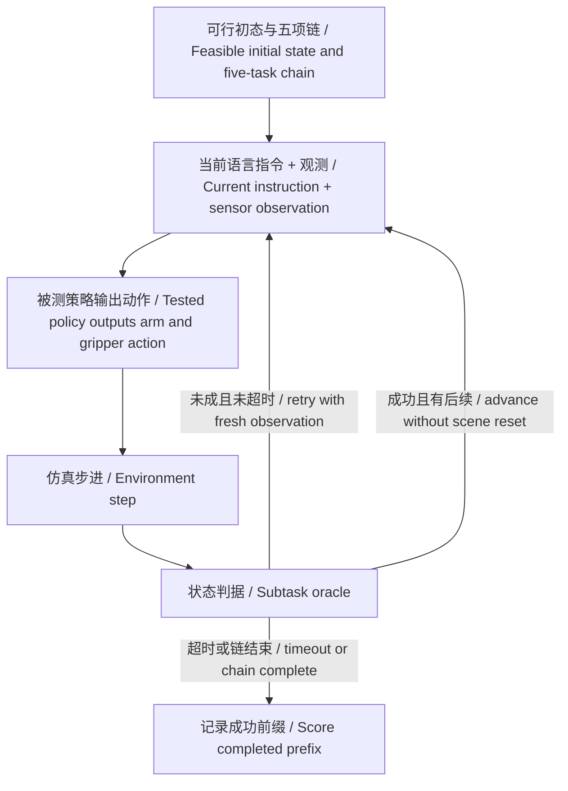
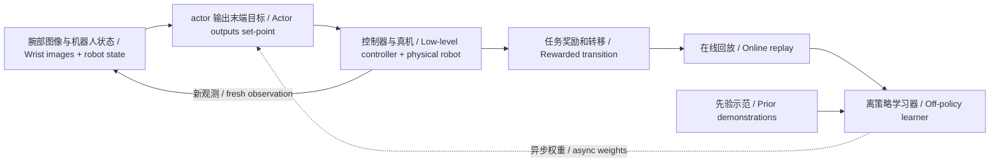
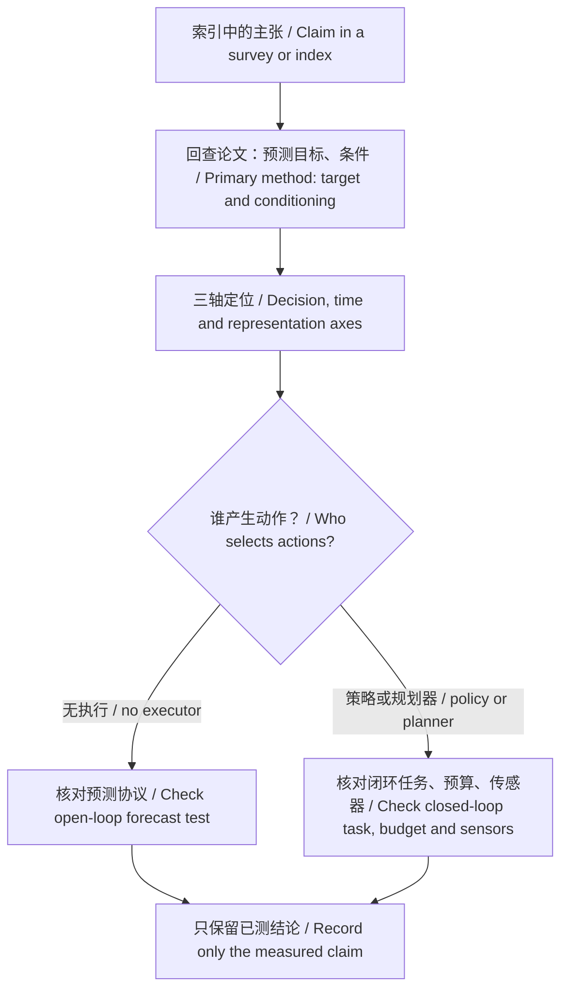

# 具身评测、在线学习与综述证据｜Embodied evaluation, online learning and survey evidence

[EAI-7 · 环境与评测](#eai-7) · [EAI-8 · 强化学习](#eai-8) · [SURVEY · 综述与索引](#survey) · [逐行证据 / Reading ledger](../data/reading-eai-c.json)

这 53 项资料回答三个不同的问题：**实验条件由谁生成？策略由什么信号改变？读者凭什么接受结论？** 例如，同一段机器人视频在 SIMPLER 中可用于视觉匹配，在 RoboReward 中是待评分的轨迹，而在综述中只是回查实验的线索。它本身并不是三个问题的答案。

**Scope.** The row numbers below are workbook **No.**, not worksheet offsets: 268–294 (27 environments and evaluations), 295–309 (15 learning systems), 310–320 (11 surveys and indexes). Paper links point to passages inspected; implementation links pin files to commits, not necessarily the exact training revision. A numerical result is attributed to its authors unless stated otherwise. `sections` means selected passages were read, `repo` means source or curation files were inspected; neither means a full-paper read or a reproduced run. No robot, simulator, training job or leaderboard submission was run for these notes. The two local lists are compared as repositories; the separate WAM PDF review is outside this chapter.

## EAI-7 · 环境不会自己出动作｜Who acts, and who grades?

**代表：CALVIN（#271）。** [§III-B/C、图 5/7](https://arxiv.org/html/2112.03227#S3) 从四个布局 A–D 中约 24 小时的遥操作 play 开始；只有一小部分交互被配上语言（论文设置为 1%）。这决定了**训练时**语言与动作的配对密度。**评测时**则从已知初态构造由 34 种子任务组成的可行五项链，过滤不可行、循环或相似的序列。比如“把物体放进抽屉”必须面对前一指令留下的真实抽屉状态，而不是重置后的演示起点。评测器知道当前任务的判据，但策略只读给定指令与选定传感器；不要把裁判的内部状态当作策略输入。

**Follow one rollout.** [§IV-A](https://arxiv.org/html/2112.03227#S4) uses MCIL as a baseline: a latent plan and goal condition an action decoder; the benchmark itself does not prescribe this model. The [sequence generator](https://github.com/mees/calvin/blob/fa03f01f19c65920e18cf37398a9ce859274af76/calvin_models/calvin_agent/evaluation/multistep_sequences.py) chooses feasible chains. In [`evaluate_sequence` → `rollout`](https://github.com/mees/calvin/blob/fa03f01f19c65920e18cf37398a9ce859274af76/calvin_models/calvin_agent/evaluation/evaluate_policy.py), `model.step(obs, lang_annotation)` supplies the action to `env.step(action)`. The task oracle compares start and current info for **this** subtask. The pinned script allows 360 steps per subtask; a new instruction is not a fresh scene. Feedback changes the *next observation and instruction*, not the policy weights.

**如何读成绩 / Reading the denominator.** Let \(L\) be the number of tasks completed before the first failure. Mean chain length in subtasks is the sum of the five prefix-success fractions, not the percentage of chains with \(L=5\). [Fig. 8 and §V](https://arxiv.org/html/2112.03227#S5) report that, even training and testing in the same environment, the best MCIL model completed the first subtask in 48.9% of chains but all five in only 0.08%. These are the paper's baseline figures, **not** the later ABC→D leaderboard. 先对齐相机、训练布局、测试布局和 chain 定义，才谈领先多少；单目标成功不测子目标之间的状态衔接。

**这 27 项怎样搭配？** #268–270、278–283 提供场景、物理或执行接口；#271–274 等在接口之上定义任务与裁判。#275 SIMPLER 反过来问“裁判是否可信”：用真实动作轨迹调控制响应，把仿真前景叠在真实背景上，最后才问不同策略在真机与仿真的排序是否一致。[图 2–4](https://arxiv.org/html/2405.05941#S3.F2) 把“画面像不像”与“相对强弱是否预测对”分开。#284、286 的实机实验绕开渲染误差，却引入操作者摆位、场地和比较采样的差异。For a calibration study choose paired sim/real evaluation; for compositional language choose a chain protocol; for throughput fix cameras, solver, hardware and environment count. None substitutes for the others.

### 逐行核证 / Row-by-row reading

|No. · 工作 / Work|所见与边界 / Finding and boundary|定位 / Evidence|
|---|---|---|
|268 · **AI2-THOR / ProcTHOR**|AI2-THOR 提供动作接口；ProcTHOR 改变房屋的采样分布。换测试场景是在测泛化，不是在测引擎帧率。 The Python client sends actions to Unity and receives rendered observations and scene metadata. ProcTHOR changes the distribution of interactive houses, not the action API; its ObjectNav transfer tests explicitly change the scene dataset.|§2.1–2.2, Figs. 2–3; ProcTHOR §§3–5 [Source](https://arxiv.org/html/1712.05474) · [`controller.py`](https://github.com/allenai/ai2thor/blob/24f79883b4889e3f0e6f4ae301808b9025872dfc/ai2thor/controller.py) · [ProcTHOR §3](https://arxiv.org/html/2206.06994#S3)|
|269 · **Habitat (1.0/2.0/3.0)**|从找点、搬物到与人协作，观测与任务都已改变；不能把三个版本拼成一条导航成绩曲线。 PointGoal reports both success and path-length-weighted success across sensor configurations on Gibson/MP3D. Later releases test rearrangement and human–robot social tasks respectively: those scores do not extend the original navigation curve.|§§3–5, Table 2; H2.0 §§4,6; H3.0 §§3–4 [Source](https://arxiv.org/html/1904.01201) · [`simulator.py`](https://github.com/facebookresearch/habitat-sim/blob/57ee4941dc4765240f0f91f70b2c97a919bf9038/src_python/habitat_sim/simulator.py) · [H2.0 §4](https://arxiv.org/html/2106.14405#S4) · [H3.0 §4](https://arxiv.org/html/2310.13724#S4)|
|270 · **Isaac Gym → Orbit → Isaac Lab**|Gym 把状态留在 GPU；Orbit 抽象机器人与环境；Lab 把 USD 场景映射到批量物理状态。无头吞吐不等于真机学习效率。 PhysX state buffers in Gym, Orbit’s agent/world interfaces, and Lab’s USD scene graph plus batched physics views solve different integration problems. Lab measures headless throughput with specified GPUs and sensors, not task success per real hour.|§2, Figs. 2–3; §4.1; Gym §3; Orbit §III [Source](https://arxiv.org/html/2511.04831) · [`manager_based_rl_env.py`](https://github.com/isaac-sim/IsaacLab/blob/99a3acd776f47fbcece4413f3c1d63f02b6979e2/source/isaaclab/isaaclab/envs/manager_based_rl_env.py) · [Gym §3](https://arxiv.org/html/2108.10470#S3) · [Orbit §III](https://arxiv.org/html/2301.04195#S3)|
|271 · **CALVIN**|五步指令链中途不重置场景；第一步失败会截断所有后缀。单项成功率、链长、五项全成都不能互换。 Given a valid chain, the evaluator issues the next instruction only after a state-based oracle accepts the current subtask. Prefix length, first-task success and five-task success measure different events or use different units; sensor suite and training scenes matter.|§III-B/C, Figs. 5,7–8; §V [Source](https://arxiv.org/html/2112.03227) · [`evaluate_policy.py`](https://github.com/mees/calvin/blob/fa03f01f19c65920e18cf37398a9ce859274af76/calvin_models/calvin_agent/evaluation/evaluate_policy.py)|
|272 · **OmniGibson / BEHAVIOR-1K**|活动描述、物理与启发式状态、视觉逼真度问卷、策略实验各有对象；覆盖千项定义不等于千项都已解决。 BDDL initial and goal conditions turn activities into executable tasks. Some non-kinematic states (e.g. temperature) evolve by heuristics. The realism rating comes from human rankings of images; the agent experiments select three activities, not 1,000 policy rollouts per method.|§§4–6.1, Figs. 2–3 [Source](https://arxiv.org/html/2403.09227) · [`behavior_task.py`](https://github.com/StanfordVL/BEHAVIOR-1K/blob/30880c2c6b6160aee5bc43478f6fd00652749251/OmniGibson/omnigibson/tasks/behavior_task.py)|
|273 · **LIBERO**|固定策略骨干后，顺序学习在前向迁移上反而领先；只看最后一个任务的成功率会漏掉遗忘。 Task suites vary spatial relations, objects and goals; Table 2 fixes ResNet-T to compare lifelong algorithms. Plain sequential learning leads on forward transfer in the reported suites, which is not the same as retaining old skills.|§§4–5.2, Figs. 2–3, Tables 1–2 [Source](https://arxiv.org/html/2306.03310) · [`libero_suite_task_map.py`](https://github.com/Lifelong-Robot-Learning/LIBERO/blob/8f1084e3132a39270c3a13ebe37270a43ece2a01/libero/libero/benchmark/libero_suite_task_map.py)|
|274 · **HumanoidBench**|同一人形本体既要稳住身体又要操纵物体；四种 RL 基线的比较发生在仿真中。 A dexterous humanoid must coordinate hands and whole body across locomotion and manipulation. DreamerV3, TD-MPC2, SAC and PPO are evaluated in the simulator: comparing algorithms here is not evidence of a deployable hand controller.|§§III–V, especially V-A [Source](https://arxiv.org/html/2403.10506) · [`env.py`](https://github.com/carlosferrazza/humanoid-bench/blob/cb1189039151c8aadaaa987b442da54383c87fab/humanoid_bench/env.py)|
|275 · **SimplerEnv**|先校准控制与画面，再用成对真机实验验证策略排序；拟合相对强弱不等于还原绝对成功率。 SysID aligns open-loop arm motion; visual matching overlays simulated foregrounds on real backgrounds and matches textures. Paired real/sim tests report Pearson r and maximum rank violations averaged over policies (MMRV), so high correlation need not mean calibrated absolute success.|§§III-B,IV,VI-A, Figs. 2–4 [Source](https://arxiv.org/html/2405.05941) · [`maniskill2_evaluator.py`](https://github.com/simpler-env/SimplerEnv/blob/eddb5690749a1e34267807c0f7b5eede323918d7/simpler_env/evaluation/maniskill2_evaluator.py)|
|276 · **RoboCasa**|炉灶旋钮不仅改变角度，也改变燃烧器状态；原版用此类交互构造百项任务，并区分人工与合成示范。 Articulated kitchen fixtures also have semantic state changes (turning the knob activates the burner). The original 100-task study compares human demonstrations with MimicGen trajectories; it is not the later 365-task benchmark.|§§III–V, Fig. 3 [Source](https://arxiv.org/html/2406.02523) · [`scene_builder.py`](https://github.com/robocasa/robocasa/blob/7bfc60c9d26c02506d4265cbe0e86b35e6e25d42/robocasa/models/scenes/scene_builder.py)|
|277 · **GRUtopia / InternUtopia**|居民的知识来自场景标注和仿真后端；语言规划器可查询它，但回答正确还不等于导航或操作成功。 GRResidents separates a manager of simulator/annotation knowledge from an LLM dialogue planner. Object navigation, social navigation and loco-manipulation require different uses of that knowledge; dialogue success alone is not embodied success.|§§3–4, Figs. 3,5 [Source](https://arxiv.org/html/2407.10943) · [`gym_env.py`](https://github.com/Sage-PhysicalAI/InternUtopia/blob/b0a9520c586317c2743023c153cbf7c4f04f4732/internutopia/core/gym_env.py)|
|278 · **ManiSkill3**|须注明相机、几何与显存；用 GPU 加速一个软体场景，和并行数百个刚体环境不是同一指标。 Cartpole throughput includes RGB rendering and varies with cameras and GPU memory. The limitations explicitly distinguish batched rigid environments from soft-body scenes that can use the GPU to accelerate a single environment.|§III, Figs. 2–3; §V [Source](https://arxiv.org/html/2410.00425) · [`sapien_env.py`](https://github.com/mani-skill/ManiSkill/blob/62ff3a5896b4d5b4cf0ac4c8d79afe600c9404a3/mani_skill/envs/sapien_env.py)|
|279 · **Genesis (Genesis World)**|可追踪的是求解器与耦合器的步进；代码存在不足以证明所有物理分支可微，更不能证明生成场景有效。 The simulator orchestrates solver and coupling work across substeps. Read as a multiphysics implementation, not as evidence that a generative model produces valid scenes or that all solvers share the same gradient support. No matched policy evaluation reproduced. The supplied blog URL did not expose its article body in the retrieved HTML.|genesis/engine/simulator.py, Simulator build and step; engine solvers [Source file](https://github.com/Genesis-Embodied-AI/genesis-world/blob/2eaa40c6efe8dceb9e44289d4a364075546c9edd/genesis/engine/simulator.py) · [README](https://github.com/Genesis-Embodied-AI/genesis-world/blob/2eaa40c6efe8dceb9e44289d4a364075546c9edd/README.md) · [workbook release page (article text unavailable in retrieved HTML)](https://www.genesis.ai/blog/the-role-of-simulation-in-scalable-robotics-genesis-world-10-and-the-path-forward)|
|280 · **VLABench**|拿铁任务隐含加奶，且需串联多种技能；单次抓取无法测出语义推断和长程执行两种失败。 The 60 primitive and 40 composite tasks probe different demands. In the latte example the agent must infer milk as an implicit goal and sequence skills; scoring an isolated pick misses both problems.|§§3.1,4; Figs. 2–3 [Source](https://arxiv.org/html/2412.18194) · [`evaluate_policy.py`](https://github.com/OpenMOSS/VLABench/blob/cf588fe60c0c7282174fe979f5913170cfe69017/scripts/evaluate_policy.py)|
|281 · **MuJoCo / MJX / MuJoCo Playground**|批量渲染与物理步进可一起编译；潜在接触对会带来静态开销。论文实现用仓库中的 RSS 2025 快照定位。 The paper connects MJX to Madrona through JAX primitives for batched vision and visual randomization. Static shapes can make contact cost scale with possible rather than active contacts. The RSS 2025 source is distinct from current tasks.|§III, §IV, Fig. 4; §VI [Source](https://arxiv.org/html/2502.08844) · [`mjx_env.py`](https://github.com/google-deepmind/mujoco_playground/blob/d7bfcbb1dcfd9665278768c55740271146c69f3e/rss2025/mujoco_playground/_src/mjx_env.py)|
|282 · **Newton**|建模器装配几何和关节，求解器推进状态；框架没有替具体任务定义奖励。 A model builder assembles bodies, joints and shapes into a simulation model; a solver advances state. Warp and solver extensibility describe an engine interface, not a task definition, reward or comparable policy score.|newton/_src/sim/builder.py, ModelBuilder; announcement: Introducing Newton [Source file](https://github.com/newton-physics/newton/blob/959a3d51612c9a670c32adb59113163e3928c4cf/newton/_src/sim/builder.py) · [README](https://github.com/newton-physics/newton/blob/959a3d51612c9a670c32adb59113163e3928c4cf/README.md) · [Newton announcement](https://developer.nvidia.com/blog/announcing-newton-an-open-source-physics-engine-for-robotics-simulation/#introducing_newton)|
|283 · **RoboVerse (MetaSim)**|统一配置和 step 接口便于换引擎，不保证接触动力学一致。旧仓 README 已注明迁移。 Nested configuration describes the scene; a handler implements backend-specific operations behind a Gym interface. A common call signature does not ensure identical contacts. The workbook repository now points development to packages/metasim in the RoboVerse monorepo.|§III, Figs. 3–4, Code 1; §VII [Source](https://arxiv.org/html/2504.18904) · [`base.py`](https://github.com/RoboVerseOrg/MetaSim/blob/560d7ba07c1a036332b12b58f7f0e7f0f64dce32/metasim/sim/base.py)|
|284 · **RoboArena**|同场景成对比较可减少场景难度的干扰；真机偏好名次不是固定任务表的成功率。论文的本体范围是 DROID。 Distributed evaluators run pairwise comparisons across real scenes; rankings aggregate comparisons rather than a fixed suite’s binary pass rate. Experiments are on DROID, not a demonstration of cross-embodiment ranking.|§§3.1,4–5,7; Algorithm 1 [Source](https://arxiv.org/html/2506.18123)|
|285 · **RoboTwin 2.0**|仿真反馈先用于修专家程序，程序再造示范；程序能跑通与后续策略能泛化是两个实验。 A multimodal model writes expert programs against a skill API and revises them using simulation feedback; successful programs produce randomized demonstrations. Code-generation success over repeated executions and learned-policy generalization are separate tests.|§§2–4.1, Figs. 2–4 [Source](https://arxiv.org/html/2506.18088) · [`_base_task.py`](https://github.com/RoboTwin-Platform/RoboTwin/blob/ea8b21121ebb3cd201ff5b3fe361944ac94eda3f/envs/_base_task.py)|
|286 · **RoboChallenge**|测试者若反复选“甜点”摆位就能抬高成功率；先对齐复位方式以及一模多任务或逐任务协议。 A tester can move props to a policy’s sweet spot and inflate success. Table30 separates task-specific and generalist submissions; matching reset procedures and which policy covers which tasks is essential for comparison.|§§2–4, Figs. 3–4,9 [Source](https://arxiv.org/html/2510.17950)|
|287 · **BEHAVIOR Challenge 2025**|2025 年规则单列机载观测与特权信息赛道；满足的目标谓词可获部分分。不能用现行 2026 首页替代。 The 2025 rules separate onboard-observation and privileged tracks; ranking averages over 50 tasks and awards partial credit by the fraction of satisfied BDDL goal predicates. The workbook’s unversioned landing page now describes 2026.|2025 archive: Evaluation & Rules → Challenge Tracks / Evaluation Metrics [Source](https://behavior.stanford.edu/challenge/archive/2025/index.html#evaluation-metrics) · [`evaluation.md`](https://github.com/StanfordVL/BEHAVIOR-1K/blob/30880c2c6b6160aee5bc43478f6fd00652749251/docs/challenge/archive/2025/evaluation.md)|
|288 · **Isaac Lab-Arena**|组装环境后并行评估；报道的提速条件是同构环境、参数变化、八张 GPU，而不是策略更强。 The environment builder combines task, embodiment and scene components. The vendor timing uses GR00T N1.5 on ten RoboCasa tasks with 4,096 homogeneous environment variations per task on eight GPUs: a throughput comparison, not evidence of better policy quality.|isaaclab_arena/environments/arena_env_builder.py; announcement: Rapid policy evaluation results [Source file](https://github.com/isaac-sim/IsaacLab-Arena/blob/49aacb0dd13603bc90fd1c3dace26c7ae5790904/isaaclab_arena/environments/arena_env_builder.py) · [README](https://github.com/isaac-sim/IsaacLab-Arena/blob/49aacb0dd13603bc90fd1c3dace26c7ae5790904/README.md) · [timing conditions](https://developer.nvidia.com/blog/simplify-generalist-robot-policy-evaluation-in-simulation-with-nvidia-isaac-lab-arena/#rapid_policy_evaluation_results)|
|289 · **MolmoSpaces**|先筛可动资产和可解试次，再测导航、抓放、开关等任务。可解性筛查不是策略成绩。 MolmoSpaces-Bench selects solvable trials for eight base tasks; its asset pipeline validates colliders and articulation rather than treating proximity as a grasp. Trial solvability is a prerequisite, not a guarantee for the tested policy.|§§3–4.1, Fig. 8; Ai2 release: High-fidelity physics [Source](https://arxiv.org/html/2602.11337) · [`task.py`](https://github.com/allenai/molmospaces/blob/67acef9a17bb8212a18aadfc8f62ff6171d84891/molmo_spaces/tasks/task.py) · [asset validation](https://allenai.org/blog/molmospaces)|
|290 · **RoboCasa365**|同属 365 套件也须区分预训练迁移、终身学习及评估时限；版本更新曾将时限放宽 1.5 倍。 The 365-task release separates multitask training, pretraining transfer and lifelong settings. The project subsequently increased evaluation horizons by 1.5×; compare results under the same horizon rather than treating the suite name as a protocol.|§§3–4; RoboCasa release notes for v1.0.1 [Source](https://arxiv.org/html/2603.04356) · [`kitchen_drawer.py`](https://github.com/robocasa/robocasa/blob/7bfc60c9d26c02506d4265cbe0e86b35e6e25d42/robocasa/environments/kitchen/atomic/kitchen_drawer.py) · [release notes](https://robocasa.ai/)|
|291 · **WorldArena (1.0 / 2.0)**|视频质量、策略排序、闭环规划不能互作替代指标；2.0 再引入视触觉与真机试验，但少量试次不是部署认证。 v1 separates 16 perceptual metrics from utility as data generator, policy evaluator or planner on RoboTwin-based tests. v2 adds visuotactile tests and physical evaluations; its small physical trial counts and fixed-seed RL protocol limit extrapolation.|v1 §§3–4.1; v2 §3.1, Fig. 2, §5 [Source](https://arxiv.org/html/2602.08971) · [`calculate_policy_pearson_r.py`](https://github.com/tsinghua-fib-lab/WorldArena/blob/2da2ae253b8637ba9de3afc7bea4e087f778ee4d/embodied_task/policy_eval_release_bundle/calculate_policy_pearson_r.py) · [v2 §3.1](https://arxiv.org/html/2605.17912v2#S3.SS1)|
|292 · **RoboLab**|动了手臂不代表作用到了物体；论文限定 DROID 策略和刚体桌面任务，不能外推到布料或力控。 The bowl-in-bin example distinguishes actual grasp-and-deposit from arm motion with no object interaction. The comparison uses DROID-finetuned policies; rigid tabletop scenes underrepresent deformable and fine force-controlled tasks.|§III, Fig. 5; §§IV-A,V [Source](https://arxiv.org/html/2604.09860) · [`task.py`](https://github.com/NVlabs/RoboLab/blob/dc3383888b7279b4256312268a35a5f9046c44d3/robolab/core/task/task.py)|
|293 · **Isaac Lab 3.0 (Newton backend)**|3.0 增加 Newton 后端；报道比较同时更换版本和后端，不能把最高吞吐差异全归于求解器。 Lab 3.0 exposes a Newton backend alongside PhysX. NVIDIA’s up-to-2.5× comparison changes both the Lab version and backend for a vision-based dexterity workload; it does not isolate a universal solver speedup.|source/isaaclab_newton/isaaclab_newton/physics/newton_manager.py; CoRL announcement: Where the Training and Scaling Happens [Source file](https://github.com/isaac-sim/IsaacLab/blob/99a3acd776f47fbcece4413f3c1d63f02b6979e2/source/isaaclab_newton/isaaclab_newton/physics/newton_manager.py) · [README](https://github.com/isaac-sim/IsaacLab/blob/99a3acd776f47fbcece4413f3c1d63f02b6979e2/README.md) · [Lab 3.0 announcement](https://blogs.nvidia.com/blog/robotics-simulation-advancements-corl/)|
|294 · **DexBench & VABAR**|VABAR 用可控变化诊断失效，两个后端的资产和外观也有差别；DexBench 的 15 项、四场景来自发布说明，不是二者横评。 VABAR varies task instances over six industrial tasks and studies success, cycle time and failure modes. Its Newton and Arena implementations differ in assets and appearance. DexBench is a separate 15-task/four-scene release; its scope here comes from the announcement, not a matched head-to-head evaluation. The Arena gear-mesh predicate checks released, seated rotation rather than mere proximity.|VABAR §§IV,VII-A; CoRL announcement: New Industrial Benchmarks [Source](https://arxiv.org/html/2611.06881) · [DexBench / CoRL release](https://blogs.nvidia.com/blog/robotics-simulation-advancements-corl/) · [DexBench publisher](https://www.rlwrld.ai/en/news/117) · [VABAR gear_mesh_success](https://github.com/BerkeleyAutomation/VABAR/blob/cc9e2d37a9088eba93c8a75e0da857563737b930/isaaclab_arena/isaaclab_arena_vabar/src/isaaclab_arena_vabar/tasks/gear_insertion/terminations.py)|

## EAI-8 · 谁产生下一条经验？｜Where does the next transition come from?

**代表：SERL（#295），而非泛称的“VLA + RL”。** [§4.1–4.5、图 2/4](https://arxiv.org/html/2401.16013#S4) 将三件事拆开：actor 从当前观测产生末端目标，底层控制器在真机上跟踪目标；奖励来自任务规则或图像分类器；learner 用先验数据与在线回放各半的样本更新 actor–critic。多个梯度步不对应多个机器人动作。分类器看错和控制器没执行到位是两种完全不同的失败。对可逆的搬运任务，可以让相反方向的策略把物体搬回来；这不等于 PCB、理线等任务都自动复位。

**Implementation boundary.** In the [pinned cable-routing example](https://github.com/rail-berkeley/serl/blob/1fa2af7496be042e43d36120a7c8d1b71f1bfb59/examples/async_cable_route_drq/async_drq_randomized.py), `actor` steps the robot environment and `learner` draws from both `replay_buffer` and `demo_buffer`. A parameter update returns to the acting process without forcing real-time control to wait for every gradient. The later [HIL-SERL §3.4 / Fig. 3](https://arxiv.org/html/2410.21845#S3.F3) lets a human replace a poor action during exploration and retain the correction as experience. A seed demonstration in SERL and a corrective intervention on the current policy’s state distribution are not interchangeable supervision.

**Evidence.** [§5, Figs. 6–7](https://arxiv.org/html/2401.16013#S5) compare PCB insertion, cable routing and object relocation on a Franka with wrist cameras. RL starts from 20 demonstrations per task plus subsequent robot time; BC gets 100 high-quality demonstrations. The authors report 100/100 successes per RL task and also measure time to completion. This separates reliable completion from simply moving slowly. It does **not** establish identical human/reset costs, or transfer to arbitrary objects. 这里受检验的是指定初态范围、硬件和任务中的成功率及周期时间，不是任意真机上的通用能力。

**对照读法。** #296 把 critic 的偏好蒸馏成监督动作目标；#301 只修正冻结策略的残差；#309 则压缩冻结 VLA 的表征，再在线优化轻量动作网络。#305–306 与 SERL 的分界不是有没有 RL，而是谁回答“执行后看到了什么”：前者的训练轨迹可以由预测器生成。#308 又是另一类：给定视频与指令输出进度分，不替机器人选择动作。When comparing gains, record interaction source (hardware, simulator, or learned model), reward source, which parameters changed, and the independent environment used for testing. A high critic score, a long imagined rollout and a successful physical episode are three different observations.

### 逐行核证 / Row-by-row reading

|No. · 工作 / Work|所见与边界 / Finding and boundary|定位 / Evidence|
|---|---|---|
|295 · **SERL / HIL-SERL**|真机与学习器异步，先验示范和在线回放混采。SERL 的初始示范不等于 HIL-SERL 中途接管。 The actor acts while an off-policy learner mixes equal-sized prior and online replay samples. SERL compares 20 demonstrations plus robot interaction against BC on 100 demos; HIL-SERL separately incorporates operator corrections during exploration.|SERL §§4.1–4.4, Fig. 2, §5 Figs. 6–7; HIL-SERL §3.4, Fig. 3 [Source](https://arxiv.org/html/2401.16013) · [`async_drq_randomized.py`](https://github.com/rail-berkeley/serl/blob/1fa2af7496be042e43d36120a7c8d1b71f1bfb59/examples/async_cable_route_drq/async_drq_randomized.py) · [HIL-SERL §3.4](https://arxiv.org/html/2410.21845#S3.SS4)|
|296 · **PA-RL**|梯度先改候选动作，再把优化结果教给策略；离线初值与额外交互千幕后表现必须分开。 The critic ranks candidate actions and refines them by gradient ascent in action space; supervised fitting distils the target back into the actor. The table separates offline results from results after 1,000 online episodes.|Fig. 2, Algorithm 1; §5 Table 1 [Source](https://arxiv.org/html/2412.06685)|
|297 · **iRe-VLA**|探索时冻主干，监督阶段再更新；已探索任务的进步不能算作未见任务迁移。 The VLM is frozen during exploration while the action head learns; supervised updates then unfreeze it. Experiments separate demonstration, online-training and held-out tasks, so improvement on an explored task is not zero-shot transfer.|§IV, Fig. 2, Algorithm 1; §V Fig. 4 [Source](https://arxiv.org/html/2501.16664)|
|298 · **ConRFT**|两阶段共享一致性策略目标；比较在线结果时，还要看各自从哪一个离线检查点开始。 Cal-ConRFT starts from demonstrations; HIL-ConRFT adds real interaction and teleoperated interventions with a consistency-policy objective balancing Q and imitation. Table I's online methods do not all start from the same offline checkpoint.|§IV, Figs. 1–2; Table I; §VI-A [Source](https://arxiv.org/html/2502.05450) · [`train_conrft_octo.py`](https://github.com/cccedric/conrft/blob/a779fde7fa5db5a469960a8490c100f35b41b49e/examples/train_conrft_octo.py)|
|299 · **RL4VLA**|区分画面、语义、执行三类扰动；纠正失手不等于读懂新的指代。 DPO, GRPO and PPO supply different update signals. The pick-and-place generalization study separates visual changes, semantic changes and execution shifts; a policy recovering from an imperfect grasp is not necessarily better at unseen instruction semantics.|§§4–5.1, Figs. 3,9 [Source](https://arxiv.org/html/2505.19789)|
|300 · **VLA-RL**|策略负责采样，价值模型与冻结的过程奖励模型提供学习信号；四个 LIBERO 子集是限定域内实验。 The transformer policy samples actions in vectorized environments while a separate value model and frozen process reward model guide updates. LIBERO’s four suites test manipulation, not arbitrary physical deployment.|§3, Fig. 2; §4 Fig. 3 [Source](https://arxiv.org/html/2505.18719)|
|301 · **ResFiT**|固定模仿策略，只学受限的修正动作；约两百倍的步数比较针对仿真 BoxCleanup，并非普适加速。 ResFiT freezes the cloned base and fits a bounded residual with off-policy RL on demonstrations and interaction. The roughly 200× step comparison with PPO is for simulated BoxCleanup, not a universal speed ratio.|§III Fig. 1, Algorithm 1; §V-A Fig. 3 [Source](https://arxiv.org/html/2509.19301)|
|302 · **RLinf-VLA / πRL**|πRL 改的是流策略探索与优化；RLinf 解决的是学习器、采样器等的执行调度，不应当成同一算法。 πRL makes flow denoising stochastic for online optimization (learned noise or an SDE); the learned-noise route drops that network at inference. RLinf’s macro-to-micro execution system is infrastructure, not the policy update rule. RLinf-VLA Table I compares agent/algorithm variants by benchmark.|πRL §§4.1–4.2, Figs. 2–3, §5.1; RLinf §3 Fig. 4 [Source](https://arxiv.org/html/2510.25889) · [`pi0.py`](https://github.com/RLinf/RLinf/blob/d7c4b65602bea8a32d56789e7d46a1e428ec89f5/rlinf/models/embodiment/openpi/pi0.py) · [RLinf systems paper](https://arxiv.org/html/2509.15965#S3) · [RLinf-VLA §V, Table I](https://arxiv.org/html/2510.06710#S5.T1)|
|303 · **SimpleVLA-RL**|采样器需要与环境轮流推进而非一次生成整段文本；温度、裁剪和各基准的动作块数都会改变结果。 A veRL rollout now alternates policy sampling with parallel environment steps rather than generating a complete text response. Dynamic sampling, temperature and asymmetric clipping affect the outcome-reward update; action chunk counts vary by benchmark.|§§3–4, rollout pseudocode, Fig. 4 [Source](https://arxiv.org/html/2509.09674) · [`ray_trainer.py`](https://github.com/PRIME-RL/SimpleVLA-RL/blob/7c51662df27b586f9e8a1ab35fcf849f2b8852f9/verl/trainer/ppo/ray_trainer.py)|
|304 · **VLAC**|动作、奖励 token 与价值头作用不同；评价评论器的 F1 不是真机任务成功率。 The forward pass emits structured action and reward tokens; a separate value head estimates state value for PPO. Critic F1 is measured as its own prediction problem and should not be read as the robot’s success rate.|§3 Fig. 3; §4.4 Fig. 4 [Source](https://arxiv.org/html/2509.15937)|
|305 · **World-Env**|动作来自 VLA，想象观测来自世界模型，反馈来自反思器；应以独立的 LIBERO 执行检验，而非直接采信想象回报。 World-Env trains a transition model on demos plus self-exploration. During imagined interaction the VLA proposes actions, the simulator predicts observations, and an Instant Reflector supplies feedback; comparisons use five demonstrations per task on LIBERO.|§4 Figs. 3–4; §5.1 Table 1 [Source](https://arxiv.org/html/2509.24948)|
|306 · **VLA-RFT**|“可验证”主要指与示范的相似度可算，并非有外部物理判据；像素分数不证明超越专家。 A VLA’s action chunks drive an action-conditioned video simulator. Its verified reward is largely similarity to expert trajectories, not an independent physical goal predicate; frame reconstruction metrics cannot certify improvement beyond the expert.|§3 Fig. 2, Algorithm 1; §4 Table 1; §5 [Source](https://arxiv.org/html/2510.00406)|
|307 · **π*0.6 (RECAP)**|价值函数给经验打优势标签，再据标签学习动作；在分钟级多阶段任务里，还要区分完成与完成速度。 RECAP estimates value with a separate VLM-based network and conditions action learning on a binarized advantage label. Evaluation includes multistage espresso, laundry and box tasks where throughput as well as completion matters.|§IV Figs. 3–4; §VI [Source](https://arxiv.org/html/2511.14759)|
|308 · **RoboReward**|同一视频换指令即可构造部分成功样本；测的是终局进度预测误差，而不是策略回报。 Counterfactual instructions turn a successful video into partial or failed task-video pairs. RoboRewardBench asks for discrete end-of-episode progress (1–5) and reports MAE, not a policy’s return or success.|§3 Fig. 2; §4 Fig. 4; §5.1 Table 1 [Source](https://arxiv.org/html/2601.00675)|
|309 · **RLT (RL Token)**|只读压缩出的 RL 状态，再用小型 actor–critic 修动作块；本就会做的任务也可能只在吞吐上改善。 A reconstruction objective compresses frozen VLA features into an RL token. A lightweight online actor/critic refines action chunks using the token and proprioception. The Ethernet example improves throughput without needing a success-rate jump.|§IV-A/B Fig. 2, Algorithm 1; §VI Figs. 4–5 [Source](https://arxiv.org/html/2604.23073)|

## SURVEY · 分类不是测试｜A taxonomy is not an evaluation

**代表：Li 等（#316）。** [图 1 与 §III](https://arxiv.org/html/2510.16732#S3) 的三轴可以写成三个问题，而非三个互斥“流派”：动力学为某个控制目标服务还是面向通用预测？未来是依序展开还是整体预测？状态是一个向量、一串 token、空间网格，还是可渲染的分解表示？例如，同样是空间网格，若接口只给预测占用，就不能据此假设存在选动作的控制器；逐步展开也只是**允许**闭环，不等于实验中真的重新观测过。

**Walk a claim back to its test.** [§V-B/C, Tables V–VII](https://arxiv.org/html/2510.16732#S5) are deliberately separate. On Occ3D-nuScenes, two seconds of past occupancy condition a three-second forecast; horizon IoU is about spatial prediction. DMC return sums rewards over 1,000 control steps, and the table flags entries approximated from curves. RLBench success is a fraction of trials reaching a goal within the limit, with modality, resolution and episode budget differences. Before saying *this model acts better*, find the controller and matched control test. If only the occupancy row exists, report a forecast result. This is a reader's workflow, not an invented “survey architecture.”

### 两个本地快照：同名条目如何核证？｜Two repositories, two kinds of provenance

|本地检出 / origin|维护对象 / unit of curation|如何使用 / what to verify|
|---|---|---|
|[Li-Zn-H/AwesomeWorldModels · `19c44f6`](https://github.com/Li-Zn-H/AwesomeWorldModels/blob/19c44f619a1b4d823ae1c7578049b519124434da/README.md) · 2026-11-15|李等综述配套的 README 与中英文幻灯片。README 按决策耦合 × 时间推理 × 空间表示分组，年份和领域图标帮助检索；图标非排他。|Use the pinned grouping to locate a prediction interface, then check the underlying paper. [Issue #3](https://github.com/Li-Zn-H/AwesomeWorldModels/issues/3) asked where language reasoning and an explicit training-time view graph belong. The maintainer placed both under *Decision-Coupled / Sequential / Token Feature Sequence*: a training scaffold does not automatically become the inference-time state.|
|[OpenMOSS/Awesome-WAM · `aa6cd05`](https://github.com/OpenMOSS/Awesome-WAM/blob/aa6cd0508a089e7556dd2fa0347e847c91ca986b/README.md) · 2026-09-06|Wang 等工作配套仓库；README 另按级联/联合 WAM、用于模仿/强化/评测的世界模型分类，并提供逐篇导读与带出处的排行榜。|Use it to ask where future prediction enters action learning or evaluation. [Issue #3](https://github.com/OpenMOSS/Awesome-WAM/issues/3) reports a disputed explicit/implicit placement for mimic-video; it is closed, with no issue comments establishing which revision corrected the tree. [Issue #4](https://github.com/OpenMOSS/Awesome-WAM/issues/4) identifies the linked reading-blog generation skill. A generated report is a pointer, not the reporting paper.|

**可核对的分歧。** 同一 ST-WAM 提议在 [Li 列表 #4](https://github.com/Li-Zn-H/AwesomeWorldModels/issues/4) 已关闭，固定 README 可找到条目；[WAM 列表 #114](https://github.com/OpenMOSS/Awesome-WAM/issues/114) 在本次检查时仍开放。前者表明实际收录，后者只是待处理建议；不能拿 issue 作者粘贴的分数当两份独立证据，也不能把未收录当作论文不重要。Both local checkouts had clean tracked state at inspection. Issue links are live discussions; the README and data links here pin the inspected revisions.

**One score, traced through both sorts of evidence.** The WAM [benchmark schema](https://github.com/OpenMOSS/Awesome-WAM/blob/aa6cd0508a089e7556dd2fa0347e847c91ca986b/leaderboard/data/benchmarks.json) names the CALVIN metric `avg_len`, in **subtasks**. A [result record](https://github.com/OpenMOSS/Awesome-WAM/blob/aa6cd0508a089e7556dd2fa0347e847c91ca986b/leaderboard/data/leaderboard.json) distinguishes `model_paper`, `reported_paper`, `reported_table` and `curated_by`. Following the reporting link to [GHIL-Glue, Table I](https://arxiv.org/html/2410.20018#S5.T1) shows **2.94 for its SuSIE baseline**, not 2.94 for GHIL-Glue (SuSIE), whose row reads 3.69. The five SuSIE prefix fractions sum to 2.939; the tabulated mean rounds to 2.94. The caption specifies held-out D and four seeds. 这是从策展记录回到原始表格的交叉核验，不是重新跑了四个种子；如把模型原论文、报告论文、评测协议合并成一个“来源”，连这两行都容易读反。

### 逐行核证 / Row-by-row reading

|No. · 工作 / Work|所见与边界 / Finding and boundary|定位 / Evidence|
|---|---|---|
|310 · **Awesome-World-Models (leofan90)**|候选、提交 PR、合并入表是三件事；目录按主题找线索，不据收录推断实验复现。 This robotics index separates datasets/evaluations from methods and has a candidate-to-PR workflow. A discovered or proposed paper is not independent replication, nor is it necessarily a merged entry.|README sections: Datasets & Benchmarks, World Models for VLA; docs/arxiv-pipeline.md [Source file](https://github.com/leofan90/Awesome-World-Models/blob/85302a4d286fb7e98b3f7db2e116a95aa5c9fe3d/docs/arxiv-pipeline.md) · [README](https://github.com/leofan90/Awesome-World-Models/blob/85302a4d286fb7e98b3f7db2e116a95aa5c9fe3d/README.md)|
|311 · **VLA Survey (Ma et al.)**|任务规划器写子指令，低层策略才执行；读完结构图还要查数据与评测里谁真正动了。 The survey treats task decomposition separately from low-level action prediction: a planner emits sub-instructions that condition a control policy. Its dataset/benchmark section is needed to identify what actually executed.|Fig. 1, §III, §IV and §V [Source](https://arxiv.org/html/2405.14093) · [`README.md`](https://github.com/yueen-ma/Awesome-VLA/blob/5cf12ccf827b425c0750ca7d807faeb4f9c4d631/README.md)|
|312 · **Aligning Cyber Space with Physical World**|脑、身体、跨模态传感器共同构成闭环；有仿真器不等于已证明策略迁移成功。 The AI brain/body/cross-modal sensor framing places the world model in a larger embodied loop. Its sim-to-real discussion concerns validating transferred behavior; having a simulator is not itself a transfer result.|Fig. 1, §§III,VII [Source](https://arxiv.org/html/2407.06886) · [`README.md`](https://github.com/HCPLab-SYSU/Embodied_AI_Paper_List/blob/8e93900e6786f83d79a01ed091a0081e45f2dd96/README.md)|
|313 · **Understanding World or Predicting Future?**|隐式知识与显式未来画面是两条线；能据表示决策的系统不一定出视频，出视频的也未必出动作。 The survey distinguishes learning implicit world knowledge from producing explicit future scenarios. A representation supporting a decision need not render a forecast video; a forecast alone says little about who selects actions.|§2 Fig. 2; §§3–4.1 [Source](https://arxiv.org/html/2411.14499) · [`README.md`](https://github.com/tsinghua-fib-lab/World-Model/blob/53d7623b4394e51a24d577dccc33508f47139952/README.md)|
|314 · **Embodied-AI-Guide (具身智能技术指南)**|指南适合按背景选学习路径；RoboTwin 演练指向原项目，不能代作基准的实验依据。 The Chinese guide routes newcomers by background into a RoboTwin practice sequence and separate algorithm, control, infrastructure and hardware notes. It is a learning path, not the source of RoboTwin benchmark results.|README: Start From Here / hands-on RoboTwin sequence; topics/control.md [Source file](https://github.com/TianxingChen/Embodied-AI-Guide/blob/236f5fb35ca7058a0ff842046a6b11cfd521b7b5/topics/control.md) · [README](https://github.com/TianxingChen/Embodied-AI-Guide/blob/236f5fb35ca7058a0ff842046a6b11cfd521b7b5/README.md)|
|315 · **VLA Survey: Action Tokenization Perspective**|文中 token 是模块间传递的行动信息，未必是离散电机指令；解读时要补出它到可执行控制之间的转换。 Action tokens here include subtask descriptions, code, affordances, goal states and latent representations, not only quantized motor commands. Ask what post-processing must intervene before the robot moves.|§3, Figs. 1–2; §§4–11 [Source](https://arxiv.org/html/2507.01925) · [`README.md`](https://github.com/Psi-Robot/Awesome-VLA-Papers/blob/bc4d6a4c72b969076e92351fb12934f5d2a0b5bd/README.md)|
|316 · **World Models for Embodied AI Survey (Li et al.)**|决策耦合、时间推理、空间表示是三轴；占用预测、回报和操作成功率各有分母，不能跨表排总榜。 Decision coupling, temporal prediction and spatial representation are separate axes. Occ3D mIoU, DMC return and RLBench success answer different questions; Table VI even flags scores read from curves. Taxonomy labels do not establish a control result.|Fig. 1, §§III–V, Tables I, IV–VII; companion README [Source](https://arxiv.org/html/2510.16732) · [`README.md`](https://github.com/Li-Zn-H/AwesomeWorldModels/blob/19c44f619a1b4d823ae1c7578049b519124434da/README.md)|
|317 · **awesome-embodied-ai (jonstephens85)**|自动摘要流与人工精选分开；去重记录只能防重，不能验证论文结论。 The repository separates generated topical digests from curated highlights, with a seen-record store and scheduled workflow. Feed membership is discovery evidence, not a verified taxonomy placement or result.|README: Auto-Updated Paper Feeds vs Highlighted Papers; arxiv_digest.py [Source file](https://github.com/jonstephens85/awesome-embodied-ai/blob/37427e0233f2a3c3ec1b8adfa22f49f69dce8000/arxiv_digest.py) · [README](https://github.com/jonstephens85/awesome-embodied-ai/blob/37427e0233f2a3c3ec1b8adfa22f49f69dce8000/README.md)|
|318 · **World Models Comprehensive Survey (Zidan et al.)**|架构、方法族、推理、应用可交叉分类；视频分布更接近，并不能代替动作条件或下游检验。 The survey organizes architecture, methodological family, reasoning strategy and application separately. Section 7 asks for action-conditioned and downstream tests as well as perceptual quality; a lower distributional video distance is not sufficient.|Fig. 1, §§3–6; §7.1 [Source](https://arxiv.org/html/2606.00133)|
|319 · **Plausible→Controllable→Actionable WM Survey**|能力阶梯说“证明了什么”，四种更新循环说“什么被改变”；进入矩阵某一格不构成能力证明。 The plausible–controllable–actionable ladder states capability requirements; the data, reward, policy and model-self loops say what changes under repeated use. Table 2 describes possible interactions rather than measured achievements.|§§2–3 Fig. 2, Table 2; §7 [Source](https://arxiv.org/html/2609.16697)|
|320 · **awesome-embodied-vla-va-vln**|VLA 与 WAM 同栏、VLN 与 VA 分栏有利检索；栏目相同并不意味着共享动作接口或评估协议。 The README places WAMs with VLA models but keeps navigation and vision-action tracks separately, with year-grouped pointers. These headings are retrieval aids, not a common action space, controller or evaluation protocol.|README: VLA & WAM / VLN / VA sections [Source file](https://github.com/jonyzhang2023/awesome-embodied-vla-va-vln/blob/b5786e73fd0ffeb57783cdc1e4776b636bc24f86/README.md)|
