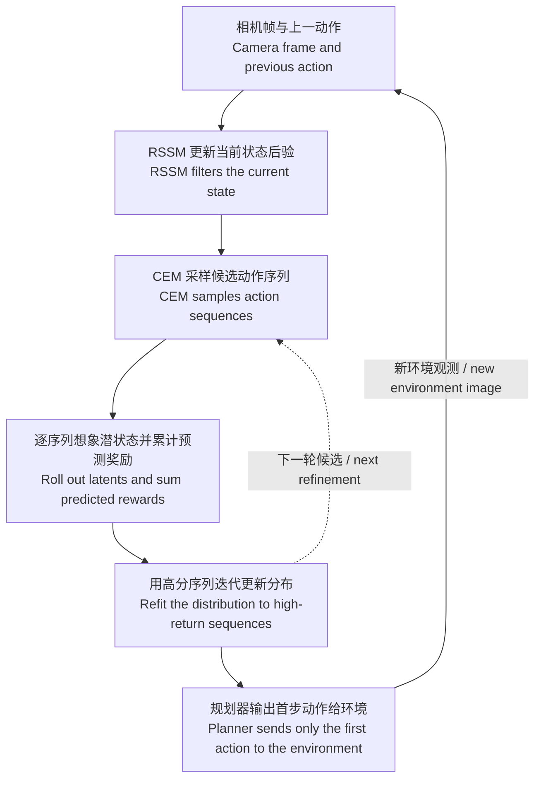
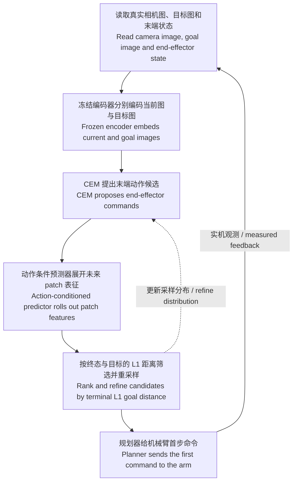
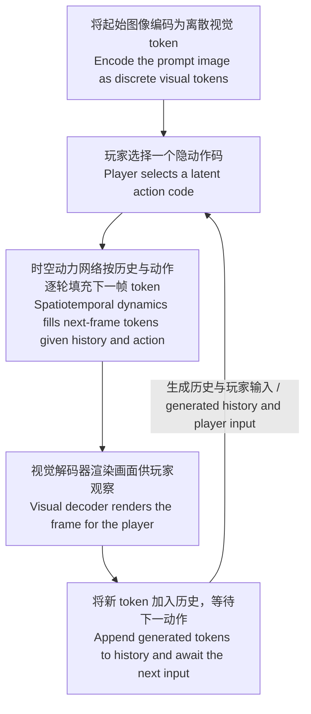

# 从潜状态到交互画面 / From latent state to interactive frames

**阅读范围 / Scope.** `Paper_Repo_List`, No. 1–69: [WM-1 · control](#wm-1) (20), [WM-2 · predictive representations](#wm-2) (20), [WM-3 · video simulation](#wm-3) (29). [逐条证据 / Evidence ledger](../data/reading-wm-a.json) · [网页运行图数据 / Runtime data](../data/runtime-wm-a.json).

判断这些工作，先问两件事：**谁选动作，下一次观察从哪里来？** PlaNet 的规划器会收到新观测并纠错；V-JEPA 2 的遮挡编码器本身不会选动作，须另接动作条件预测器与规划器；Genie 的玩家虽能操作，反馈画面却由模型自己生成。这三者的奖励、目标特征误差、视频指标不可互换。

**Who chooses the action, and where does the next observation come from?** PlaNet replans from new measurements. Masked V-JEPA pretraining does not itself select actions. A Genie player can act, but the resulting image is another prediction. Reward, terminal feature error and video quality therefore answer different questions.

### 证据如何分级 / How to read the evidence

`sections` means that named sections, tables, figure captions or passages of a primary work were inspected—not that the work was read cover to cover. All 69 entries reached this threshold: 59 have paper/report manuscripts (including the position paper and PDFs); 10 rely on first-party web reports or announcements (explicitly marked below). A web report's “sections” are **not** a peer-reviewed experiment. No record is labeled `full`; no abstract-only or unresolved primary row was needed. Release notes, static code inspection, model cards and inaccessible artifacts are recorded separately. No checkpoint, robot, notebook or benchmark was run. Scores below are the authors' results.

每条均给出实际检查的位置。`sections` 是定位阅读，不表示全文逐句读完。59 条使用论文/技术报告稿件，10 条以第一方网页报告或发布说明为主；网页有方法段落不代表有受控实验。代码阅读是静态查看，文档不是源码，卡片不是已加载权重。未独立复现实验。编号、类别保留工作簿索引，不把归类当作已证实的技术谱系。

**需要改读的表项 / Workbook corrections worth carrying forward**

- **#2 / #12:** PlaNet proposes overshooting but its final RSSM did not need it. The 104 TD-MPC2 tasks are not a single 104-task policy. / 区分候选设计与最终配置、跨任务实验总数与一个模型实际学过的任务数。
- **#20 / #25 / #29:** ScanDreamer's README says source is not yet public. NWM is diffusion-based, and its supplied HF endpoint is gated. The supplied V-JEPA 2 card is for the visual backbone, not the 2-AC planner. / 仓库存在、权重可读、控制器可用，是三个不同问题。
- **#21 / #28 / #48 / #69:** A blueprint, an identifiability result, a physical-continuation benchmark and a software runner are not four more trained agents. The updated #28 title is *General agents contain world models*. / 不为设计提案、定理、基准或基础设施虚构推理回路。
- **#59 / #60 / #63:** The #59 manuscript now says *Actionable*. The #60 “paper” URL is a repo; the two primary manuscripts are linked below. For #63 the fast 5B path, 28B experiments and released weights are distinct. / 题名、文献入口、实验规模与发布范围分别核验。

## WM-1 · 隐动力学与决策 / Latent dynamics for decisions

本组按“奖励如何转化为动作”区分：在线搜索、想象中学策略，以及只测预测失效的诊断。 / Separate online search, policy learning in imagination, and diagnostics that never select an action.

### 精读 / Close reading: PlaNet — who chooses the action?

**状态估计不是未来模拟 / Filtering is not forecasting.** In [§§2–3 and Fig. 1](https://arxiv.org/html/1811.04551), the deterministic recurrent path carries history, while a stochastic state can retain ambiguity. On measured experience the posterior sees the encoded image; on a hypothetical branch the prior must advance without it. Image reconstruction helps train a state that explains observations, but the planner sums reward predictions from those states. It need not paint thousands of futures to compare their returns.

真实交互时，后验能看到新图像；候选未来没有新图像，只能走先验。确定性通道保留历史，随机部分表达不确定性。重建在训练中约束状态，评分在潜空间直接读奖励；因此“从像素规划”并不意味着“为每条候选轨迹生成视频”。

**一次决策 / One decision.** Algorithm 2 samples sequences from a time-indexed diagonal Gaussian. In the reported setup the horizon is 12, with 1,000 candidates per round and 10 refinements using the top 100. One stochastic latent trajectory per candidate trades precision on any one sequence for wider search. Execute the **first mean action**, then discard the rest as a commitment and plan again. The [implementation, `MPCAgent.perform`](https://github.com/google-research/planet/blob/HEAD/planet/control/mpc_agent.py), makes this boundary visible: update the cell with the actual observation and previous action, call the configured planner, take `action[:, 0]`, then store the executed action and filtered state. Optional collection noise is not CEM's search noise.

在每个未来时刻维护一组高斯参数，反复采样、按累计奖励筛选、对精英序列重估分布。每条候选只模拟一条随机轨迹，把预算留给更多方案。执行的是优化后均值序列的第一步；下一轮拿真实反馈纠偏。采集时额外加的探索噪声与搜索候选的方差不能混为一谈。

**What the controls establish / 对照实际验证什么。** Fig. 4 contrasts random *data collection* with random *shooting* (take the best of 1,000 sequences without refitting). The former changes which states the model learns; the latter changes the search procedure and is not an equal-total-rollout-budget comparison. Table 1 is six simulated visual control tasks: at 1,000 episodes PlaNet scores 930 on Cup Catch and 700 on Finger Spin, versus 993 and 825 for CEM with the true simulator. These are not hardware results; the D4PG data-efficiency factors are estimated from published curves. Appendix D Fig. 7 is a useful counterexample to a neat lineage story: multi-step overshooting improves the comparison DRNN but slightly reduces RSSM performance.

随机采集改变学习数据的分布，随机射击去掉精英迭代，两条消融不能互相替代。表 1 的真模拟器是参照而非输入；即使同是六项控制，杯接球与拨指旋转也留下不同差距。附录 D 表明多步一致性目标的贡献取决于模型结构，并非列入方法关键词就必然有增益。

**运行图 / Runtime**

### 逐项阅读 / Entry-by-entry evidence

#### 01 · World Models (Ha & Schmidhuber)

[论文或技术稿 / manuscript](https://arxiv.org/html/1803.10122) — §§2–4, Fig. 8, Tables 1–2.

控制器同时读取当前图像的潜码和循环记忆。赛车实验用游戏回报进化策略；真正检验“梦中训练、回到原环境”的是 Take Cover。表 2 改变采样温度后生存和迁移都会变，不能把两项实验统称为纯梦境训练。

The controller sees both the current VAE code and the recurrent memory; the mixture model can sample several plausible next codes. The experiments answer different questions: CarRacing evolves the controller against game returns, whereas Take Cover evolves it in the learned environment and tests transfer back to the game. Temperature changes survival and transfer, not just visual diversity.

- [文档 / docs](https://github.com/hardmaru/WorldModelsExperiments/blob/HEAD/README.md): Author reproduction README: the original scripts expect Gym 0.9.x, not 0.10.x. / 原作者复现说明限定了 Gym 版本。

#### 02 · PlaNet

[论文或技术稿 / manuscript](https://arxiv.org/html/1811.04551) — §§2–5, Algorithms 1–2, Fig. 4, Appendix D Fig. 7.

PlaNet 在隐空间累计候选动作的预测奖励，只执行首步，再用真实图像修正状态。随机射击对照检验的是搜索，随机采集检验的是数据分布。多步 overshooting 对 DRNN 有利，却不是最终 RSSM 获胜的必要条件。

PlaNet scores candidate action sequences with summed latent reward predictions, executes one action, and corrects the state using the next image. Removing iterative elite refitting or collecting data randomly tests different parts of the loop. Multi-step overshooting helped the DRNN comparison but slightly hurt the proposed RSSM.

- [仓库说明 / repository README](https://github.com/google-research/planet/blob/HEAD/README.md)
- [源码 / source · `mpc_agent.py`](https://github.com/google-research/planet/blob/HEAD/planet/control/mpc_agent.py): `MPCAgent.perform` encodes the actual image, advances the filter with the previous action, calls the planner, slices `action[:, 0]` and stores state/action for the next call. / 代码确认只执行首个动作，不是整段开环执行。

#### 03 · MuZero

[论文或技术稿 / manuscript](https://arxiv.org/html/1911.08265) — §3 Fig. 1; §4 Fig. 3, Table 1.

动力网络预测奖励和后继隐状态，预测头给树搜索提供策略先验与价值。监督信号只约束决策所需信息，并不要求恢复棋盘或画面。图 3 改变搜索预算；特定预算下与规则引擎相当，不意味着无限加深仍然准确。

The dynamics network returns a reward and successor hidden state; a separate head supplies policy priors and values for tree search. The training targets constrain what matters for choosing moves, not a decoded game state. Fig. 3 varies search effort; performance against a rules-based searcher need not extrapolate to arbitrarily deep search.

#### 04 · Dreamer (V1)

[论文或技术稿 / manuscript](https://arxiv.org/html/1912.01603) — §3 Algorithm 1, Figs. 3–4; §6 Figs. 6–7.

从回放后验出发想象轨迹，用带自举的价值梯度训练 actor，执行时不再逐步做 PlaNet 式搜索。图 4 将只看视界内奖励与估计视界外价值区分开；证据是视觉控制任务，而非任意动力系统。

Instead of repeating PlaNet's search at deployment, Dreamer starts simulated trajectories from replay posteriors and differentiates a bootstrapped value estimate through dynamics to train an actor. The horizon experiment separates near-term imagined reward from value beyond the rollout; the advantage is measured on visual control, not arbitrary dynamics.

- [仓库说明 / repository README](https://github.com/danijar/dreamer/blob/HEAD/README.md)
- [源码 / source · `dreamer.py`](https://github.com/danijar/dreamer/blob/HEAD/dreamer.py): `_imagine_ahead` supplies model trajectories; `policy` handles real observations separately, and value bootstraps the return. / 想象展开与真实观测决策走不同路径。

#### 05 · DreamerV2

[论文或技术稿 / manuscript](https://arxiv.org/html/2010.02193) — §2 Figs. 2–3, Algorithms 1–2; §3 Tables 1–2.

离散随机潜码与确定性循环状态一起展开，想象无需逐帧解码。直通估计解决采样梯度，KL 平衡则调整先验与后验两侧的学习压力。消融使用稍早版本；55 款游戏、2 亿帧下的汇总分不是 100k 样本效率。

Categorical stochastic latents and a deterministic recurrent path allow compact imagination without decoding images. Straight-through estimation and separately weighted KL gradients address different training problems. The component ablation used a slightly earlier agent; 55-game aggregate results at 200M frames should not be read as Atari 100k results.

- [仓库说明 / repository README](https://github.com/danijar/dreamerv2/blob/HEAD/README.md)
- [源码 / source · `agent.py`](https://github.com/danijar/dreamerv2/blob/HEAD/dreamerv2/agent.py): `WorldModel.imagine` receives the actor and posterior starts; `actor_loss` and slow-target updates are separate from model fitting. / 从后验出发调用 actor，慢目标更新并非世界模型损失。

#### 06 · EfficientZero

[论文或技术稿 / manuscript](https://arxiv.org/html/2111.00210) — §4 Fig. 2; §5 Tables 1, 3.

把想象状态对准随后真实帧的编码，以累计价值前缀代替逐项奖励，并重估过时的回放目标。26 个游戏的逐项消融尤其支持一致性项。100k 步约合两小时游戏经历，不等于两小时训练算力，更非逐游戏胜人。

EfficientZero anchors imagined states to encodings of later real observations, predicts a value prefix instead of summing fragile reward estimates, and revises stale replay targets. Removing each term across 26 games particularly implicates consistency. A superhuman mean after 100k steps is an aggregate, not victory on every game or two hours of training compute.

- [仓库说明 / repository README](https://github.com/YeWR/EfficientZero/blob/HEAD/README.md)
- [源码 / source · `reanalyze_worker.py`](https://github.com/YeWR/EfficientZero/blob/HEAD/core/reanalyze_worker.py): The reanalysis worker builds bootstrapped replay values and value-prefix targets with per-index TD steps. / 重分析按样本位置生成自举价值及前缀目标。

#### 07 · TD-MPC

[论文或技术稿 / manuscript](https://arxiv.org/html/2203.04955) — §§3–5, Algorithms 1–2, Figs. 1–4, Table 1.

TOLD 联合学习后继表征、奖励与 Q；策略提供动作候选，短轨迹后接价值尾项。这是在长程模型误差与 critic 偏差间取舍。状态输入的运动任务与像素输入的 100k 表应分开看。

TOLD learns the next latent, reward and terminal Q jointly. Short model rollouts rank action sequences; a learned policy supplies proposals and a value tail. This trades long-horizon model bias for critic bias. State-input locomotion and the separate pixel-input 100k table test different observation conditions.

- [仓库说明 / repository README](https://github.com/nicklashansen/tdmpc/blob/HEAD/README.md)
- [源码 / source · `tdmpc.py`](https://github.com/nicklashansen/tdmpc/blob/HEAD/src/algorithm/tdmpc.py): `plan` and `update_pi` are separate: improving the policy prior does not remove test-time optimization. / 训练策略先验不取代调用规划器。

#### 08 · DayDreamer

[论文或技术稿 / manuscript](https://arxiv.org/html/2206.14176) — §§2–3, Figs. 2, 4–8.

机器人用当前策略采集，模型学回放，actor–critic 学想象。约一小时对应四足机翻身、站立、行走；不同机械臂的抓放与小车导航使用不同观测和奖励，并非同一策略零样本跨机型。

On hardware the current policy collects transitions; replay trains the world model, which supplies imagined actor–critic data. The one-hour result refers to one quadruped learning to roll up and walk. Bin transfer and Sphero navigation use different sensors and reward definitions, not one zero-shot policy transferred among robots.

- [仓库说明 / repository README](https://github.com/danijar/daydreamer/blob/HEAD/README.md)
- [源码 / source · `agent.py`](https://github.com/danijar/daydreamer/blob/HEAD/embodied/agents/dreamerv2plus/agent.py): `policy` and the model's `imagine` take different inputs; the latter carries latent trajectories through the actor update. / 真机策略入口和想象更新入口不同。

#### 09 · IRIS

[论文或技术稿 / manuscript](https://arxiv.org/html/2209.00588) — §2 Figs. 1–3; §3 Table 1, Fig. 7.

离散化单帧后，因果 Transformer 预测新 token、奖励和终止，策略在解码出的想象观测上学习。Pong 的细节保真并不普遍：Frostbite 的后续关卡需要罕见的长成功序列，数据覆盖不足会限制想象。

IRIS tokenizes each image separately; the causal transformer predicts future tokens, rewards and episode ends, allowing policy learning on decoded imagined observations. The clean Pong example is not the whole result: later Frostbite levels are hard to simulate when the data rarely contain the long successful sequence needed to reach them.

- [仓库说明 / repository README](https://github.com/eloialonso/iris/blob/HEAD/README.md)
- [源码 / source · `world_model_env.py`](https://github.com/eloialonso/iris/blob/HEAD/src/envs/world_model_env.py): Environment `step` feeds the action token, samples reward/end on the first pass, then samples observation tokens and decodes. / 奖励与终止在首轮采样，后续才生成观测。

#### 10 · DreamerV3

[论文或技术稿 / manuscript](https://arxiv.org/html/2301.04104) — Figs. 1, 3, 5–6; Methods: actor critic learning.

RSSM 生成 actor–critic 的训练轨迹；损失尺度处理与回报归一化使统一配置能适应不同奖励。图 5 统计各次训练发现后期物品的比例，“找到钻石”不同于每个随机种子都可靠完成任务。

The RSSM supplies imagined actor–critic trajectories. Robust loss scales and return normalization let the same recipe handle differently scaled rewards. Fig. 5 measures the fraction of training runs discovering late Minecraft items: discovery of a diamond is a stronger test than a reconstruction, but not a guarantee for each seed.

- [仓库说明 / repository README](https://github.com/danijar/dreamerv3/blob/HEAD/README.md)
- [源码 / source · `agent.py`](https://github.com/danijar/dreamerv3/blob/HEAD/dreamerv3/agent.py): `loss` starts an imagined trajectory via `dyn.imagine`; the deployed `policy` has its own recurrent carry. / 训练展开与部署的递归状态不同。

#### 11 · STORM

[论文或技术稿 / manuscript](https://arxiv.org/html/2310.09615) — §§3.1–3.2, Fig. 2, Table 1; Figs. 3–4.

因果 Transformer 在时间上预测随机状态，而非逐图像 token 生成。策略的输入组合与动力网络结构分别消融。表 2 是 Atari 100k；图 1 的部分速度是折算值，不宜当作全体同卡实测。

STORM predicts stochastic latents with a causal transformer instead of generating an image-token grid serially; the actor can use both current stochastic information and temporal features. State-choice and architecture ablations are separate. Table 2 is Atari 100k, and Fig. 1 partly extrapolates training FPS rather than timing every baseline on one GPU.

- [仓库说明 / repository README](https://github.com/weipu-zhang/STORM/blob/HEAD/readme.md)
- [源码 / source · `world_models.py`](https://github.com/weipu-zhang/STORM/blob/HEAD/sub_models/world_models.py): `forward_prior` maps sequence features to logits; `imagine_data` takes an actor–critic alongside sampled observation/action context. / 先验头输出 logits，再由策略驱动想象。

#### 12 · TD-MPC2

[论文或技术稿 / manuscript](https://arxiv.org/html/2310.16828) — Figs. 3–4, 7–8; Table 1.

以归一化潜码、奖励和终端价值评估轨迹，不解码观测。图 4 的 104 项是单任务实验；图 7 才是一个模型学 80 或 30 项。图 8 在留出任务上继续交互，不是零样本迁移。

No observation decoder is needed to rank trajectories: normalized latents predict rewards and an ensemble estimates terminal value. Fig. 4 pools 104 single-task experiments; Fig. 7 trains one multitask agent on 80 or 30 tasks. Finetuning on held-out tasks in Fig. 8 consumes new interaction; it is not zero-shot.

- [仓库说明 / repository README](https://github.com/nicklashansen/tdmpc2/blob/HEAD/README.md)
- [源码 / source · `tdmpc2.py`](https://github.com/nicklashansen/tdmpc2/blob/HEAD/tdmpc2/tdmpc2.py): `_plan` includes policy trajectories, candidate sampling and a shifted previous mean. / 规划会复用上一轮均值；不是直接执行策略头。
- [模型卡或集合 / HF](https://huggingface.co/nicklashansen/tdmpc2): The card distinguishes 324 checkpoint files, including 12 multitask models, and cautions about unseen-task transfer. / 模型卡区分单任务与多任务权重，并提示新任务通常要微调。

#### 13 · EfficientZero V2

[论文或技术稿 / manuscript](https://arxiv.org/html/2403.00564) — Fig. 2; Tables 1–2; Figs. 3–4.

通过采样将连续动作变成有限候选交给 Gumbel 搜索；混合价值目标解决的是回放中“学哪种回报”。图 3 和图 4 分开验证这两个设计；状态与像素控制的交互预算不同。

Sample-based Gumbel search makes a finite set of proposals usable even for continuous actions. The mixed value target addresses a separate problem: which return to learn from replay. Search-count and value-target ablations isolate both choices; state and pixel control use different interaction budgets.

- [文档 / docs](https://github.com/Shengjiewang-Jason/EfficientZeroV2/blob/HEAD/README.md): The paper-linked README fills the blank code column: `ez/train.py` has distinct Atari, DMC state and DMC image configs. / 作者提供三个不同观测配置。

#### 14 · DIAMOND

[论文或技术稿 / manuscript](https://arxiv.org/html/2405.12399) — Fig. 1, Table 1, Figs. 2–5.

依据近期帧与动作去噪生成下一帧。Boxing 中一步生成易把对手的多种走向平均成模糊影像；Asterix 中敌人与奖励的身份混淆会直接影响决策。Atari 100k 的均值 1.46 与四分位截尾均值 0.64 不能互换。

DIAMOND denoises the next observation conditioned on recent frames and actions. In Boxing, single-step denoising blends possible opponent moves; extra steps can select a sharp outcome. Small object identity matters for the policy in Asterix. Mean human-normalized score 1.46 versus IQM 0.64 shows why the Atari 100k aggregate needs a named statistic.

- [仓库说明 / repository README](https://github.com/eloialonso/diamond/blob/HEAD/README.md)
- [源码 / source · `world_model_env.py`](https://github.com/eloialonso/diamond/blob/HEAD/src/envs/world_model_env.py): Environment `step` fills the action buffer, samples the next observation, then predicts reward/end and rolls both buffers; a horizon truncation is separate from learned termination. / 步数截断不等同于学得的终止。
- [模型卡或集合 / HF](https://huggingface.co/eloialonso/diamond): HF identifies pretrained diffusion world models; the short card is not an evaluation report. / 短卡片只确认权重身份。

#### 15 · Δ-IRIS

[论文或技术稿 / manuscript](https://arxiv.org/html/2406.19320) — Figs. 1–2, 4–6; Table 1.

历史条件使离散 Δ-token 主要承载变化；连续 I-token 重置当前画面的参照，免去对一长串差分求和。去掉 I-token 后 Crafter 退步；这里的 FPS 是训练时长内采集的环境帧，不是渲染帧率。

Conditioning the tokenizer on history means discrete delta tokens need only explain new information. Continuous I-tokens convey a current observation summary, rather than forcing the sequence model to integrate all previous deltas. Removing them hurts Crafter; reported FPS counts collected environment frames per training time, not interactive rendering speed.

- [仓库说明 / repository README](https://github.com/vmicheli/delta-iris/blob/HEAD/README.md)
- [源码 / source · `world_model.py`](https://github.com/vmicheli/delta-iris/blob/HEAD/src/models/world_model.py): `WorldModel` exposes `burn_in` with observations, actions and latent tokens, plus an optional KV cache. / 条件历史由显式预热入口初始化。
- [模型卡或集合 / HF](https://huggingface.co/vmicheli/delta-iris): The HF artifact is specifically the Crafter 5M-frame agent. / 权重针对 Crafter 五百万帧设置。

#### 16 · Dreamer 4

[论文或技术稿 / manuscript](https://arxiv.org/html/2509.24527) — Fig. 2; §4.1 Offline Diamond Challenge, Figs. 3–5.

视频分词器与 shortcut forcing 让低步数想象可用于策略提升。离线经历和想象用于训练，回到实际游戏才检验迁移。同一初始画面可被玩家导向不同结局，证明可响应动作，不等于策略成功率。

A video tokenizer and shortcut-forcing dynamics make low-step imagined rollouts cheap enough for policy improvement. Minecraft behavior is learned from offline experience and imagination; playing the resulting policy in the actual game evaluates transfer. A human steering one initial frame tests action response, not the probability that an agent succeeds.

#### 17 · Newt

[论文或技术稿 / manuscript](https://arxiv.org/html/2511.19584) — Figs. 2, 4, 6–9.

指令描述本体和目标，共享模型据此预测并为计划打分。200 项平均分对应状态输入的 agent，不应混作 RGB 模型或新本体成绩。图 9 迁移需要少量目标任务适配。

Newt conditions shared dynamics on the task and ranks plans using the model; instructions describe both embodiment and objective. Its 200-task state-agent average is distinct from RGB-input and new-embodiment experiments. Fig. 9 adapts on target tasks, so the result is not unrestricted instruction-following in novel environments.

- [仓库说明 / repository README](https://github.com/nicklashansen/newt/blob/HEAD/README.md)
- [源码 / source · `world_model.py`](https://github.com/nicklashansen/newt/blob/HEAD/tdmpc2/common/world_model.py): `task_emb`, `next`, `reward`, `pi` and `Q` are distinct interfaces; the encoder handles state and optional RGB. / 任务条件不仅进入动作头，动力与价值分支也会用到。
- [模型卡或集合 / HF](https://huggingface.co/nicklashansen/newt): The card distinguishes the single simultaneous 200-task agent from 200+ checkpoints in the release. / “两百多个权重”不等于两百个多任务模型。

#### 18 · AirDreamer

[论文或技术稿 / manuscript](https://arxiv.org/html/2606.03252) — Figs. 1, 4–8; Tables II–III.

训练在仿真中，通过深度观测学习循环表征；部署靠策略，不是机上逐帧解码想象。偏航设置影响成功率，C 形障碍检验能否脱困而非仅仅朝终点前进。实机证据限于所测六张地图。

AirDreamer learns a depth-conditioned recurrent representation in simulation; deployment uses the policy, not a decoder drawing imaginary camera frames on the vehicle. Yaw randomization/learning changes success, and the C-shaped real obstacle tests escape rather than straight-line goal tracking. The hardware evidence is six maps, not a universal field success rate.

#### 19 · MMBench2 / WM Hallucination

[论文或技术稿 / manuscript](https://arxiv.org/html/2606.27326) — Figs. 1, 3–5; Tables 1–2.

区分分词器感知失真、忽略动作、整段场景漂移；用模型内部信号预测后续误差，再定向补采数据。训练任务的留出片段与十个新任务微调是两种检验。相关性不意味着可完全消除幻觉。

The authors separate tokenizer reconstruction failures, insensitivity to actions, and trajectory divergence. Their internal signals correlate with later rollout error; targeted collection tests whether filling a coverage hole helps. Held-out sequences from training tasks and finetuning on ten unseen tasks answer different questions. No detector guarantees error-free interaction.

- [文档 / docs](https://github.com/nicklashansen/mmbench2/blob/HEAD/README.md): Paper-linked release README separates tokenizer/dynamics training, checkpoints and failure detection; the workbook's empty code cell is not evidence of closure. / 论文指向的仓库另列训练、权重与检测。

#### 20 · ScanDreamer

[论文或技术稿 / manuscript](https://arxiv.org/html/2611.11605) — Fig. 1, Tables II–III, Fig. 6.

记忆地图给出局部几何与剩余代价，想象只能用当前已有的地图，不能偷看未来的扫描。等预算仿真成功率 96.3% 对 59.6%；去掉前向视锥惩罚后碰撞增多。仓库明确写着录用后再放代码，不能记为已开源实现。

A persistent scan map supplies cost-to-go and local features; imagined motion is evaluated against the map available now, not future sensor returns. At the same simulation budget the reported success is 96.3% versus AirDreamer's 59.6%; removing the forward-cone penalty raises collisions. The repository explicitly withholds implementation pending acceptance.

- [文档 / docs](https://github.com/WANGSHUAIzzzz/ScanDreamer/blob/HEAD/README.md): README, “Code availability”: release promised upon acceptance; current evidence is documentation and flight material, not runnable source. / 仓库仅能证实说明与演示。

## WM-2 · 预测表征与目标规划 / Predictive representations and goal planning

本组先分清预测的对象：遮挡图块、下一状态、文本表征，还是一个定理中的转移核。只有部分模型能对候选动作评分。 / The target may be a masked patch, next state, text embedding or theoretical transition kernel. Only some entries can score candidate actions.

### 精读 / Close reading: V-JEPA 2-AC — from masked video to an executable command

**Where supervision changes / 监督信号在哪里改变。** [Fig. 2](https://arxiv.org/html/2506.09985) separates two predictors. During visual pretraining the student receives visible patches and predicts masked target features computed by an EMA encoder. This does not identify what would happen *if the robot acted differently*. In post-training the visual encoder is frozen; a new 300M block-causal predictor learns on about 62 hours of DROID interactions, including end-effector state and commands. “Unlabeled” excludes reward/task/success labels, not the action information. Fig. 6 combines one-step teacher forcing with a rollout loss so the predictor also sees the consequences of its own forecasts.

先学“没有看见的画面表征是什么”，再学“采取这个动作之后会怎样”。第二阶段不是简单放大第一阶段的遮挡器：冻结视觉编码、换预测器和监督数据，使用末端状态与动作；所谓无标签并非无动作。单步教师强制与多步展开分别应对一步拟合与误差积累。

**Where the command comes from / 谁发出动作。** In §4 and Fig. 7 the objective is the mean absolute difference between **terminal predicted patch features and goal-image features**. CEM proposes action sequences, the predictor rolls out each given the current state, and the planner sends the first command. The physical arm's new observation replaces the prediction at the next decision. The [author energy-landscape notebook](https://github.com/facebookresearch/vjepa2/blob/HEAD/notebooks/energy_landscape_example.ipynb) isolates the scoring step: a 5×5×5 grid of translations, other command dimensions zero, is scored by mean absolute difference over the final patch tokens. It visualizes a cost surface; that grid is **not** the robot's full planner.

模型并不直接输出“把杯子拿起”的策略：目标图定义代价，预测器打分，规划器选动作，机械臂执行。笔记本固定其他动作维度，仅扫描三维平移来显示代价面的形状；这段离线诊断既不驱动真机，也不能代替闭环对照。

**What “zero-shot” buys / 零样本的边界。** Table 2 tests the same weights in two labs, ten trials per task per lab. Reaching averages 100%, but grasping averages 65% for a cup and 25% for a box. Pick-and-place is not a contradiction: it receives two intermediate goal images plus the final image, switched on a prescribed schedule (Fig. 10). No target-lab finetuning is different from no task scaffolding. The authors tried camera placements; Fig. 16 links camera position to rotation error in the inferred action axes. A visual representation can transfer well while the action frame transfers poorly.

两个实验室复用权重，不代表没有为任务提供外部结构。单图抓取与按时间切换子目标的抓放不能按难度直接排序。相机位置会改变模型理解的运动坐标轴：视觉表征泛化与动作坐标标定是可分离的误差来源。

**运行图 / Runtime**

### 逐项阅读 / Entry-by-entry evidence

#### 21 · A Path Towards AMI (JEPA / H-JEPA blueprint)

[立场论文 / position paper](https://cdn.prod.website-files.com/65ca2b5d0ef26db55441f990/65cb79b6f007ce46ebe78f84_1Uv3a7gntOX-0rjrqMo8z3DdpTgUWGlMjNhgNHRPOpM.pdf) · mirrored author PDF; [publisher record](https://openreview.net/forum?id=BZ5a1r-kVsf) (publisher PDF blocked) — v0.9.2, §3.1.2–3.1.3, Figs. 2, 4–5.

这是设计提案。Mode 2 中行动者提出动作，世界模型预测结果，代价模块打分；Mode 1 可学着近似昂贵的规划结果。分层抽象讨论计算与监督方式，没有机器人实测，也没有所谓“闭源权重”可供比较。

This is a design proposal. In Mode 2 an actor proposes actions whose predicted consequences are scored by a cost module; Mode 1 can learn to approximate that expensive solution. Planning in increasingly abstract representations is a hypothesis about computation and supervision, not a robot result or a closed-source checkpoint.

#### 22 · I-JEPA

[论文或技术稿 / manuscript](https://arxiv.org/html/2301.08243) — Figs. 3–4; Tables 1–4.

从同一图像的可见上下文预测数块被遮区域的教师表征；较大的遮块减少靠局部纹理取巧。线性探针还考察计数和深度，但整个任务没有动作或时序转移，不是控制器。

A context block predicts the teacher's representations of several disjoint target regions from the same image. Block size prevents trivial local completion. Frozen linear probes measure retained information, including counting and depth; neither the target nor the probe has a temporal transition or action input.

- [仓库说明 / repository README](https://github.com/facebookresearch/ijepa/blob/HEAD/README.md)
- [源码 / source · `train.py`](https://github.com/facebookresearch/ijepa/blob/HEAD/src/train.py): `forward_target` encodes the image without gradient, while `forward_context` uses the context path before the prediction loss. / 目标分支与上下文分支分开。
- [模型卡或集合 / HF](https://huggingface.co/facebook/ijepa_vith14_1k): `ijepa_vith14_1k` is an image encoder card with a noncommercial license, not a video-action checkpoint. / 这是图像表征权重。

#### 23 · V-JEPA

[论文或技术稿 / manuscript](https://arxiv.org/html/2404.08471) — Fig. 3; Tables 1, 3–4.

可见时空上下文预测动量教师的遮挡视频表征。表 1 在相同遮挡任务下比较像素与特征目标；表 3 表明冻结评估也受池化器影响。识别动作标签不同于决定下一步采取什么动作。

A visible spatiotemporal context predicts masked video features from a moving teacher. Pixel versus feature targets are compared with a matched masking task. Frozen performance depends on the pooling probe (Table 3); action recognition here means labeling what happened, not selecting the next intervention.

- [仓库说明 / repository README](https://github.com/facebookresearch/jepa/blob/HEAD/README.md)
- [源码 / source · `train.py`](https://github.com/facebookresearch/jepa/blob/HEAD/app/vjepa/train.py): `forward_target` normalizes full-clip target features then gathers masked positions. `forward_context` uses encoder masks and the predictor; loss compares features. / 掩码后对齐的是表征，不是 RGB。

#### 24 · DINO-WM

[论文或技术稿 / manuscript](https://arxiv.org/html/2411.04983) — Figs. 1–4; Tables 1–3.

冻结的 DINOv2 局部 patch 保留空间布局，另学动作条件动力学；规划比较预测终态与目标图表征。可视化解码器不参加搜索，表 3 的泛化局限于指定布局或物体变化。

Frozen DINOv2 patch features retain local spatial information; an action-conditioned predictor learns transitions from offline trajectories. Planning compares a predicted terminal patch map to a goal image embedding. The visualization decoder is not in the optimizer; generalization in Table 3 is over particular layout/object changes.

- [仓库说明 / repository README](https://github.com/gaoyuezhou/dino_wm/blob/HEAD/README.md)
- [源码 / source · `cem.py`](https://github.com/gaoyuezhou/dino_wm/blob/HEAD/planning/cem.py): `plan` encodes the goal once and samples an action batch per evaluation instance before ranking rollouts. / 目标缓存后与一批候选轨迹比较。

#### 25 · NWM (Navigation World Models)

[论文或技术稿 / manuscript](https://arxiv.org/html/2412.03572) — §3.2 Fig. 2; Figs. 4, 7; Tables 1–2.

尽管列在 WM-2，NWM 用条件扩散 Transformer 生成未来视图，而非 JEPA 的表征回归。可对 NoMaD 给出的路线做模拟与排序。RECON 两秒轨迹误差是离线代理指标，长视频画质也不是闭环到达率。

NWM is a generative conditional diffusion transformer, not a JEPA loss despite the sheet placement. It can roll out candidate navigation trajectories and score proposals from NoMaD. RECON trajectory error for a two-second prediction is an offline proxy; the longer video comparison is not a closed-loop navigation success rate.

- [仓库说明 / repository README](https://github.com/facebookresearch/nwm/blob/HEAD/README.md)
- [源码 / source · `planning_eval.py`](https://github.com/facebookresearch/nwm/blob/HEAD/planning_eval.py): `planning_eval.py` evaluates predicted trajectories relative to reference positions; it is not a robot driver. / 此脚本做离线轨迹度量。
- [模型卡或集合 / HF](https://huggingface.co/facebook/nwm): The public landing page identifies CDiT checkpoints; files require agreeing to share account information (raw card returned 401). No gated files were inspected. / 仅核验公开页面，未访问受限文件。

#### 26 · PLDM

[论文或技术稿 / manuscript](https://arxiv.org/html/2502.14819) — Figs. 2–5; Tables 1–2.

从无奖励轨迹学局部动作转移，测试时才针对目标搜索。双房间中减少穿门轨迹，可区分“学局部动力”与“直接学远目标可达性”。受控迷宫揭示机制，不足以证明所有离线 RL 都该用规划。

PLDM fits action-conditioned latent transitions to reward-free trajectories, then searches at test time for actions serving the current goal. Two-room data with poor door coverage distinguishes learning local transitions from learning long-range goal reachability. Small controlled mazes expose failure modes; they do not establish dominance for all offline RL.

- [仓库说明 / repository README](https://github.com/vladisai/PLDM/blob/HEAD/readme.md)
- [源码 / source · `mppi_planner.py`](https://github.com/vladisai/PLDM/blob/HEAD/pldm/planning/planners/mppi_planner.py): `mppi_planner.py:plan` is a distinct trajectory optimization interface; planning is not the same as training a goal-conditioned action classifier. / 仓库把轨迹优化作为独立模块。

#### 27 · V-JEPA Intuitive Physics

[论文或技术稿 / manuscript](https://arxiv.org/html/2502.11831) — Figs. 1–3, S1; Table S2.

以预测表征与真实未来的偏差衡量惊讶，对比物理可能与不可能的视频。随机网络也能吃到数据偏差，且不同检验适合平均或峰值惊讶。成对排序正确不等于学得力学方程或控制策略。

The surprise score compares predicted features to observed future features on physically possible/impossible clips. The random-network baseline matters because some datasets have visual biases; mean and peak surprise can suit different comparisons. A correct ranking on a violation pair does not give a force law or a policy.

- [仓库说明 / repository README](https://github.com/facebookresearch/jepa-intuitive-physics/blob/HEAD/README.md)
- [源码 / source · `eval.py`](https://github.com/facebookresearch/jepa-intuitive-physics/blob/HEAD/evaluation_code/evals/intuitive_physics/eval.py): The evaluator computes unreduced L1 prediction errors and keeps matched pairs together; the code even notes possible padding-related inaccuracy for InfLevel. / 配对排序和补零处理会影响指标解读。

#### 28 · General Agents Need World Models

[论文或技术稿 / manuscript](https://arxiv.org/html/2506.01622) — Theorem 1, Algorithms 1–2, Figs. 2–4.

现题为 contain：在假设满足且可用特制目标查询策略时，能从行为恢复转移概率。图 3 联系目标深度与恢复误差。结论是信息可辨识，并非每个策略内部都有显式 JEPA 或都执行模型规划。

The current title says “contain”: by querying a sufficiently general goal-conditioned policy on specially constructed goals, the transition probabilities can be recovered. Fig. 3 varies attainable goal depth and recovery error. This is a statement about information identifiable from behavior under assumptions, not proof of an explicit JEPA inside every trained policy.

#### 29 · V-JEPA 2 / V-JEPA 2-AC

[论文或技术稿 / manuscript](https://arxiv.org/html/2506.09985) — §§2–4, Figs. 2, 6–7, 10; Tables 2–3.

遮挡预测学的是编码器，不会直接给机器人动作。另用 DROID 训练块因果动作预测器，部署时由规划器最小化目标表征距离，并以真实观测重规划。杯与盒抓取率差别明显，多阶段放置有外给子目标。

Mask prediction supplies the visual encoder, not the robot action. A separate block-causal predictor learns the consequences of end-effector commands on DROID. At deployment an external planner optimizes goal-feature distance and replans from the measured robot state. Cup and box grasp rates differ substantially, and multi-stage placement uses supplied subgoals.

- [仓库说明 / repository README](https://github.com/facebookresearch/vjepa2/blob/HEAD/README.md)
- [源码 / source · `energy_landscape_example.ipynb`](https://github.com/facebookresearch/vjepa2/blob/HEAD/notebooks/energy_landscape_example.ipynb): The energy notebook loads the AC encoder/predictor, sweeps a Cartesian translation grid and averages final patchwise absolute error. This diagnostic does not run the closed-loop robot. / 笔记本验证代价面，未驱动硬件。
- [模型卡或集合 / HF](https://huggingface.co/facebook/vjepa2-vitg-fpc64-256): `vjepa2-vitg-fpc64-256` is tagged video-classification; this card alone does not establish that the AC robot planner was loaded. / 所列卡片是视频骨干，不应误当作 AC 控制器。

#### 30 · LLM-JEPA

[论文或技术稿 / manuscript](https://arxiv.org/html/2509.14252) — Fig. 2; Tables 1–4; Fig. 3.

把描述与代码作为两种视图，向语言建模加入表征对齐损失；并未把语言生成换成机器人动力学。在合成正则表达式任务上可直接核对生成表达式，结果取决于视图配对、损失与任务，而非物理滚动精度。

Paired descriptions and code serve as different views; an embedding-alignment term augments language modeling rather than replacing language generation with robot dynamics. On synthetic regex tasks the generated expression can be tested against the requested language. Performance depends on the pairing, loss and task, not embodied rollout accuracy.

- [仓库说明 / repository README](https://github.com/rbalestr-lab/llm-jepa/blob/HEAD/README.md)
- [源码 / source · `finetune.py`](https://github.com/rbalestr-lab/llm-jepa/blob/HEAD/finetune.py): `finetune.py` computes LM loss and an embedding term with branches using cosine similarity or L2. / 模型并未放弃词元损失。

#### 31 · LeJEPA

[论文或技术稿 / manuscript](https://arxiv.org/html/2511.08544) — Fig. 2, Figs. 5–8, Table 1.

SIGReg 对批内表征做随机一维投影并检验高斯性；X 形例子说明只对齐均值和协方差会漏掉依赖，投影方向也需更新。ImageNet 线性探针检验表征质量，并不校准控制系统的不确定度。

SIGReg tests one-dimensional projections of minibatch embeddings against a Gaussian. Matching only mean and covariance can miss non-Gaussian dependence (the X-shaped example). Resampling directions matters. The ImageNet linear probe is evidence about representation quality, not calibrated state uncertainty in a control loop.

- [文档 / docs](https://github.com/rbalestr-lab/lejepa/blob/HEAD/README.md): SIGReg README example composes `SlicingUnivariateTest` with an Epps–Pulley test and backpropagates a batch loss; documentation example, not executed. / 说明演示如何将一维检验组合成投影正则。

#### 32 · JEPA-WMs

[论文或技术稿 / manuscript](https://arxiv.org/html/2512.24497) — Table 1, Figs. 2–7, Table 2.

分别考察优化器、本体感觉、编码器与预测器；开爪或合爪再抬升的反事实检验杯子是否随手移动。不同任务最优配置不同；表 2 的 V-JEPA 2-AC 是重训基线，不能与原文数值直接混用。

The paper varies planner, proprioception, encoder and predictor instead of attributing all gains to one new network. Its open-versus-closed-gripper counterfactual asks whether the imagined cup actually follows the hand. Recipes differ by domain, and the V-JEPA 2-AC baseline in Table 2 is retrained, not simply the original reported number.

- [仓库说明 / repository README](https://github.com/facebookresearch/jepa-wms/blob/HEAD/README.md)
- [源码 / source · `train.py`](https://github.com/facebookresearch/jepa-wms/blob/HEAD/app/vjepa_wm/train.py): `app/vjepa_wm/train.py` separates `step_model` and rollout/decode from planning evaluation parameters such as horizon and elite count. / 训练损失与评测搜索预算是不同配置。

#### 33 · VL-JEPA

[论文或技术稿 / manuscript](https://arxiv.org/html/2512.10942) — Fig. 2, Tables 1–4, Figs. 3–4.

根据视觉与问题预测目标文本表征；检索可直接算相似度，需要文本时才解码，且可只在表征显著改变后触发。少解码是流式字幕效率取舍；分类、问答、动作预判都不是控制证据。

The predictor estimates a target text embedding from vision and a query. Retrieval can use the embedding directly; generation invokes a decoder, optionally only after a sufficiently large change. Reduced decoding frequency is a streaming caption trade-off; classification, VQA and anticipation scores are not environment-control evidence.

#### 34 · C-JEPA (Causal-JEPA)

[论文或技术稿 / manuscript](https://arxiv.org/html/2602.11389) — §§4–6, Figs. 1–3, A3–A4.

冻结编码器给出物体槽；跨时间遮住某物体，仅留身份锚点，阻止沿原轨迹抄答案，迫使利用其他物体。干预的是模型可见信息，不是物理世界；增益仍取决于物体分解质量。

The frozen encoder supplies object slots. Masking one slot through time, except for an identity anchor, prevents the predictor from copying that object's motion and forces it to use other objects. The intervention is on visibility in the model, not a physical intervention on the scene; downstream gains depend on slot quality.

- [文档 / docs](https://github.com/galilai-group/cjepa/blob/HEAD/README.md): The repo documents training VideoSAUR, downloading checkpoints or consuming pre-extracted slots; the paper-linked implementation is absent from the workbook URL column. / 对象槽并非无成本获得。

#### 35 · LeWM (LeWorldModel)

[论文或技术稿 / manuscript](https://arxiv.org/html/2603.19312) — Figs. 1, 3–6, 8; Table 1.

下一表征预测加高斯正则使编码器与动力模型能端到端学习，无需冻结教师。低 token 数降低每条候选轨迹的代价。图 3 是等算力规划，图 8 是外观或物理扰动的惊讶度；二者不能合为一个物理理解分。

Jointly fitting next-embedding prediction and a Gaussian regularizer avoids a frozen visual teacher. Few latent tokens make each candidate plan inexpensive. Fig. 3 compares planning at fixed compute and Fig. 8 probes surprise to appearance versus physical changes: these two tests measure efficiency and sensitivity, respectively.

- [仓库说明 / repository README](https://github.com/lucas-maes/le-wm/blob/HEAD/README.md)
- [源码 / source · `jepa.py`](https://github.com/lucas-maes/le-wm/blob/HEAD/jepa.py): `jepa.py:predict` takes embeddings and action embeddings, not decoded images. / 预测器接口直接接收表征及动作嵌入。

#### 36 · V-JEPA 2.1

[论文或技术稿 / manuscript](https://arxiv.org/html/2603.14482) — Figs. 3–5, Tables 1–3, 6.

给可见 token 也加上下文损失，并改进图像/视频联合处理，使稠密特征保留局部细节。表 2 单独检验权重；分割增益不必同幅转化为视频分类提升。机械臂杯子 MPC 是另一个较窄的实验。

A context loss supplies local supervision even for visible tokens, with additional design changes for mixed image/video input and dense features. Table 2 isolates weighting; segmentation gains need not improve global video classification equally. Robot MPC is separately tested on cup manipulation, not a full re-evaluation of all embodied settings.

- [文档 / docs](https://github.com/facebookresearch/vjepa2/blob/HEAD/README.md): Shared V-JEPA 2/2.1 README separates 2.1 pretraining, 2 pretraining and 2-AC post-training. Sharing a repo does not make their checkpoints interchangeable. / 同仓库分不同阶段与模型版本。

#### 37 · HWM

[论文或技术稿 / manuscript](https://arxiv.org/html/2604.03208) — §2 Figs. 1–3; §3 Tables 1–4, Fig. 6.

上层编码动作块并规划宏动作，把首个粗尺度预测当作下层的子目标。图 6 显示短视界反而是细模型更准确，分层并非无条件胜出。Franka 抓放证明特定装置能用单张目标图，并不证明通用长程操作。

The upper model compresses action chunks into macro-actions. Its first predicted coarse state becomes a subgoal for a finer planner in the shared latent space. Fig. 6 shows why one scale is not always best: the fine model predicts short horizons better. Franka pick-and-place tests one visual goal and a particular apparatus.

- [关联出处 / source](https://arxiv.org/html/2604.03208): The paper links `kevinghst/HWM_PLDM`; the linked README and project site were unavailable in this check. No code-level verification here. / 本次未核验该实现，不能从论文链接推断可复现。

#### 38 · Generalization Theory for JEPA-WMs

[论文或技术稿 / manuscript](https://arxiv.org/html/2606.27014) — §§3.4, 4.1–4.5, §5 Fig. 2, Table 1.

以条件共现图分解刻画预训练风险，并将其联系到规划遗憾。提高维数可减小逼近误差，却增大估计误差。噪声与视界实验说明取舍，不能把特定假设下的界当作任意部署模型的保证。

A conditional co-occurrence graph turns the pretraining risk into a factorization problem and relates it to planning regret. Increasing dimension can reduce approximation error while increasing estimation error. Noise and horizon experiments illustrate the trade-off; a bound under this formulation is not a certificate for any deployed JEPA.

#### 39 · H-JEPA

[论文或技术稿 / manuscript](https://arxiv.org/html/2610.06805) — §§2–4, Figs. 2–6, 9; Table 1.

不同时间步幅学出不同层级的代价；粗计划引导细计划。AntMaze 只换代价函数的对照把表征与搜索拆开。探针显示时间尺度分离与选择性抽象有关，在更多样的 DROID 设置中还需逆动力损失。

Different temporal strides learn different latent costs. Coarse plans guide finer ones; changing only the cost on AntMaze probes whether representation or search is responsible. Probe evidence links temporal separation to selective abstraction; a more diverse DROID setting requires additional inverse-dynamics supervision in their comparison.

- [仓库说明 / repository README](https://github.com/kevinghst/H-JEPA/blob/HEAD/README.md)
- [源码 / source · `planning_eval.py`](https://github.com/kevinghst/H-JEPA/blob/HEAD/h_jepa/planning_eval.py): `run_planning_eval` records per-solve gradient-planning compute metadata by level and horizon. / 各层实际求解预算会写入评估。
- [模型卡或集合 / HF](https://huggingface.co/jepa-world-models/h-jepa): The HF card separates 84 simulation checkpoints from 9 DROID checkpoints. / 仿真与真实数据检查点分开列出。

#### 40 · WARP-JEPA

[论文或技术稿 / manuscript](https://arxiv.org/html/2611.10806) — §4 Fig. 2; §5 Tables 1–4.

冻结 H-JEPA，以模型在环的上层候选和廉价下层桥接取代反复在线求梯度。表 3 区分离线终端代价与闭环 Push-T 成功率。用时来自单种子、少量回合和指定硬件，不能当作普遍加速倍数。

WARP keeps H-JEPA frozen. An upper proposer generates macro-actions with the model in the loop; candidate ranking and a cheap lower bridge replace repeated online gradient steps. Table 3 separates offline terminal cost from closed-loop Push-T success. Episode timings are a small, single-seed hardware sample, not an environment-independent speedup.

- [仓库说明 / repository README](https://github.com/hideinsewer/WARP-JEPA/blob/HEAD/README.md)
- [源码 / source · `train_upper.py`](https://github.com/hideinsewer/WARP-JEPA/blob/HEAD/cost_probe/train_upper.py): Upper-proposer evaluation branches between parallel proposals and sequential `generate(..., cost_model=...)`, using held-out segments with a fixed horizon. / 上层网络并非都以同一种方式输出整段宏动作。

## WM-3 · 生成式交互与物理评估 / Generative interaction and physical evaluation

先分清开放环续写、外部用户控制、供策略使用的模拟器、以及只负责评分的基准。回访稳定性与物理正确性并不是同一件事。 / An open-loop continuation, a player-driven world, a policy simulator and an evaluator have different interfaces. Returning to a consistent view is not itself physical correctness.

### 精读 / Close reading: Genie — a playable prediction is not a learned policy

**Learning a control interface / 从无动作标签的视频学接口。** In [§2.1, Figs. 2–6](https://arxiv.org/html/2402.15391), a video tokenizer learns discrete visual tokens. A separate latent-action model is allowed to see the next frame during training; an eight-code bottleneck makes it describe a change compactly enough for a human to choose later. The reconstruction side gives those codes learning signal. The dynamics model instead learns to predict masked next-frame tokens conditioned on past visual tokens and action codes. Space–time attention is factorized; this is not a physics solver with Minecraft-style object state.

视觉码本压缩画面，动作码本描述变化，不能把两个码本混为一谈。训练时读到后一帧是为了发现可能的动作；动力模型的任务则是在给定动作和历史时预测下一帧。在交互时若仍需“先看未来、再推断动作”，系统就不能玩；图 7 恰好划清了这条边界。

**Runtime / 运行。** §2.2 Fig. 7 drops the action-inference network except its codebook. The player supplies an action index; the dynamics transformer fills in next-frame tokens over iterative MaskGIT steps. The decoder displays pixels; the generated history and next player input drive the following step. There is no external camera correction, endogenous reward, or action optimizer in this loop. An initially plausible result can therefore become the context for another, increasingly implausible result.

玩家选动作，模型反馈画面；反馈来自自己合成的世界，不是外部真值。逐帧自回归描述的是**帧与帧之间**的依赖，并不表示帧内每个 token 都按光栅顺序生成。可控的接口也不等同于自主策略。

**Does a better video metric imply better control? / 画质更好就更可控吗？** Table 2 compares token-input and pixel-input latent-action inference. On platformers the pixel-input variant has *worse* FVD (40.1 versus 38.8; lower is better) but *higher* ΔPSNR (1.91 versus 1.33). ΔPSNR compares reconstruction under actions inferred from the reference future versus random actions, measured at step four. It detects sensitivity to an informative action code, not a promise that “left” works in every scene. On robotics both measures favor pixel input; the two platformer variants also differ slightly in size. Fig. 14 is a different test: CoinRun imitation with an adaptation mapping from latent to actual actions, not an agent discovering a policy solely by playing Genie. §5 reports 16 frames of memory, hallucinated futures and roughly 1 FPS.

表 2 的反例说明为何不能只看 FVD：真实后续推断的动作比随机动作更能解释画面，才是 ΔPSNR 所问的问题。CoinRun 又回答另一个问题，即少量对应样本能否把隐码映到真实动作。记忆窗口、推理速度及缺少外部校正共同划定了“可玩”的范围。

**运行图 / Runtime**

### 逐项阅读 / Entry-by-entry evidence

#### 41 · UniSim

[论文或技术稿 / manuscript](https://arxiv.org/html/2310.06114) — Fig. 2, Table 1, Figs. 4, 7.

给定历史和动作生成一段后续视频，动作可以是语言而非关节量；下条指令来自独立策略。多帧近期历史优于单帧。Language Table 上的策略迁移范围比跨域视频展示窄得多。

UniSim predicts a clip given observation history and an action that may be language rather than a motor vector. A separate policy supplies the next instruction. Recent multi-frame history improves video metrics over a lone context image; the Language Table experiments test a narrower kind of policy transfer than the cross-domain video gallery.

#### 42 · Genie

[论文或技术稿 / manuscript](https://arxiv.org/html/2402.15391) — §§2.1–2.2 Figs. 4–7; §§3.3–3.4 Fig. 14, Table 2; §5 Conclusion and Future Work.

训练时从相邻视频推断隐动作，测试时玩家选码取代动作编码器；动力模型填下一帧 token，再解码显示。直接看像素推断动作使可控指标提高，即使 FVD 变差；两者都不能保证每个键始终代表人所想的动作。

A latent-action encoder sees consecutive video frames in training; a player selects a learned code instead at test time. A dynamics transformer fills in the next frame's tokens, then the decoder renders them. Pixel-input action inference raises controllability even where FVD worsens; neither metric verifies the intended semantics of every key.

#### 43 · Sora

[第一方网页 / first-party web report](https://openai.com/index/video-generation-models-as-world-simulators/) — Technical report: Turning visual data into patches; Emerging simulation capabilities; limitations paragraph.

把压缩视频切成时空 patch 后去噪；网格形状可变，因而能混合图片、画幅与时长。玻璃破碎、吃东西的反例说明“看起来像下一幕”不等于执行不可逆的物态变化。报告没有给出动作闭环接口。

Sora denoises a space–time grid of patches of compressed video. Variable grid shapes let the training mix images, aspect ratios and durations. The glass and eating examples illustrate the missing constraint: a plausible next appearance need not implement an irreversible material-state change. This report describes prompt-conditioned generation, not an action-feedback API.

#### 44 · GameNGen

[论文或技术稿 / manuscript](https://arxiv.org/html/2408.14837) — §3, Figs. 3–6; Tables 1–2.

先用 agent 采集游戏轨迹，再按历史帧和动作生成下一帧。训练时污染历史，使模型容忍自身生成误差；图 4 让玩家不动，漂移仍会显现。实时 DOOM 不等于能维护任意游戏的精确状态。

GameNGen trains on recorded trajectories from an agent and generates the next DOOM frame given actions and history. Corrupting the conditioning context during training makes the model tolerate its own imperfect outputs; Fig. 4 holds the player still to expose drift. A real-time DOOM demonstration is not a general-purpose game-state engine.

#### 45 · Oasis

[第一方网页 / first-party web report](https://oasis-model.github.io/) — Project report: Architecture, temporal stability / dynamic noising, limitations list.

以键鼠为条件生成视频，而非推进 Minecraft 原生状态。报告称在推理中调节噪声以抑制累积误差，并列出长程记忆与精细库存操作困难。报告的代码链接本次返回 404，不能据此声称源码已核验。

Oasis generates the next video frame under keyboard and mouse controls rather than advancing Minecraft's native state. The report describes inference-time dynamic noising to reduce compounding errors and explicitly lists limited memory and poor precise inventory control. The linked code endpoint returned 404; this reading does not verify that implementation.

- [项目所链代码 / project-linked code](https://github.com/etched-ai/open-oasis) — 404 at inspection. HF landing page visible; download gated.
- [模型卡或集合 / HF](https://huggingface.co/Etched/oasis-500m): The author-linked HF card is separate from the unavailable GitHub endpoint; the stated release is a 500M model, not the whole hosted stack. / 开放卡片与线上服务不能等同。

#### 46 · Genie 2

[第一方网页 / first-party web report](https://deepmind.google/blog/genie-2-a-large-scale-foundation-world-model/) — DeepMind report: examples of long-term memory; AI agents acting inside the world model; Diffusion world model.

以单步动作和历史潜帧自回归生成可操作视图。移开视线再看回来能检验持久性；外部 agent 在生成场景中操作，只说明接口可用。“最长约一分钟”不是所有提示下的下界，也不是碰撞几何的验证。

Genie 2 rolls latent frames forward given individual actions and decodes them to a playable view. Looking away and back probes persistence; an external agent acting in generated scenes tests interface compatibility. The author describes consistency up to a minute, not a measured lower bound across prompts or proof of collision geometry.

#### 47 · Cosmos WFM (Predict1)

[论文或技术稿 / manuscript](https://arxiv.org/html/2501.03575) — Figs. 1–5; pre-trained WFM and post-training examples.

平台同时包含连续潜码扩散与离散 token 自回归两条路线；清洗去重、分词、预训练后专门化是不同阶段。用机器人轨迹控制生成视频证明条件预测，不代表基础模型自己会选动作。

Cosmos Predict1 is a platform with both continuous-latent diffusion and discrete-token autoregressive models. Filtering and deduplicating clips, tokenizing them, then specializing a pretrained generator are different stages. A specialized video conditioned on a robot trajectory illustrates conditional prediction, not autonomous action choice by the base model.

- [文档 / docs](https://github.com/nvidia-cosmos/cosmos-predict1/blob/HEAD/README.md): Predict1 README separates pretrained inference, post-training and inference with specialized models. / 基模与后训练例子分开。

#### 48 · Physics-IQ

[论文或技术稿 / manuscript](https://arxiv.org/html/2501.09038) — Original paper Figs. 1–2, 4–7; Table 1.

根据一帧或短前缀续写真实物理事件，四项得分以实拍重复实验的自然差异为参考。测的是运动是否正确演化，而非人能否辨假。各物理门类难度不同；原版与后来 Verified 榜的分数不可混排。

A model completes a recorded physical event from a frame or short prefix. The four-part score is normalized against variation between real repeats; it asks whether motion develops correctly, not whether a viewer can spot a fake. Results differ by physical category. Do not pool this original protocol with the later Physics-IQ Verified leaderboard.

- [项目页 / project](https://physics-iq.github.io/) → manuscript 2501.09038; 原始实验与更新后的 Verified 文档分开。
- [仓库说明 / repository README](https://github.com/google-deepmind/physics-IQ-benchmark/blob/HEAD/README.md)
- [源码 / source · `calculate_iq_score.py`](https://github.com/google-deepmind/physics-IQ-benchmark/blob/HEAD/physiq/calculate_iq_score.py): `calculate_iq_score` combines CSV metrics, rescales, and clips the result to [0,100]; current README also documents a separate Verified workflow. / 总分经过归一化与截断。

#### 49 · VBench-2.0

[论文或技术稿 / manuscript](https://arxiv.org/html/2503.21755) — Figs. 1–4, 7–8; intrinsic faithfulness evaluation.

把生成结果分为 18 个维度；解剖异常检测在图像区域上进行，力学与实例保持又是不同检验。图 2 为展示按维度归一化，雷达图面积不是物理准确度绝对差，更不是交互控制成功率。

VBench-2.0 decomposes a generator's output into 18 dimensions rather than assigning one “physics” score. The anatomy detector operates on detected image regions; mechanics and instance preservation ask different questions. Fig. 2 normalizes each dimension for display, so polygon areas are not absolute differences in physical accuracy.

- [文档 / docs](https://github.com/Vchitect/VBench/blob/HEAD/README.md): VBench's repo lists a distinct VBench-2.0 section and accepts user-supplied generated videos; this is an evaluator, not a generation pipeline. / 输入是待评视频。

#### 50 · MineWorld

[论文或技术稿 / manuscript](https://arxiv.org/html/2504.08388) — §2 Figs. 1–2, Tables 1–3, Figs. 4–5.

离散视觉与动作 token 交错输入。分组并行解码牺牲帧内依赖换速度；表 2 比较掩码和微调的影响。同时生成动作与画面可模仿玩法，但动作可辨度及其与人评的相关性不等于长任务成功率。

MineWorld interleaves discrete visual and action tokens. Grouped parallel decoding trades within-frame dependence for speed; Table 2 compares masks and finetuning rather than attributing speed to more parameters. Predicting actions as well as frames can imitate gameplay; the action-recovery metrics and human correlation are not long-horizon task completion.

- [文档 / docs](https://github.com/microsoft/MineWorld/blob/HEAD/README.md): Microsoft README separates scene-conditioned demo, local inference and checkpoint list. / 演示需要输入场景，并非完整 Minecraft 引擎。

#### 51 · WorldMem

[论文或技术稿 / manuscript](https://arxiv.org/html/2504.12369) — §§3.3–3.4, Fig. 2, Figs. 4–5, Tables 3–4.

外部库保存历史帧及位姿、时间，检索超出局部窗口的相关视角。转身再返回比一直向前更能检验一致性。在 Minecraft 与 RealEstate10K 表现好，仍不能推出模型维护了可编辑且独立于摄影路径的三维状态。

WorldMem stores past frames with state information such as pose and time. Retrieval supplies relevant earlier views outside the local diffusion window. A turn-and-return sequence distinguishes consistency from smooth forward motion. Success on Minecraft and RealEstate10K does not imply a persistent, editable 3D state independent of camera history.

- [文档 / docs](https://github.com/xizaoqu/WorldMem/blob/HEAD/README.md): README distinguishes model inference from `calculate_fid.py` on output videos; FID alone does not test pose-conditioned return. / 画质统计不能替代回访测试。

#### 52 · Hunyuan-GameCraft

[论文或技术稿 / manuscript](https://arxiv.org/html/2506.17201) — Figs. 3–7, especially history ablation Fig. 6.

将键鼠映射为连续相机条件。只接上一张图会画质崩坏，接整段历史又可能削弱新指令；混合历史针对这两种不同失效。能循环延长接口，不等于实验验证无限长一致。

GameCraft maps keyboard and mouse inputs to continuous camera conditions. A single carried image loses quality, while conditioning on a history clip can weaken response to new commands; hybrid history balances these failures. Repeatedly extendible generation is an interface property, not measured infinite consistency.

- [文档 / docs](https://github.com/Tencent-Hunyuan/Hunyuan-GameCraft-1.0/blob/HEAD/README.md): Release README distinguishes checkpoints/open-source plan from runtime installation and inference. / 核验的是文档，不据此声称运行过模型。

#### 53 · Genie 3

[第一方网页 / first-party web report](https://deepmind.google/blog/genie-3-a-new-frontier-for-world-models/) — DeepMind report: Environmental consistency over a long horizon; Promptable world events; Limitations.

可边生成边导航，并以提示词改变事件。回访旧地点比再画一张相似照片更有说服力，但仍是展示案例。作者明确持续时间仅数分钟且动作空间有限；实时不等于无限可交互。

Genie 3 accepts ongoing navigation and promptable events as it synthesizes frames. Revisiting a place is a stronger demonstration than producing a similar still; it remains a selected example. The report limits continuous interaction to minutes and the action space is restricted, so real-time output is not an unlimited simulator.

#### 54 · Matrix-Game 2.0

[论文或技术稿 / manuscript](https://arxiv.org/html/2508.13009) — Figs. 2–3, 6–8; causal distillation.

移除视频底模的文本分支，加入动作模块，用游戏与引擎配对记录监督。双向教师指导少步因果学生以便流式运行。实时对应蒸馏路径，不能归给离线教师，也不证明场景永不遗忘。

Matrix-Game 2.0 removes a text branch from a video backbone and injects action modules; paired game/engine captures supervise control. A bidirectional teacher initializes a few-step causal student for streaming. Real-time response is measured for the distilled path, not a free property of the offline teacher, nor proof of indefinite scene memory.

- [文档 / docs](https://github.com/SkyworkAI/Matrix-Game/blob/main/Matrix-Game-2/README.md): Version-specific Matrix-Game-2 README lists checkpoints and inference; the current root README covers later releases too. / 避免用主分支新版本功能倒推 2.0。

#### 55 · Yan

[论文或技术稿 / manuscript](https://arxiv.org/html/2508.08601) — §5.1 Fig. 4; §§5.2–5.3; §6 limitations.

分别构造模拟、生成、编辑模块。Yan-Sim 用高压缩 VAE 和带缓存的移窗去噪压低延迟；字幕条件生成与编辑是另外的路径。1080p/60 FPS 对应模拟器，并非全部编辑操作或任意物理域的实测。

Yan separates simulation, generation and editing. Yan-Sim's compressed VAE and shift-window denoising with cached context target low latency; caption-driven generation and editing are other paths. The reported 1080p/60 FPS belongs to the simulator, not a measured throughput for every editing operation or arbitrary physical domain.

#### 56 · Sora 2

[第一方网页 / first-party web report](https://openai.com/index/sora-2/) — OpenAI release: missed basketball example; synchronized sound and multi-shot examples.

以投篮不中为例，球可以弹回，而非为满足提示强行入筐；同步声音和跨镜头连贯扩展了生成内容。发布文给的是案例，不是配对轨迹基准、物理误差分布或逐帧控制接口。

The Sora 2 release illustrates a change in failure behavior: after a missed shot, the ball can rebound rather than being moved to satisfy the prompt. Synchronized audio and shot continuity extend what is rendered. The article supplies examples, not a paired trajectory benchmark, physical error distribution or per-frame action interface.

#### 57 · Veo 3 zero-shot

[论文或技术稿 / manuscript](https://arxiv.org/html/2509.20328) — §3 Fig. 1; Figs. 3–4, 7–9; Table 2.

把图像和指令作为问题，生成帧作为候选答案；边缘图、迷宫、类比实际检验不同能力。多抽几次取最佳会掩盖单次失败。分割样本受限且结果对提示敏感，不能把汇总图解读成可靠通用推理。

The experiment treats an image plus instruction as a problem and a generated frame as a candidate answer. Edge maps, mazes and visual analogies therefore test different capabilities of the same frozen generator. Best-of-k can hide a low single-attempt rate; the segmentation subset and prompt sensitivity constrain the broader “reasoning” interpretation.

#### 58 · Cosmos-Predict2.5

[论文或技术稿 / manuscript](https://arxiv.org/html/2511.00062) — §3.2 Fig. 2; Figs. 3–5; §5 Tables 10–12; §6 Table 13.

潜扩散 Transformer 接受视觉和文本条件。分开比较分域微调、权重合并与奖励后训练。视频人评不是机器人成功率；表 13 的真实机器人实验用 Transfer2.5 扩充策略训练数据，并非 Predict2.5 基模直接执行动作。

Predict2.5 uses a latent diffusion transformer with visual/text conditioning. Domain SFT, merging and reward-based post-training are compared separately. Human preference for rendered video does not measure task success; the real-robot augmentation result in Table 13 specifically uses Transfer2.5, not an unmodified Predict2.5 policy.

- [仓库说明 / repository README](https://github.com/nvidia-cosmos/cosmos-predict2.5/blob/HEAD/README.md)
- [文档 / docs](https://github.com/nvidia-cosmos/cosmos-predict2.5/blob/HEAD/docs/inference.md): Inference guide separates a `video2world` JSON example from an autoregressive sliding-window long-video config. / “可长视频”对应特定推理配置。

#### 59 · PAN

[论文或技术稿 / manuscript](https://arxiv.org/html/2511.09057) — §2 Fig. 1; §3 Figs. 2–3; Supplement Figs. S2–S3.

现题用 Actionable，不是表里的 Interactable。自回归骨干推进潜在状态，滑窗扩散负责渲染；规划实验的动作由另一个 VLM 提案和选择。继续滚动会累积误差，开放与商业模型在 WR-Arena 的样本数也不同。

The current paper title uses “Actionable.” An autoregressive backbone advances the latent state; a sliding-window diffusion decoder renders it. In the planning experiment a separate VLM proposes and selects actions after simulated comparisons. Forecast consistency declines across rounds; WR-Arena comparisons also use different sample counts for open and commercial models.

#### 60 · HY-World 1.5 (WorldPlay)

[论文或技术稿 / manuscript](https://arxiv.org/html/2512.14614) — WorldPlay research paper Figs. 2–5, Tables 2–5; HY-World 1.5 technical report p. 4 Fig. 1.

表中论文链接其实是仓库。原技术报告与 WorldPlay 论文区分离散按键及连续相机姿态，每个 16 帧片段重新组织历史。回访几何检验比单帧展示更有意义；720p/24 FPS 的流式配置使用八张 H800。

The workbook's “paper” link is the code repo. Its original report and linked WorldPlay paper distinguish discrete keys from continuous camera poses and retrieve history for each 16-frame chunk. Revisit/geometry tests are more informative than single images. The reported 720p/24 FPS streaming configuration uses eight H800 GPUs.

- [仓库说明 / repository README](https://github.com/Tencent-Hunyuan/HY-WorldPlay/blob/HEAD/README.md)
- [源码 / source · `generate_custom_trajectory.py`](https://github.com/Tencent-Hunyuan/HY-WorldPlay/blob/HEAD/hyvideo/generate_custom_trajectory.py): `generate_camera_trajectory_local` composes camera motions; this script supplies conditioning, not a learned actor. / 相机轨迹生成脚本不是策略网络。
- [关联出处 / source](https://3d-models.hunyuan.tencent.com/world/world1_5/HYWorld_1.5_Tech_Report.pdf): Technical report p. 4 Fig. 1 illustrates return views, stylization and reconstruction. / 技术报告的重建展示不同于闭环机器人实验。

#### 61 · Runway GWM-1

[第一方网页 / first-party web report](https://runway.com/research/introducing-runway-gwm-1) — Runway release: GWM Worlds, GWM Avatars, GWM Robotics; Policy evaluation in simulation.

GWM-1 是家族，按专门化版本接受相机姿态、交互或机器人指令。机器人分支模拟给定命令的后果，可用于比较策略，不代表视频模型本身发出底层命令。发布文明确三支当时仍是分别后训练的模型。

GWM-1 is a family: the frame-by-frame model can condition on camera pose, interaction or robot commands depending on the post-trained variant. In robotics, conditioning a simulated outcome on a proposed command can help compare policies; it is not the video model issuing a low-level action. The announcement says these are separate models.

#### 62 · LingBot-World

[论文或技术稿 / manuscript](https://arxiv.org/html/2601.20540) — Figs. 2–6, 10; Base and Fast comparisons.

先学视频先验，再加动作控制，最后用块因果适配做流式推理；块间因果与块内双向并不矛盾。Base 画质与 Fast 速度不能拼成同一配置；也不能由此保证任意场景回访一致。

LingBot-World first learns a video prior, adds action control, then uses block-causal adaptation for streaming. Global causality between chunks need not forbid bidirectional attention within one chunk. Base gallery quality and Fast throughput concern different paths; neither guarantees accurate revisitation of every scene.

- [文档 / docs](https://github.com/robbyant/lingbot-world/blob/HEAD/README.md): README separates Base and Fast inference and download instructions. / 基础模型与快速版本的发布入口不同。

#### 63 · Matrix-Game 3.0

[论文或技术稿 / manuscript](https://arxiv.org/html/2604.08995) — Figs. 2–6, 9–11.

用检索记忆帧辅助去噪，让训练上下文含误差，再用分段自滚动蒸馏。图 9 反向重走前半程以检验回访。720p 最高 40 FPS 对应 5B 路径，28B 的画质样例不自动享有相同延迟。

Matrix-Game 3.0 conditions denoising on retrieved memory frames and trains with imperfect context, then distills with rollout segments. Fig. 9 reverses the initial navigation actions to probe revisitation. Up to 40 FPS at 720p refers to the 5B path; the larger 28B quality examples do not establish the same latency.

- [文档 / docs](https://github.com/SkyworkAI/Matrix-Game/blob/main/Matrix-Game-3/README.md): Versioned README advertises two 5B checkpoints (base/distilled) and describes 28B as forthcoming there; the paper's experiment is not proof that all weights at all scales ship. / 版本说明与论文实验不能替代彼此。

#### 64 · Cosmos 3

[论文或技术稿 / manuscript](https://research.nvidia.com/labs/cosmos-lab/cosmos3/technical-report.pdf) — Technical report §2; §6.2.5 pp. 65–66, Tables 18–19.

推理塔与生成塔交换上下文，仍分别优化自回归和扩散目标。动作实验固定下游数据与算力，比较是否经过动作中训。表 18 的驾驶逆动力学看位姿误差、机器人正动力学看 PSNR；表 19 才测策略。不能把这些列当同一能力排名。

Reasoner and generator exchange context while retaining distinct autoregressive and diffusion objectives. The action study controls downstream data and compute, comparing checkpoints with and without action mid-training. Table 18 measures pose errors for inverse driving versus PSNR for robot forward prediction; Table 19 tests policies. These columns cannot be ranked as one skill score.

- [文档 / docs](https://github.com/nvidia/cosmos/blob/HEAD/README.md): The Cosmos repository is an umbrella entry point organized by generation and other workflows, not a single model file. / 入口仓库是平台索引。
- [模型卡或集合 / HF](https://huggingface.co/collections/nvidia/cosmos3): The supplied HF URL is a collection with multiple checkpoint entries, not one omnimodal checkpoint tested here. / 已核对集合页，未加载权重。

#### 65 · GWM Worlds 2

[第一方网页 / first-party web report](https://runway.com/research/introducing-gwm-worlds-2) — Runway report: WorldPrompt, Real-Time Generation / Model Overview, Agentic Control, Limitations.

WorldPrompt 把持续场景/主体规则与带时间的文本事件、连续相机输入分开。用户或外部 agent 施加控制，模型续写视听内容。快速旋转会损坏纹理和几何；会话不限时并非记忆永不漂移。

WorldPrompt separates persistent scene/subject rules from timed text events and continuous camera input. The real-time model predicts audiovisual continuations; a user or external agent drives it. Fast rotations degrade textures and geometry, and memory is imperfect. An unbounded session interface does not establish unbounded world persistence.

#### 66 · Odyssey-3

[第一方网页 / first-party web report](https://odyssey.systems/introducing-odyssey-3) — Odyssey release: robot and Flexion humanoid demonstrations; real-road safety-driver comparison.

同一扩散骨干适配不同控制接口；人形策略还包括合作方工程与遥操作数据。道路对照中，纯仿真训练策略两次人工接管间的距离约为实拍训练策略的 77%。这是相对距离，既不是安全成功率，也非同一策略无需适配通用。

An autoregressive diffusion backbone is adapted to different control interfaces; the humanoid policy includes additional partner engineering and teleoperation data. The most interpretable comparison is distance between interventions: the simulation-trained driving policy reaches about 77% of the real-footage-trained policy's distance. That is a relative distance, not a safety rate or one policy transferred without adaptation.

#### 67 · Genie 4

[第一方网页 / first-party web report](https://deepmind.google/blog/genie-4-a-new-generation-of-world-simulation/) — DeepMind release: Modeling how the world sounds; Simulating complex events with Gemini models; Understanding current limitations.

键鼠和场景编辑引导实时视听流，Gemini 辅助解释指令与引导事件。画面、音频是生成结果，不是真实世界回传。作者说明多次编辑、长会话或移动会带来漂移，不能用录制时长替代一致性保证。

Keyboard/camera controls and scene edits steer a real-time audiovisual stream. Gemini helps interpret and guide events; the generated image and audio are outputs, not observations fed back from a physical world. The authors report drift after edits, long sessions or navigation, so uninterrupted recording length is not a consistency guarantee.

- [关联出处 / source](https://deepmind.google/models/model-cards/genie-4/): The model card identifies a Gemini Omni Flash adaptation and distinguishes training data, intended usage and limitations; exact internal control algorithms are not reproduced. / 卡片补充架构出处，不等于公开完整实现。

#### 68 · PAN 2

[第一方网页 / first-party web report](https://ifm.ai/blog/pan2/) — IFM technical blog: conceptual/perceptual reasoning, structured state examples, Physics-IQ Verified evaluation.

语言模型先写事件、主体和相机运动等结构化中间状态，再由另训的潜扩散模型渲染。可以区分是事件写错，还是状态正确但渲染失真。Physics-IQ Verified 测视频续写，不测 agent 在现实里执行该计划的成败。

A language model writes a structured intermediate state describing events, actors and camera motion; a separately trained latent diffusion model renders it. This exposes where an error enters: a wrong symbolic event versus a faithful state rendered incorrectly. Physics-IQ Verified tests generated continuations, not success of an agent executing the simulated plan.

- [仓库说明 / repository README](https://github.com/ifm-ai/PAN2/blob/HEAD/README.md)
- [源码 / source · `generate.py`](https://github.com/ifm-ai/PAN2/blob/HEAD/generate.py): `generate.py:generate_video` is the synthesis entry point; reading this renderer does not verify the performance of an external plan selector. / 生成入口与外部计划选择器是两回事。
- [模型卡或集合 / HF](https://huggingface.co/IFM/PAN2): HF identifies the released image/text-to-video Diffusers artifact and Apache-2.0 license. / 卡片说明的是发布权重的接口与许可。

#### 69 · WorldFoundry

[论文或技术稿 / manuscript](https://arxiv.org/html/2611.10771) — Fig. 1, Table 1; unified runner and artifact contracts.

统一请求、运行、持久化产物与评分接口；贡献是让异构模型遵循同一套运行契约，而非训练新的动力模型。表 1 的流程支持或目录收录，都弱于在相同协议下真正运行并测得分数。

WorldFoundry standardizes the path from a request to a persisted artifact and benchmark score. Its contribution is a contract across heterogeneous models, not another trained dynamics predictor. A documented workflow in Table 1 or a catalog entry is weaker evidence than a model actually executed and scored under a common protocol.

- [仓库说明 / repository README](https://github.com/OpenEnvision/WorldFoundry/blob/HEAD/README.md)
- [源码 / source · `correctness.py`](https://github.com/OpenEnvision/WorldFoundry/blob/HEAD/benchmarks/inference/correctness.py): `compare_step` checks shapes, finite outputs and error tolerance before timing; the code explicitly distinguishes this from checkpoint video quality. / 数值一致性门槛不验证生成质量。
