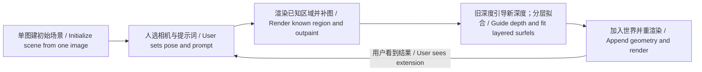
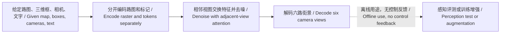
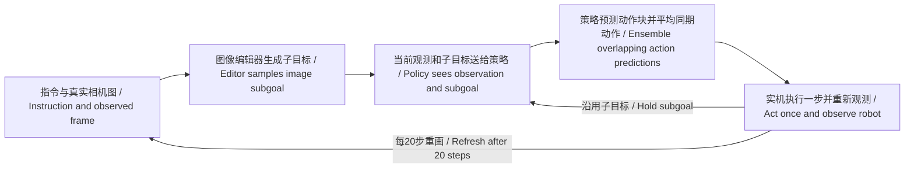

# 从可探索场景到能执行的动作 · From explorable scenes to executable actions

| 类别 / Category | 阅读时先问 / First question | 主表 / Main rows |
|---|---|---|
| [WM-4 空间世界 / Spatial worlds](#wm-4) | 转回同一地点时，什么被保留下来？ What survives a camera revisit? | 70–83 · 14 |
| [WM-5 驾驶 / Driving](#wm-5) | 改变自车动作后，是谁改变下一帧？其他车会回应吗？ Who updates the sensors after an ego action, and can other agents react? | 84–103 · 20 |
| [WM-6 操作 / Manipulation](#wm-6) | 谁把预测变成电机命令？执行后谁看见真实结果？ Who turns a prediction into a motor command, and who sees what actually happened? | 104–131 · 28 |

[逐行证据 / Row-by-row evidence](../data/reading-wm-b.json) · [网页运行图数据 / Runtime diagram data](../data/runtime-wm-b.json)。下文的 **#** 是 `Paper_Repo_List` 的 `No.`，不是论文引用序号。每行记录原文版本或项目、节/图/表或代码路径。62 条中，3 条通读指定版本（含附录），50 条阅读正文选节，8 条只据项目资料，1 条仅确认演讲身份。所有数字均为作者报告，未运行模型、复训练或验证实机安全性。

**Reading key.** A **#** refers to the workbook row; its ledger entry locates the primary source. The three full reads are WonderWorld, MagicDrive and SuSIE. The other entries distinguish selected paper sections, project/repository documentation and unresolved evidence. A README is evidence of a documented interface, not of a reproduced result. Compare numbers **within** the stated experiment, not across the three families.

## WM-4 · 空间世界：重访时还剩下什么？ / Spatial worlds: what survives a revisit?

### 通读 / Full read — WonderWorld (#70)

**一次场景扩展不是一帧渲染。** [原文 v4，§3、图 2，附录 B 算法 1–3](https://arxiv.org/html/2406.09394v4)：从单张图建立初始场景，用户移动相机决定扩展位置，用提示词决定内容。系统在新视点先渲染已有场景，补出缺失的图像；新深度必须尽量与重叠处的旧深度一致。§3.1 将单视图分成前景、背景、天空，分别补全遮挡区域，用深度和法线初始化薄高斯面元，再由后向前优化。§3.2、图 4 把已有区域的深度误差用于引导深度扩散。留下的是可再次渲染的几何，不是要求视频模型“记住上一段”的文字提示。

**A scene extension is not a rendered frame.** The user chooses *where* to extend and *what* to add. At the requested view the system already knows some colors and depths; it need not synthesize them all again. Initializing surfel positions, orientations and scales from the image geometry makes the subsequent fit short. Layers address what is hidden behind foreground objects; guided depth addresses a different failure, the seam where an extension meets the old world. Removing them gives distinct artifacts (Figs. 7–8). No learned policy chooses the camera pose.

| 实验及出处 / Test and locator | 怎么读 / What it establishes |
|---|---|
| §4、表 1、附录 E 表 5：单块 A6000，新场景 **9.5 s**，WonderJourney **749.5 s**。 | 两者都是生成一个场景的耗时，不是显示一帧的延迟。The new-scene cost includes diffusion and fitting; the already-built scene can be rendered without regenerating it. |
| §4、图 5、表 2–3、附录 D：4 个起始例 × 7 段；固定全景路径，基线相机距离略缩短；204 人比较鸟瞰图。 | 相对 WonderJourney 的偏好为 **98.5%**。这是画面选择，不是导航成功率。Preference is for the shown renderings; four starting examples are not a geographic coverage study. |
| 附录 E 表 6：在可见交叠区，新旧深度的尺度不变 RMSE 为 **0.36**（不引导）、**0.21**（平移缩放对齐）、**0.08**（引导）。 | 它直接检验拼接假设，比 CLIP 相似度更贴近几何问题；但旧深度也不是实测真值。This tests agreement with existing geometry, not absolute metric accuracy. |

**实现边界 / Implementation boundary.** [作者仓库](https://github.com/KovenYu/WonderWorld)的 `run.py` 在 `handle_render_pose`、`handle_new_prompt`、`handle_gen` 中分别处理观察与生成请求；`README.md` 的 *Run examples* 给出场景配置。附录 D 还指出初始天空可离线生成。实际复核宜分开计量初始化、扩展、重访；§5 明确指出背面未生成，细枝可能出现空洞或漂浮物。Time all three stages separately. A user can revisit the stored scene; that does not make hidden surfaces complete or supply a physics engine.

### 同类方法如何选 / Choosing the right spatial test

| 任务 / Need | 有依据的区别与建议 / Evidence and practical comparison |
|---|---|
| 已知几何与未知内容 / Geometry vs. plausible fill | **Aether #71** (§§3–5) 分测深度、位姿与规划；**GEN3C #72** (§§4.1–4.5、表 2) 把缓存点云从新视点渲染出来；**Voyager #74** (§§4.1–4.3、表 1–2) 把深度带入后续探索和重建。For a fixed path, separate interpolation from extrapolation. GEN3C's two-view Tanks and Temples PSNR is 22.22 vs 20.51 respectively; Voyager's novel-view and reconstructed-scene scores are themselves different experiments. |
| 重建可用资产 / A usable asset | **SpatialLM #75** (§§3.1, 4.1–4.2、图 2) 输出布局与物体框；**WorldMirror #79** (§§3, 5.2、表 1) 在不同先验下预测几何；**Lyra #77** (§§3.2, 4.1、表 2) 从视频潜变量解码高斯；**HunyuanWorld 1.0 #76** (§§2.1–2.5) 从全景分层构网格；**HY-World 2.0 #82** (图 2、§§4–7) 先规划覆盖路径、扩展，再重建。Choose layout F1 for doors/walls, held-out views for rendering, and point accuracy/completeness for measured geometry. Match supplied poses/depth before comparing. |
| 速度与受控比较 / Speed and control | **WorldScore #73** (§3.3、表 2) 是统一任务的评分器，不是世界生成器。**FlashWorld #78** (§4.3、表 2) 的时间列混用 H20 与 H100；作者 `README.md` 另列 *Clarification on WorldScore Evaluation*。Use the same view sequence, sampling rule and accelerator before interpreting efficiency or camera adherence as a model advantage. |
| 交互产品 / Interactive products | **RTFM #80**（*Persistence: Posed Frames as Spatial Memory*）按位姿检索帧；**Marble #81**（*Exporting Worlds to 3D and Video*）强调可导出表示，Spark 是渲染器；**Atlas #83**（*Technical Details → Benchmarks*）相机跟随的人评中，Atlas 接收原生路径，对手接收文字摄影指令。A frame memory, an exportable asset, and a camera-control API solve different problems. These are first-party project descriptions, not three independently tested training implementations. |

## WM-5 · 驾驶：生成画面、训练感知，还是闭环检验？ / Driving: synthesis, perception training or closed-loop testing?

### 通读 / Full read — MagicDrive (#87)

**从标注到传感器图像，方向不要画反。** [原文 v7，§§3–4、图 2–4](https://arxiv.org/html/2310.02601v7)：道路是鸟瞰栅格，车辆等物体是带类别和高度的三维框；把两者全压进平面会丢失遮挡和高差。MagicDrive 用额外编码分支注入道路图，以注意力注入可变数量的框、相机参数与文字，去噪时交换左右相邻相机的特征。§5.4、图 7 的时间注意力是**视频扩展**，不是基础多视图图像实验自带驾驶员反馈。

**The labels are inputs, not detections.** A spatial encoder handles the raster; camera/text and object tokens preserve information that a flat map would discard. Each view attends to its two neighbors during denoising. The detector enters *after* synthesis as a measurement tool or a consumer of augmented training data. There is no step in which the detector steers the ego vehicle and thereby changes the next map. The video extension adds temporal attention to clips rather than closing that loop.

| 问题 / Question | 作者结果及边界 / Reported experiment and boundary |
|---|---|
| 像真的图就足够吗？ / Is visual realism enough? | §5.1：nuScenes 700 个训练场景、150 个验证场景。表 1 的 224×400 FID 为 **16.20**（BEVGen 25.54）。但在附录 C 表 5，只看一个邻居比看两个的 FID 更低（13.06 vs 14.46），车辆 mIoU 却更低（26.41 vs 27.13）；图 11 可检查跨相机接缝。Better single-image statistics can select a worse multi-camera configuration. |
| 合成图是否改善真实验证集？ / Does augmentation help on real validation images? | §5.2、表 2：272×736 增强下，纯相机 BEVFusion mAP **32.88→35.40**；相机加 LiDAR 为 **65.40→67.86**，不是生成了新的 LiDAR。附录 F 表 6 延长纯相机训练到 2× 后仅 **35.49→35.74**。Keep both the modality and the real-only training schedule fixed; longer training materially changes the estimated benefit. |
| 哪类控制可能失效？ / Where does control fail? | §6 表 4：相同消融设置下，去掉独立框编码器，车辆 mIoU 从 **27.13 降到 5.50**；§7 图 9 给出夜景过亮、未见天气生成失败。Test the intended rare condition explicitly; a prompt edit does not prove coverage of that condition. |

**实现边界 / Implementation boundary.** [作者代码](https://github.com/cure-lab/MagicDrive)的 `demo/run.py::main` 从验证数据加载输入、调用 `run_one_batch` 并拼接六视图；`README.MD` 的 *Test the model* 另列生成验证集和算 FID 的步骤。README 的 `video` 分支另有较晚的长视频配置。The inspected path is a synthesis demo, not a policy-in-the-loop simulator. Do not report a later branch's clip length as the setup of paper Table 2.

### 对比时固定什么 / What to hold fixed

| 层级 / Level | 方法、实验与可比条件 / Evidence and comparison |
|---|---|
| 预测观测 / Predict observations | **GAIA-1 #84** (§§2–3) 在伦敦 4,700 小时私有数据上预测图像标记；**GenAD #91** (§4.2、表 2) 的 OpenDV-2K 与 nuScenes-only 变体 FID 同为 15.4，FVD 为 184 vs 244；**GAIA-2 #95** (§§2.2.3, 6.2) 区分保真度和条件准确性。**Vista #92** (§§3.2–3.3、表 2) 与 **Epona #97** (图 2、表 1) 还提供控制/轨迹接口。Record action conditioning and horizon; FVD can improve while FID gets worse (#97), and neither measures a driver's decisions. |
| 生成不同传感器或表征 / Predict another sensor or representation | **Copilot4D #88** (图 2、表 1–2) 预测离散 BEV 后渲染 LiDAR 深度；**OccWorld #90** (图 2、表 1–2) 预测语义占据和自车运动；**UniScene #94** (§§3.1–3.3) 将占据作为视频和 LiDAR 的共同条件。OccWorld 的平均 1–3 s mIoU，输入占据为 17.14%，相机 D 变体为 8.62%。Do not compare a privileged occupancy input with an image-only baseline without charging for the perception front end. |
| 离线制造数据 / Make offline training data | **DriveDreamer #86** (§§3–4、表 1) 的 4K 合成样本把 BEVFusion mAP 从 32.8 提到 35.8；**DriveDreamer4D #93** (图 2、表 2) 却是用新轨迹补足 4D 场景，Waymo 变道视图的 PVG FID 为 105.29→71.52；**Cosmos-Drive-Dreams #96** (图 2、表 1–2) 测下游车道/物体感知及天气子集。Choose real held-out detection for augmentation, held-out view rendering for scene reconstruction. Their gains have no common denominator. |
| 选轨迹 / Choose a trajectory | **Drive-WM #89** (§§4.1–4.2, 5.4) 用图像奖励给分支打分；仓库 `README.md → TO DO` 中权重和全套训练代码仍未勾选。**DriveVLA-W0 #98** (§§3.2–3.3、表 1–2) 将世界预测与动作专家结合，用 NAVSIM 衡量规划。Score the *chosen trajectory* under the same proposal and evaluation protocol; neither a published planning result nor a repository URL proves a deployable driver. |
| 真正改变下一次观测 / Change the next observation | **GAIA-3 #99**（发布文的 world-on-rails 示例）改变自车而保留其他车的日志；**GAIA-4 #102**（*Closed-loop simulation grounded in the real world*）让驾驶员动作改变自己收到的传感器流，并区分锁定其他车与允许其反应。**Waymo #100**（*Strong Simulation Controllability*）演示动作/布局/语言控制；**OmniDreams #101**（表 2–3）分开计单视图和四视图的块延迟；**BirdDreams #103** (§§4.2–4.3、表 1–2) 分开检验自车跟随和他车反应。Ask separately: is the ego in the loop, are other agents reactive, and does the simulator meet the policy's latency budget? A demo played at 4× is not a throughput measurement (#100). |

**证据缺口 / Evidence gap (#85).** [CVPR WAD 日程](https://cvpr2023.wad.vision/)确认 2023-06-18 17:00–17:30 的 Tesla 演讲 *Building Foundation models for Autonomy*，不等同于题为 *Tesla World Simulator* 的论文。No simulator benchmark or training implementation is attributed to that schedule.

## WM-6 · 操作：谁出动作，谁看到后果？ / Manipulation: who acts and who observes the result?

### 通读 / Full read — SuSIE (#105)

**预测一个可达的中间状态，而不是每一帧。** [原文 v1，§§3–4、图 1、算法 1](https://arxiv.org/html/2310.10639v1)：高层用当前相机图和指令生成一个未来子目标图，训练时可利用有文字但无动作的视频；低层在带动作的机器人轨迹上学“从当前图抵达目标图”，不需要理解文字。两者分开训练。测试时低层用新的真实观测预测四步动作块；附录 A.1.2 对同一时刻的重叠预测取均值，每步实际只下发该时刻动作。达到预设 **20 个时间步**就根据新观测重画子目标，不等待模拟器宣布抵达（附录 A 表 5）。

**Predict a waypoint, not a film.** Dense video would ask a generative model to specify every detail of gripper motion. SuSIE instead lets the goal-conditioned controller determine how to approach a pictured near-future state. This moves the fine-control burden, rather than removing it: the editor is not trained to know which waypoints this particular controller can reach (§6). A plausible subgoal, precise action execution and final task success can fail independently.

| 检验 / Test | 结果应如何使用 / How to use the result |
|---|---|
| §5.2 表 1，附录 B：CALVIN 在 A/B/C 上训练，在 D 上测，100 条链，整链共 360 步预算。 | 完成第一个指令 **87%**，连续五个全成 **26%**。论文的两个 UniPi 重实现因成本只跑 25 条链。Do not report first-instruction success as five-instruction success, or treat the reimplementations as the original UniPi service. |
| §5.2–5.3、图 2–3、表 2–3，附录 B：实物 3 个场景、9 个任务、每任务 10 次，同组初始摆放用于各方法。 | 在 B 场景，两项彩椒任务 SuSIE 各 **5/10**；给出真实终局图片的 Oracle GCBC 分别 **1/10、0/10**。中间夹取姿态比单一终局图更能约束这两项动作；样本很小。This supports a waypoint benefit on these grasps, not near-perfect general manipulation. |
| §5.4、图 4、表 4：只用 BridgeData 与加入 Something-Something 视频比较。 | B 场景成功率 **0.30→0.50**，C 场景均值 **0.80→0.88**；并非每个任务都进步。Test the executed policy, not just subgoal image quality: the low-level controller can ignore some background hallucinations. |

**实现边界 / Implementation boundary.** [SuSIE](https://github.com/kvablack/susie) 的 `susie/model.py::create_sample_fn` 返回图像采样器，不返回机器人动作；`scripts/robot/eval_diffusion.py::rollout_subgoal` 使用另载入的策略。`README.md` 将低层训练指向 [BridgeData V2](https://github.com/rail-berkeley/bridge_data_v2) 的 `gc_ddpm_bc`，并说明评测脚本依赖作者硬件。The editor checkpoint alone cannot reproduce the closed loop; the robot, goal-reaching policy and camera interface matter.

### 同样叫“世界模型”，用法不同 / Different jobs for a robot world model

| 用法 / Role | 该看哪一项证据 / What to compare |
|---|---|
| 视觉计划 → 动作 / Visual plan to motor control | **UniPi #104** (§§3.1–3.2、图 2) 和 **Vidar #117** (§§2.2–2.3、表 1) 从视频读出动作；**Seer #110** (图 2、表 1–2) 将视觉预见送入逆动力学预测，**VPP #111** (§4.2、表 1–2) 聚合预测特征而非把解码视频当最终答案。Vidar 在 RoboTwin 标准数据下 clean/randomized 成功率为 65.8/17.5%。Hold controller, scene randomization and rollout count fixed to diagnose whether failure comes from the visual plan or its execution. |
| 联合预测不代表统一评测 / Joint modeling, different tests | **GR-1 #106** (§3、表 2) 与 **GR-2 #109** (§§2–3) 将视频学习接到机器人动作；GR-1 搬运的已见物体/未见类别成功率为 0.79/0.30。**UVA #112** (§§V–VIII) 可在策略、正/逆动力学间切换；**UWM #113** (§III、表 I) 用扩散时间步处理缺失动作；**WorldVLA #116** (图 2、表 2) 自回归地产生动作或条件图像。Keep “actions supplied” distinct from “actions predicted.” WorldVLA's repo now fronts RynnVLA-002; the newer model is not the original paper's LIBERO result. |
| 模拟器验证策略 / Simulate and evaluate another policy | **IRASim #107** (§4.1–4.3、表 1) 将轨迹回放、评策与规划分开；**WorldGym #115** (§4.1、图 4a) 的模拟与真实逐任务成功率相关系数为 **0.78**；**Veo (Robotics) #121** (§§3.1–3.2、图 4) 用 80 组场景/指令、8 秒片段、人评成功，并区分排序与相关性。**Ctrl-World #119** (表 1–2) 检验记忆消融；**GE-1 #118** (*GE-Act* vs *GE-Sim*、表 1–2) 将出动作与吃动作分开；**GE-Sim 2.0 #127** (*Closed-Loop Policy Consistency*、表 2) 额外提供本体状态。Pair initial states and policies, and report calibration as well as ranking. A lower replay FVD need not improve either one. |
| 离线产数据 / Generate training data offline | **DreamGen #114** (图 2、§2、表 1–2) 给生成视频补动作标签；**GigaWorld-0 #120** (§§3, 5.3) 为后续策略扩充视频/3D 数据；**DreamDojo #125** (§§3.3, 4.2、表 2) 从人类视频学习动作条件供模拟；**GRAIL #129** (§§3.1–3.4、表 1–2) 借已知资产重建、重定向人—物运动，再训练跟踪策略。For transfer, match demonstrations, real-data budget and deployment body; a tracker SR or an EgoDex video score is not the downstream real robot's success. |
| 执行速度与规划 / Execution latency and planning | **SANA-Robot #122** (§5、表 2) 报告同步单请求延迟，**LingBot-VA #124** (§3.4、表 1) 区分异步执行和多步成功，**DreamZero #126** (§3.2、表 1–2) 区分不同硬件的加速和未见任务进度。**Cosmos Policy #123** (§4.3、表 1–2) 另可用未来状态与价值作规划；**WALL-WM #128** (§3、图 2) 对齐语义事件而非等长块。Report how long a robot acts on stale observations, what portion of a chunk executes, and whether candidate evaluation is enabled; these choices can change both reaction time and success. |
| 发布谱系与适配 / Release lineage and adaptation | **1X #108**：`1xgpt/README.md → Challenges` 是预测基线；[Redwood 的评策更新](https://www.1x.tech/discover/redwood-ai-world-model)用动作预测未来，[Video to Action](https://www.1x.tech/discover/world-model-self-learning) 则用逆动力学从预测视频产生动作，不能把三者视为一份代码。**CloudRobo-WM1.2 #130**（华为发布稿 *世界模型原生DualAct架构*）仅核实项目描述。**GR00T 2 #131**（白皮书 §3.1、图 2）50 项适配任务的零/一/五示范成功率为 **40/71/95%**。Keep release documentation separate from a tested implementation, and count demonstrations before calling a result zero-shot. |

**最小可复核比较 / A minimal follow-up experiment.** 场景模型先锁定路径和先验，测扩展后回访误差；驾驶模型先锁定日志和其他车是否可反应，再改自车动作；操作模型在相同起始状态分别记录“子目标合理”“动作到达”“任务成功”。这三项是建议的诊断，不是本文复现结果。For spatial worlds, revisit the same pose. For driving, intervene on the ego while stating which actors may change. For manipulation, record goal plausibility, execution and task success separately. Each comparison tests a different causal link.
