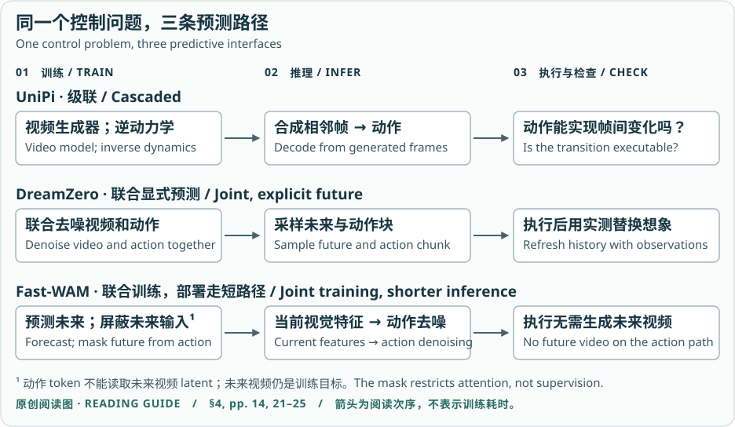

# 世界动作模型精读：预测的未来，究竟怎样改变动作？

**World Action Models: The Next Frontier in Embodied AI** · [本地原版，p. 1][source] · [arXiv:2605.12090v1](https://arxiv.org/abs/2605.12090v1) · cs.RO · 2026-05-12

## Executive summary

A robot can generate a convincing video of an open drawer without knowing where to grip it. Wang et al. use this distinction to define a **World Action Model (WAM)** by two commitments: it predicts a measurable representation of a future observation, and couples that prediction to action generation. A video backbone alone does not qualify. Nor does a simulator used only to evaluate an otherwise reactive policy (pp. 3–6, 11–14).

The survey's useful dividing line is **where the future enters control**. In a cascade, a predicted image, motion field or latent plan crosses an identifiable interface into an action decoder. In a joint model, future states and actions supervise one predictive system; they need not share a decoder or even both be sampled at deployment. DreamZero refreshes its imagined history with measurements after executing a chunk. Fast-WAM instead uses a future-video objective during training but skips future-video generation on the action path (pp. 22–24). These are different reasons to train with foresight, with different latency costs.

This is a taxonomy and evidence map, **not a head-to-head trial**. Visual fidelity, physical plausibility, recoverability of actions from a video, and task success answer different questions. None by itself establishes that this policy succeeded *because it used the predicted future*. The authors propose testing that missing link; they do not report a validated joint metric or a winning architecture (pp. 34–37, 41–44).

**阅读路线：** [版本与证据](#scope) · [判定一个 WAM](#definition) · [级联](#cascade) · [联合](#joint) · [训练到执行图解](#walkthrough) · [数据](#data) · [评测](#evaluation) · [取舍与验证](#limits) · [图表与阅读覆盖](#index)

## 1. 版本、贡献与证据等级

首页署名为 Siyin Wang、Junhao Shi、Zhaoyang Fu、Xinzhe He、Feihong Liu、Chenchen Yang、Yikang Zhou、Zhaoye Fei、Jingjing Gong、Jinlan Fu、Mike Zheng Shou、Xuanjing Huang、Xipeng Qiu、Yu-Gang Jiang；机构为复旦大学、Shanghai Innovation Institute、新加坡国立大学。前五位标为等贡献，Siyin Wang 为项目负责人，Yu-Gang Jiang 为通讯作者。以首页边栏和 PDF 元数据确认 v1，不从下载文件名推断版本。**全篇 69 页，本文页码均从 PDF 第一张起算，与印刷页码相同。**

作者贡献是给分散的工作划出概念边界，按**未来表示、动作接口、训练数据和评测问题**重新组织证据。他们称之为首篇系统性 WAM 综述（pp. 3、44）；这是作者的定位，不是本次阅读验证的优先权。文中没有提出并训练一个名为「WAM」的新网络，也没有给所有方法换上同一骨干、同一数据和同一机器人重新测试。

以下“作者定义／综述转述”指本版本写了什么；涉及被引方法的实验，证据仍来自二手转述。“本文分析／示例”是据此作出的解释或建议，不是论文新增的实验结果。

## 2. 判定一个 WAM：先看动作在条件里，还是在输出里

在当前观测 $o$ 和指令 $l$ 下，要求机器人打开抽屉。$o$ 可以包括视觉、本体感知（例如关节位置）等；$o'$ 是之后**能观察到**的状态，不是全知的物理状态。$a$ 可以是一次指令；讨论动作块时，它代表一段连续控制。按作者 §2、图 3（[p. 5][def]），三个问题可作如下区分：

| 要回答的问题 | 建模对象 | 单独缺什么 |
|---|---|---|
| VLA（视觉–语言–动作）：现在该怎么动？ | $p(a\mid o,l)$ | 不要求给出可检验的未来；不代表内部一定没有物理知识。 |
| 动作条件世界模型：**给定**这样动，会看到什么？ | $p(o'\mid o,a)$ | 动作是输入，不负责替策略选动作。语言条件版本 $p(o'\mid o,l)$ 则只给任务意图，不指定低层干预（pp. 7、9）。 |
| WAM：预期出现什么变化，与之相配的动作是什么？ | $p(o',a\mid o,l)$ | 同时需要可度量的未来表示、与它耦合的动作生成；不保证所选动作真的能引起该变化。 |

作者用数据分布 $\mathcal D$ 上的联合负对数似然表述目标：

$$
\mathcal L_{\mathrm{WAM}}=\mathbb E_{(o,l,o',a)\sim\mathcal D}[-\log p(o',a\mid o,l)].
$$

这是任务层的记法，不是说每个实现都计算一个联合似然值；实际可用 token 预测、去噪、流匹配或对齐未来嵌入来训练。另一个常见混淆是把“联合分布”当成“联合架构”。作者给级联写出的同样是这个联合分布（[p. 3][factor]）：

$$
p(o',a\mid o,l)=p(o'\mid o,l)\,p(a\mid o',o,l).
$$

**本文分析：** 等号只是概率链式法则，不产生一个架构，也不识别因果。只有当系统实际先构造一个未来，再把它作为条件交给动作模块时，右端的分解才成了工程接口。反方向同样重要：真实执行是动作改变环境，不是未来帧从物理上导致手臂移动。实际由 $o'$ 回推动作一般不唯一，同一个抽屉位移可以来自不同接触点、施力和运动轨迹。

**边界案例（§2.2，p. 6）：** VAM（Video Action Model）把视频作为未来载体，按作者口径属于 WAM；WAM 也可用光流、点云、力觉或潜变量。Video Policy 描述的是视频模型的架构来源：若只迁移视觉权重、之后只监督动作，不满足预测条件；若保留未来目标并用其特征控制，就可能同时属于两类。AWM（Action World Model）在此与 WAM 功能近似，换名是为了突出“能行动的主体”，而非一种不同的损失函数。

### 技术沿革为何与定义有关（§3，pp. 6–13）

VLA 把语言语义接入视觉控制，既可以逐 token 产生离散动作，也可用生成头输出连续动作块。增加深度、触觉能缓解当下的部分可观测性；但**增加输入**与**预测这些量下一步如何变化**是两件事。另一条路线从动作条件视频预测，发展出 PlaNet 的确定性＋随机潜状态、Dreamer 的潜空间想象，以及 JEPA（联合嵌入预测架构）对未来特征而非像素的预测。语言条件视频模型从时空卷积发展到在压缩视频上运行的扩散 Transformer（DiT），让“合成目标情景”可行，却不自动给出运动学解。具身世界模型进一步用多视角、关键点、深度和触觉约束预测；仅凭画面逼真，仍难判断抽屉是否已经卡住（pp. 7–11）。

世界模型也可以始终在策略**外部**。图 4 的四个箭头终点不同：[p. 12][external] 的模仿学习从生成并筛选的轨迹取训练样本；强化学习让策略在想象环境里试动作；奖励建模给轨迹打分；策略评测则只用虚拟展开作考场。例如 Ctrl-World 生成成功轨迹微调策略、VIPER 用轨迹对成功行为动力学的相容程度作奖励、Veo Robotics 用动作条件模拟器测试策略（pp. 12–13）。它们说明预测能服务学习或评测，**不能据此把被训练或被测的每个 VLA 都归作 WAM**。

## 3. 级联：预测模块交给控制器的究竟是什么？

级联的好处是两种监督可以分开取得：视频教模型场景怎样变化，带动作的机器人片段或几何约束教控制器怎样实现变化。代价是两个模块之间没有天然的一致性保证。诊断时先检查中间计划本身是否可达，再检查从计划到命令的转换；只看末端失败无法区分这两类问题（§4.1，pp. 14–18）。

| 中间接口 | 如何训练、如何出动作 | 有何用，容易在哪里失效 |
|---|---|---|
| **显式帧 → 学习解码器** | UniPi 用文本条件视频扩散生成执行片段，再让逆动力学模型（IDM）从相邻帧回归动作。VLP 分解子动作、用树搜索评分；RoboEnvision 先定子任务终点关键帧再插帧，约束长视频漂移（p. 14）。 | 人可检查“想象中的把手在哪里”；若第一阶段画出了不可能的接触，第二阶段仍会尝试解释。学 IDM 通常需要配对动作。 |
| **显式运动 → 几何或受约束执行** | AVDC 从合成帧算稠密光流，恢复三维刚体变换；Dreamitate 用立体图像跟踪工具的六自由度位姿，再以逆运动学求关节命令。Im2Flow2Act 直接预测流，但用另行训练的策略执行；并非几何类全都免动作标签（pp. 15–17，表 1）。 | 可换末端机构，并把运动与外观分开。代价是依赖深度、对应点、可见性、坐标标定或刚体假设；“目标移动了多少”不能唯一确定接触力。 |
| **隐式未来 → 特征条件策略** | VPP 在压缩空间单步预报再接策略；S-VAM 训练时用冻结的多步教师蒸馏时空特征，在线一步提特征后交动作头；mimic-video 则在部分去噪处读取特征。OmniVTA 用预测与当前触觉 latent 的差异提示接触状态（p. 17）。 | 省去完整像素生成，可保留与接触有关、在 RGB 中难见的信息；代价是计划不易审查。只看“用了 latent”不够，要问它预测了什么、谁读取它。 |

并非所有第二阶段都是逐帧 IDM。π0.7 将多视角子目标图送入既有 VLA，由动作专家输出一段控制；Veo-Act 把视频指导用于粗定位，接触将发生时交回反应式策略（p. 15）。LAPA 从无标签视频先学离散的潜动作，再用少量真实动作标注把编码落到机器人命令（p. 18）：**预训练无动作标签，不等于整条策略不需要动作标定**。

表 1（[p. 16][ctable]）把“是否需要动作标签”和“是否零样本”列成两列。AVDC 两列均为否；NovaFlow、Dream2Flow 行则是无动作标签、零样本为是。表中“零样本”特指无需任务特定训练／微调，而非从未训练过任何模块。还有一个值得保留的版本细节：p. 15 对 π0.7 描述了无需任务特定微调的跨具身表现，表 1 该行的 Zero-shot 却是 ×。本版没有解释两处口径为何不同，不用任意一处推出无条件的零样本结论。

## 4. 联合：共同被监督，不等于共同被解码

联合模型让世界和动作都参与训练同一预测系统。下面分两问：**生成顺序是什么？模态之间在哪里交换信息？** 这比数网络里有几个 Transformer 更可靠（§4.2，pp. 18–26）。

### 自回归：先前预测可以约束后续输出，也可能污染它

自回归（AR）将时间或符号排成有因果掩码的序列；序列中的“因果”只表示可看前项、不可偷看后项。早期预测若错，后续动作可能在错误前缀上继续得很顺畅。表 2（p. 19）要读的是**输出接口**，不只是参数量：

- **分头表示。** GR-1 共用时序上下文，但把未来视觉 patch 与连续动作交给不同头；GR-2 的视觉侧改为量化 token，动作仍由条件变分自编码器生成连续块。共享监督不要求统一词表（pp. 18–19）。
- **统一离散表示及其混合变体。** CoT-VLA 先因果生成离散视觉子目标，再以全注意力预测动作 token；WorldVLA 在块内禁止当前动作读之前生成的动作，避免仅靠重复动作绕过视觉条件。若低层精度受离散化限制，RynnVLA-002 另接并行连续动作头。虽然表中归在离散组，不能据此说其最终命令也是离散输出（pp. 19–20）。
- **预测潜表示。** VLA-JEPA 的目标是冻结编码器对真实未来的嵌入；真实未来只在监督侧出现。潜动作条件引导未来预测，具身动作 token 再引导流匹配头。这样不必为预测背景纹理付出解码代价，但所选表示若忽略细小滑移，再准确的嵌入预测也不能补回该信息（p. 20；后半句为本文分析）。

### 扩散与流匹配：并行生成一段，不等于一次前向就能执行

扩散从噪声迭代得到样本，流匹配学习把噪声输运至目标分布的速度场。两者都能在**一个生成步骤内部**处理整段世界与动作变量；从噪声到可用轨迹仍可能需要多步。图 6（[p. 21][streams]）问的是主干与信息接口，并非所有模型都双向交换信息。

| 结构 | 未来如何影响策略 | 代表性的训练／部署差别 |
|---|---|---|
| 单流，显式未来目标 | 视觉与动作进入同一去噪主干；显式目标也可以是可还原视频的 latent，不必在 RGB 像素上运算。 | PAD 对无动作视频填充并加掩码；UWM 独立控制两侧噪声，给定动作预测世界、给定转移推断动作等可在同一模型切换。Cosmos Policy 把本体、动作、未来和价值都编码成 latent 帧，可按价值从多个候选中选计划（pp. 21–22）。 |
| 单流，隐式未来目标 | FLARE 将未来 token 加入动作序列，用冻结教师对真实未来帧的表示监督其中间激活；无动作样本只产生对齐损失。 | 教师提供训练靶，不是部署时的输入。FRAPPE 把多个教师表示通过前缀与低秩适配专家接入冻结的策略，在共享主干上保留动作输出（p. 22）。 |
| 多流，反复交换特征 | CoVAR 的桥接注意力合并两流、计算注意力再拆分；DUST 保留分模态噪声时间与流匹配损失，可异步采样。 | 专家可按不同节奏建模。LingBot-VA 跨动作块保留视觉与动作历史，异步预测与执行时吸收新观测；缓存增长也是成本。不是所有分支都能在推理时删除（p. 23）。 |
| 多流，世界隐状态 → 动作 | DiT4DiT 在选定去噪时间截取视觉主干中间激活，供动作头条件化；重点是单向特征传递，即使用了交叉注意力也不等于上一行的反复双向交换。 | DiT4DiT 推理取一次确定的特征，不跑完整视频采样。Fast-WAM 训练时用掩码隔绝动作对未来视频 latent 的读取，部署时视觉分支只编码当前上下文。WAV 则还用价值分支筛选潜在未来（p. 24）。 |
| 多流，共享编码 → 分头解码 | UVA 先编码历史及被遮蔽的未来位置，形成共同表示，再用轻量世界头与动作头分别解码。 | 联合训练后，策略模式可跳过视频头；掩码决定哪些量是条件、哪些是目标。PhysGen 也晚期分头，却结合因果主干及 Action-DiT，表明“AR／扩散”不是处处互斥的实现标签（pp. 25–26）。 |

**本文分析：** “共享损失”“共享主干”“共享采样路径”是三个不同声明。尤其不能把训练时多一个未来监督头，解释为机器人的每一个动作都是看完某段视频才选的。若要在文献表中定位边界方法，优先记清信息流。例：UD-VLA 在 p. 22 的单流显式讨论中以离散去噪为例，表 3（[p. 25][jtable]）却列在多流交叉注意力组；两处都支持它联合去噪离散视觉和动作，并不足以从该表定论其主干归属。又如 p. 23 的 DexWorldModel 引 [103]，表 3 同名行引 [326]；参考文献 pp. 51、66 分列不同题名，不能把它与 §3 的 DexWM 当作同一证据。

## 5. 同一个抽屉：从训练样本走到下一个真实观测

[打开离线交互讲解：按列播放、暂停、单步或重置](../assets/wam-survey/foresight-paths.html) · [可编辑静态 SVG](../assets/wam-survey/foresight-paths.svg)

**读图提示：** 横读同一方法；竖读同一阶段。箭头只是讲解顺序。以下抽屉例子是本文的思想实验，不是三个模型在同一抽屉上做过的对照实验。

1. **离线可见的信息更多。** 一条示教记录有初始图、指令、动作和抽屉移动后的帧。级联可让生成器学位移的样子，让另一个模块学从帧对恢复动作。联合模型则可让同一系统既预测未来又拟合动作。真实末帧此时可以做靶，在线却还不存在；若把它直接喂给策略再报成绩，评估的是有先知信息的系统。
2. **下达第一块动作时，依赖不同。** UniPi 类方法需要合成帧对供 IDM 读取（p. 14）；DreamZero 从共享模型联合去噪视觉与动作 latent，不先收一张末帧再独立反解（p. 22）；Fast-WAM 可从当前视觉特征去噪动作，不生成未来视频（p. 24）。第三条路径仍可能受益于训练梯度，但这不是在线逐候选规划。
3. **抽屉没动，只有把手晃了一下。** 下一次相机测量能把两者区分。DreamZero 在执行一个动作块后用实测替换缓存中的想象观测，避免把自己的预测继续当历史；这能校正输入，却不能撤回已执行的那一块（p. 22）。对另外两条路线，图中末栏是各自的检查点，并不表示它们也采用这种缓存。评估时宜分别记录计划是否可达、动作是否导致预期转移、偏差出现后是否及时纠正。

## 6. 数据：一段录像能监督哪一侧？

图 7（[p. 26][landscape]）的横轴从左侧昂贵复杂到右侧便宜可扩，纵轴从上方容易匹配目标具身到底部难迁移；位置是概念判断，**不是每小时成本或迁移成功率的实测曲线**。四类数据的价值取决于它们补的是哪个不可观测量。

| 来源与原文位置 | 可提供的约束 | 它没有直接告诉模型什么 |
|---|---|---|
| 机器人侧轨迹，§5.1，表 4 p. 28 | 同步的观测、动作及后果可训练正向、逆向或联合预测。按表，OXE 汇集 22 种机器人、超过 100 万条轨迹；DROID 为 76k 条轨迹、564 个环境。触觉或音频可补足 RGB 遮挡下的接触信息。 | 平台间的动作坐标与频率未必相同；该表还收脚本、聚合、生成数据，不宜统称“百万条人工遥操作”。 |
| UMI 式便携示教，§5.2，表 5 p. 30 | 手持夹具把人的动作限制在较像机械末端的空间，可通过跟踪和重定向得到轨迹。RealOmin 行记为 1M 条、3,000+ 环境；RDT2 行是 10,000 **小时**。 | 手持夹具位姿不等于部署机器人的关节与力矩；小时不能直接换成独立轨迹数。 |
| 仿真，§5.3，表 6 p. 31 | 可系统改变物体、初始状态和动作，读出无遮挡深度、位姿、接触等特权真值。表中 TesserAct 为 285k 个视频片段，TLA 为 24k 对触觉–动作样本，适合不同监督目标。 | 引擎真值是**该引擎内**的真值，不能证明其摩擦、形变或触觉模型与实物一致。渲染随机化也不等于消除了动力学偏差。 |
| 人类／第一视角，§5.4，表 7 p. 33 | 无动作视频可提供事件顺序和视觉变化；手部三维姿态、手物关系、多视角能增强几何监督。Ego4D 行为 3,670 小时；EgoDex 行为 829 小时、194 个任务，后者有手指跟踪。 | 观察到人“拉开了”，不等于有目标机械臂“用此命令就能拉开”的标签；相机自运动也可能被学成物体运动。 |

**从字段到损失（本文解释，依据 pp. 18、21–23、26–34）：** 对配对三元组 $(o,a,o')$，两侧都有监督；只有 $(o,o')$ 时，仍可训练未来预测或教师对齐。缺失的动作不能填成“零动作示教”：PAD 对缺位进行掩码，UWM 让缺位动作侧处于全噪声，FLARE 只用未来对齐损失，LAPA 则另学代理动作并在下游标定。它们利用的是不同的统计信息。直接把人类视频小时数加到机器人轨迹数上，既混了单位，也混了可监督的变量。

作者把人类数据的可能迁移收益分成物理先验、交互因果和任务逻辑三层（p. 42）。**本文分析：** 若换一批视频后语言任务成功率上升，可能只是“先抓把手再拉”的顺序学得更好，并不能断言学到了受力模型。需要把语义覆盖、运动覆盖、目标机器人配对数据量拆开控制，论文没有给出通用混合比例。

## 7. 评测：一段可信的视频离一次可信的动作还有多远？

作者在 §6 开头即承认：理想对象是联合一致性，通行协议却分测世界与策略（[p. 34][metrics]）。可沿抽屉例子逐层追问：

| 检查层次 | 测量方式与出处 | 即使得分好，仍排除不了什么 |
|---|---|---|
| 画面像吗？ | 式 (1)–(6)，pp. 34–35：PSNR 比较像素均方误差与峰值；SSIM 比较亮度、对比度及结构；LPIPS 汇总多层特征局部差异；DreamSim 采用经人类三元偏好训练的嵌入；DINO 比较特征方向；FVD 比较两组视频特征的均值与协方差。 | 前几类多与某个参考匹配，另一种合理未来也可能受罚；FVD 是分布距离，不检验**本次**动作导致的抽屉位移。 |
| 物体和运动合理吗？ | 表 8 p. 36、pp. 35–37：VideoPhy 用人类标注分开判断语义与物理；PhyGenBench 检查现象及先后次序；Physics-IQ 对给定实拍开头的后续运动做空间／时空重叠比较。EWMBench 用末端轨迹分别问空间偏差、时序对齐、速度与加速度。 | 稳定、平滑的轨迹仍可能方向错误；视觉裁判未必看得到夹爪是否打滑。对物理“常识”的打分不是验证动力学定律的证明。 |
| 从视频能反推出有用动作吗？ | §6.1.3，p. 37：WorldSimBench 用控制恢复作间接检验；Wow, wo, val! 的 IDM Turing Test 从生成视频反推动作，按其真机执行成功与否判断。综述转述若干看似逼真的模型在该测试上成功率接近零。 | 测的是视频发生器＋指定 IDM＋执行系统，不是模型原生动作头。失败可能来自任一环节，不能推出所有 WAM 近零。 |
| 策略能完成任务吗？ | 表 9（[p. 40][policy]）及 pp. 38–41：一般操作可用 LIBERO、CALVIN；双臂／类人用 RoboTwin、HumanoidBench；移动操作用 HomeRobot；接触／形变用 ManiFeel 或 SoftGym；真机可用 RoboArena、RoboChallenge。 | 重复场景靠记忆也可能成功。任务成功不能证明用了预测，仿真成功不能直接移植到实物。 |

**读公式时要保留统计对象。** 式 (1) 的峰值随像素取值范围改变；按通常分贝定义用以 10 为底的对数，比较前须统一动态范围。p. 35 式 (4) 在本版明确印作 $1-\lVert E(x)-E(y)\rVert_2$，这里按综述的“相似度”方向阅读，未核实被引实现，不能与距离型分数不加区分地平均。式 (6) 的均值与协方差是在**视频特征样本集合**上估计，不是每帧到真实轨迹的逐点距离。若没有像素解码的潜预测模型，不能仅为了报 FVD 给它外接一个质量未知的解码器，就声称公平比较了物理能力。

### 哪些“结果”可以引用？

- **局部消融，而非横评。** p. 21 转述 PAD：移除未来图像预测或视频共训会降低其控制表现。它支持在该设置中这两项有用；该页没有给统一效应量、置信区间或等算力跨架构实验，尤其不能由此推断推理时必须渲染未来帧。
- **基线必须留在数字旁边。** p. 12 转述 Ctrl-World 对 π0.5-DROID 做合成成功轨迹微调，下游成功率“提高 44.7%”。该页未列起止成功率、试验分母与逐任务变化；不改写成 **44.7 个百分点**，也不归因为 WAM 动作头优于 VLA。这是外部合成数据用于模仿学习的例子。
- **部署频率，不是算法排名。** p. 43 把优化后的 DreamZero 描述为约 7 Hz，与作者举的 50 Hz 非生成式策略作对照；p. 22 说明前者使用异步执行、缓存、量化等。未给两种频率在同硬件、同动作块长度、同端到端计时下的对照。动作下发、策略重算与底层伺服可以是不同频率，不能把二者之比报成算法加速比。

## 8. 最值得补的实验：固定起点，改变预期后果

第 7 节（pp. 41–44）提出两种方向：**Counterfactual Consistency** 问想象的未来改变时动作是否相应改变；**Foresight-Conditioned Success** 要求任务成功还要符合生成的计划。它们是评价建议，综述没有给标准化阈值、协议或跑分。独立视频榜和成功率榜之间缺的正是这个环节。

**本文建议的最小对照，非原论文实验。** 在可复位的仿真抽屉上固定起点、机器人、相机和允许“部分拉开”的指令；为同一可见把手设两个均可达的目标开度。对可显式注入计划的策略，交换两种未来，比较动作方向／位移是否相应改变，并以实测开度核验。负对照只改变背景颜色而保持开度不变；策略不应仅对画面变化就改动作。报告每个初始状态的配对结果、执行失败、计划偏差与重规划延迟，而非只选漂亮的成功片段。对没有计划输入口的 Fast-WAM 类方法，不强行喂一帧图做同名测试；先固定数据、模型规模与训练预算，对比有无未来损失，再测动作与实测后果。前者问**推理依赖**，后者问**训练收益**。

回到部署选择，作者列出七类尚未解决的问题。结合其证据，可以把它们变成具体决策，而非给一个总冠军：

| 决策 | 作者指出的限制 | 本文建议怎么查 |
|---|---|---|
| 耦合强度、预测什么（pp. 41–42） | 无匹配规模／数据／协议的系统比较；RGB 看不见力、摩擦与顺应性。 | 与纯动作、仅训练有未来监督、部署也用未来三组对照；接触阶段另报触觉缺失或遮挡下的结果。 |
| 如何配数据（p. 42） | 不清楚人类视频的语义收益与动力学收益各有多少。 | 固定机器人动作标注预算，分开改变人类视频的任务语义和运动覆盖，不按小时盲目配比。 |
| 规划多远、算多久（pp. 42–43） | 长展开会漂移；逐帧预测昂贵。作者讨论外部分层规划、模型内多时间尺度、扩展记忆，以及随任务调整预测精度。 | 粗略接近和精细接触分别测；区分第一次出动作的时延与稳态更新频率。比较“更长想象”和“更早读回实测”，两者争的是同一反馈时间。 |
| 如何评估、何时停（pp. 43–44） | 缺少世界与动作联合验证；错误但自信的长动作块可能使纠错来不及。作者设想用不确定性和约束检查守护执行，但未验证其分布外可靠性。 | 分开记录完成率、计划符合率、干预和恢复。监控器、停止条件与独立实测不是预测器本身的性能，更不是论文提供的安全保证。 |

因此，若目的是让人检查或编辑计划，显式中间量有直接价值；若瓶颈是接触时的反馈时延，先验证训练侧的未来监督能保留多少收益；若目的是声称“模型学会了物理”，则必须解释改动作之后的**真实后果**。这三个研究问题需要三种证据。

## 9. 原版图表索引与核验范围

以下是定位用的读法，不转载原图、原表或整页内容。章节号、图号、表号均指 v1。

| 项目（物理页） | 如何读；证据止于哪里 |
|---|---|
| 图 1（2）、图 2（4） | 图 1 从根沿年份看同时并存的架构支线，不是模型胜负或替代顺序；图 2 的四条主枝分别索引背景、架构、数据、评测，不是一个部署栈。 |
| 图 3（5）、图 4（12） | 前者从箭头看动作是条件还是输出，集合图表达作者的术语约定；后者从轨迹、奖励、评测的去向区分外部用途，不能据图证明物理真实性。 |
| 图 5（15）、表 1（16） | 从计划到执行，区分学习解码、几何提取、潜表示三种接口；表的标签、零样本、仿真／真机列不能彼此代替。 |
| 表 2（19） | 按输出头和表示查看 AR 的三组方法；参数是所列骨干或模块的口径，未披露不等于零。 |
| 图 6（21）、表 3（25） | 读共享主干、交叉注意力、单向隐状态、共享编码四种信息流；表中平台表示评过哪里，不是成功率。正文与表的分类／引文出入见[联合机制](#joint)。 |
| 图 7（26）、表 4（28） | 前者展示迁移与扩规模的定性取舍；后者看采集方式与具身列，聚合数据不等于单一平台遥操作。 |
| 表 5（30）、表 6（31）、表 7（33） | 分别定位便携示教、仿真与人类视频；先读单位，再看是否有本体、触觉或几何监督。不将小时、帧、片段、轨迹或触觉–动作对换算为同一种样本。 |
| 表 8（36）、表 9（40） | 前者按视觉、物理与控制可恢复性选指标；后者按场景、传感器和评测目标选平台。二者都没有把预测和动作的因果联系测成一个总分。 |

**覆盖记录：** 使用本地 macOS PDFKit 按物理页分段读取 p. 1–44 全部正文（§1–8，含图表注与结论），并逐页通读 p. 45–69 的书目条目 [1]–[366]；第 69 页为末页，本版本无独立附录。已回看渲染的首页、图 1–7、表 1–9、p. 3/5/7/9 的概率式与 pp. 34–35 的式 (1)–(6)，对照原页确认表格行列和图 7 轴向。其余纯文字页按文本层阅读，未逐页做视觉校对；没有逐一核验表内每个数值的上游来源，没有阅读 366 篇被引全文或复现机器人实验。配图为本文原创讲解，不是原论文的实验图。

[source]: <../../papers/20260512-World%20Action%20Models-%20The%20Next%20Frontier%20in%20Embodied%20AI%20.pdf#page=1>
[factor]: <../../papers/20260512-World%20Action%20Models-%20The%20Next%20Frontier%20in%20Embodied%20AI%20.pdf#page=3>
[def]: <../../papers/20260512-World%20Action%20Models-%20The%20Next%20Frontier%20in%20Embodied%20AI%20.pdf#page=5>
[external]: <../../papers/20260512-World%20Action%20Models-%20The%20Next%20Frontier%20in%20Embodied%20AI%20.pdf#page=12>
[ctable]: <../../papers/20260512-World%20Action%20Models-%20The%20Next%20Frontier%20in%20Embodied%20AI%20.pdf#page=16>
[streams]: <../../papers/20260512-World%20Action%20Models-%20The%20Next%20Frontier%20in%20Embodied%20AI%20.pdf#page=21>
[jtable]: <../../papers/20260512-World%20Action%20Models-%20The%20Next%20Frontier%20in%20Embodied%20AI%20.pdf#page=25>
[landscape]: <../../papers/20260512-World%20Action%20Models-%20The%20Next%20Frontier%20in%20Embodied%20AI%20.pdf#page=26>
[metrics]: <../../papers/20260512-World%20Action%20Models-%20The%20Next%20Frontier%20in%20Embodied%20AI%20.pdf#page=34>
[policy]: <../../papers/20260512-World%20Action%20Models-%20The%20Next%20Frontier%20in%20Embodied%20AI%20.pdf#page=40>
